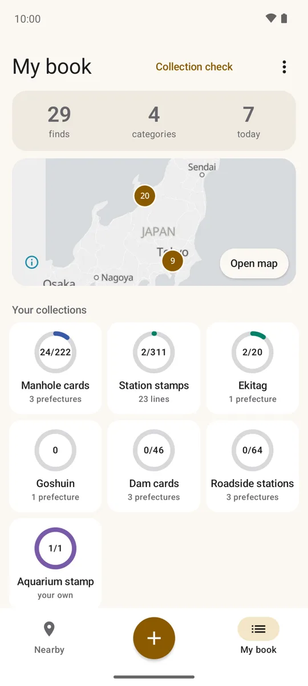
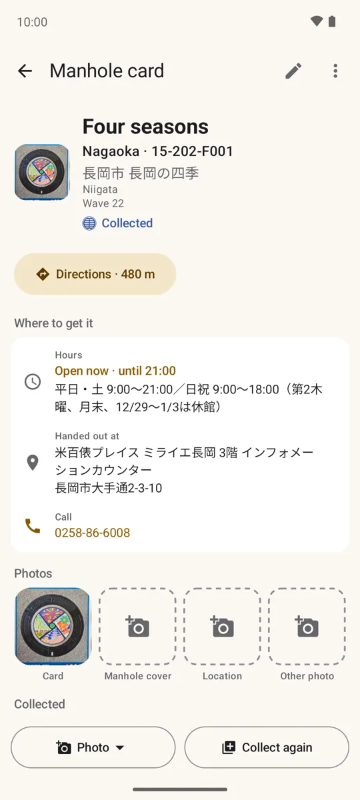
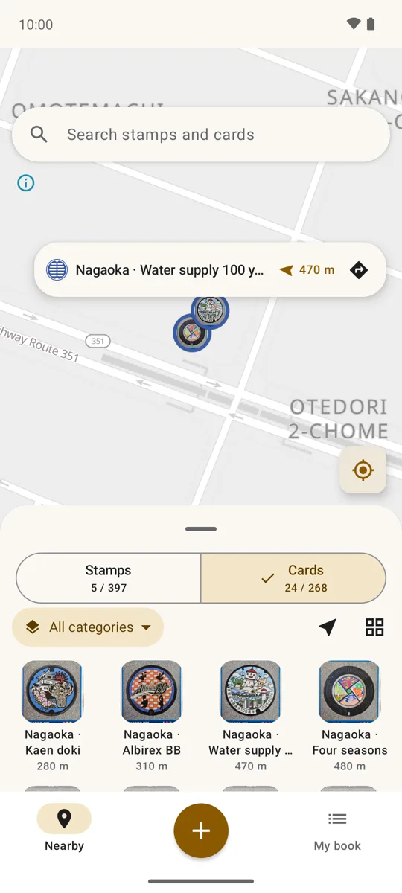

<div align="center">


# Meguri

**A collecting app for Japan's manhole cards, station stamps, Ekitag, dam cards and goshuin.**<br>
It shows what is near you, what you have, and where to get the rest.

[](https://github.com/thisisartman/Meguri/releases/latest)
[](https://github.com/thisisartman/Meguri/actions/workflows/build.yml)
[](LICENSE)


**[Download the latest APK](https://github.com/thisisartman/Meguri/releases/latest)** · [How to use it](docs/APP_GUIDE.md) · [日本語](#日本語)

</div>

The name is 巡り (meguri): going round a circuit, as on a pilgrimage or a stamp rally.

<p>
  
  
  
  
</p>

## Who it is for

People who collect these on day trips: standing at a city hall counter, a shrine or a ticket gate, often with weak signal and one hand free. Meguri is built for that moment. One tap logs a find, a photo is optional, and nothing waits on the network.

## What it does

- **Nearby:** a map and a sheet of what is closest to you, with distances, filters by type, and "Directions".
- **My book:** one ring per type (manhole cards, station stamps, Ekitag, goshuin, dam cards, roadside stations, your own collections). Each opens a page per prefecture or railway line, with the next one to get.
- **Item pages:** the official picture, where it is handed out, opening hours with "Open now" or "Closed today" (national holidays and the "closed Monday, or Tuesday when Monday is a holiday" rule included), the phone number, and your photos.
- **Photos:** the card, the manhole cover itself (cut out as a circle), the stamp, an Ekitag screenshot (turned into a tidy stamp tile), or anything else. Photos are kept inside the app.
- **Alerts:** a notification when you pass near something you still need, even with the app closed. Quiet hours and a distance for each type.
- **Share to Meguri:** share photos from your gallery; Meguri groups them by where they were taken and suggests what each one shows.
- **Region downloads:** each prefecture is its own download: its catalogue (a few KB) and, if you want it, an offline map (36 to 43 MB).
- **Trips:** plan a day by line or from a Google Maps link, and get a report of what you collected.
- **Backup and restore:** to a folder you choose, including a weekly automatic backup, with or without photos.
- English and Japanese, light and dark.

<p>
  
  
  
</p>

## Coverage

Catalogue data today: Niigata, Saitama and Tokyo (manhole cards, station stamps, dam cards, roadside stations), Niigata's Ekitag stations, and Gunma's stations on the Joetsu Line. More prefectures come as region downloads from [meguri-data](https://github.com/thisisartman/meguri-data).

## Download

Meguri is not on Google Play. Download `Meguri-<version>.apk` from the [latest release](https://github.com/thisisartman/Meguri/releases/latest) and open it on your phone (Android 10 or newer; allow installing from your browser or file manager when Android asks). Updates install over the top and keep your data. Back up first anyway: Settings › Backup and data › Back up now.

To check that an APK is genuine, its signing certificate's SHA-256 must be:

```
06:7F:32:50:E8:46:AA:0B:E0:B6:A4:8B:89:3B:21:B7:56:8E:1C:5E:9C:FC:17:D9:30:A8:63:F9:40:38:79:13
```

Apps such as [AppVerifier](https://github.com/soupslurpr/AppVerifier) check this on the phone; with the Android SDK, `apksigner verify --print-certs`.

## How to use it

The [app guide](docs/APP_GUIDE.md) walks through every page and feature, with screenshots.

## Permissions and privacy

There is no account and no server of ours (full details in [PRIVACY.md](PRIVACY.md)). Your finds, photos and backups stay on your phone and in the folders you choose.

| Permission | Why |
|---|---|
| Location (while in use, and all the time if you turn on alerts) | Distances, "Nearby", and alerts when you pass something you still need |
| Notifications | Those alerts |
| Photos (optional) | Adding photos from your gallery, and reading where a shared photo was taken |
| Internet | Online map tiles where you have no offline map, region downloads, and card pictures if you ask for them |

Card pictures belong to GKP and each city; they are downloaded to your phone only when you ask, and never go into backups.

## Build from source

```sh
./gradlew assembleDebug testDebugUnitTest
```

The debug build installs as a separate app ("Meguri (dev)") so testing never touches your real data. Requires JDK 17 and the Android SDK. Region packs are built with `tools/packs/` (see its README).

## Contributing

Bug reports, wrong or missing catalogue data, ideas and code are all welcome. See [CONTRIBUTING.md](CONTRIBUTING.md); security problems go through [SECURITY.md](SECURITY.md), not public issues.

## Credits

- Map data © OpenStreetMap contributors (ODbL), tiles by [Protomaps](https://protomaps.com), drawn with [MapLibre](https://maplibre.org)
- Station positions from OpenStreetMap; dam cards from the Ministry of Land, Infrastructure, Transport and Tourism; Ekitag stations from JR East's announcements
- Manhole card pictures via [駅からマンホール](https://ekikaramanhole.whitebeach.org/ext/manholecard/)
- Icons: Mapbox Maki and Temaki (CC0); font: M PLUS Rounded 1c (OFL)

## License

MIT. See [LICENSE](LICENSE).

## 日本語

Meguri（巡り）は、マンホールカード、駅スタンプ、エキタグ、ダムカード、御朱印を集めるためのアプリです。近くにあるもの、集めたもの、まだ集めていないものの場所がわかります。アカウントもサーバーもなく、記録と写真は端末の中だけに保存されます。

[最新版のAPKをダウンロード](https://github.com/thisisartman/Meguri/releases/latest)（Android 10以降）。アプリは日本語と英語に対応しています。不具合やデータの誤りは [Issues](https://github.com/thisisartman/Meguri/issues/new/choose) か、アプリの「フィードバックを送る」からお知らせください。
