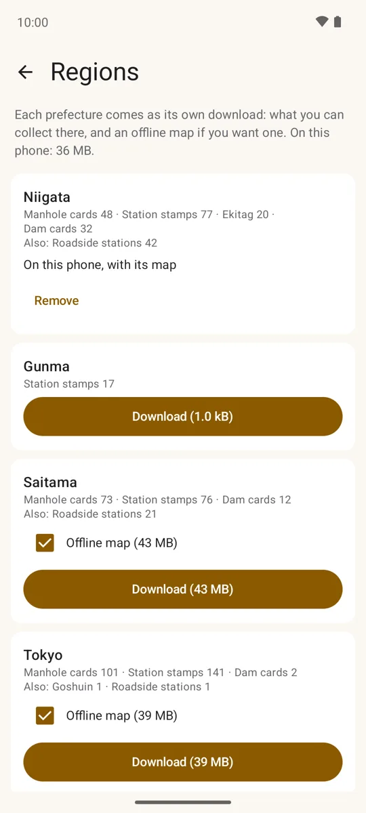

<div align="center">


# Meguri

**Collect Japan's manhole cards, station stamps, Ekitag, dam cards and goshuin.**<br>
Meguri shows you what's nearby, keeps track of what you already have, and tells you where to find the rest.

[](https://github.com/thisisartman/Meguri/releases/latest)
[](https://github.com/thisisartman/Meguri/actions/workflows/build.yml)
[](LICENSE)


**[Download the latest APK](https://github.com/thisisartman/Meguri/releases/latest)** · [How to use it](docs/APP_GUIDE.md) · [日本語](#日本語)

</div>

*Meguri* (巡り) means going round a circuit, the way you would on a pilgrimage or a stamp rally.

<p>
  
  
  
  
</p>

## Why Meguri

If you collect these on day trips, you know the moment: you're at a city hall counter, a shrine or a ticket gate, the signal is weak, and you have one hand free. Meguri is made for exactly that. Logging a find takes one tap, a photo is up to you, and nothing has to wait for the internet.

## What you can do

- **See what's around you.** Nearby shows a map and a list of the closest things you can collect, with distances, a category filter and directions.
- **Watch your collection grow.** My book has a progress ring for each category (manhole cards, station stamps, Ekitag, goshuin, dam cards, roadside stations, and any collections you add yourself). Open one to see each prefecture or railway line, and what to get next.
- **Know before you go.** Every item has its official picture, where it's handed out, the phone number, and its opening hours. Meguri tells you if it's open now or closed today, and it knows about national holidays and the "closed Mondays, or Tuesday if Monday is a holiday" rule.
- **Keep your photos with your finds.** Snap the card, the manhole cover itself (Meguri cuts it out as a circle), the stamp, or an Ekitag screenshot (turned into a neat stamp tile). Photos are kept safely inside the app.
- **Get a nudge when you pass by.** Meguri can let you know when you're near something you don't have yet, even with the app closed. You choose the distance for each category and set quiet hours.
- **Sort your camera roll.** Share photos to Meguri from your gallery, and it groups them by where they were taken and suggests what each one shows.
- **Download only the regions you need.** Each prefecture is a separate download: the catalogue is only a few KB, and the offline map (36 to 43 MB) is optional.
- **Plan a day out.** Plan a trip along a railway line or from a Google Maps link, then get a report of everything you collected.
- **Never lose your collection.** Back up to a folder of your choice, with or without photos, and let Meguri do it automatically every week.
- Meguri speaks English and Japanese, and comes in light and dark.

<p>
  
  
  
</p>

## Where it works

Right now the catalogue covers Niigata, Saitama and Tokyo (manhole cards, station stamps, dam cards and roadside stations), plus Niigata's Ekitag stations and the Joetsu Line stations in Gunma. New prefectures arrive as region downloads from [meguri-data](https://github.com/thisisartman/meguri-data), with no app update needed.

## Getting the app

Meguri isn't on Google Play yet. To install it, download `Meguri-<version>.apk` from the [latest release](https://github.com/thisisartman/Meguri/releases/latest) and open it on your phone. You need Android 10 or newer, and Android will ask you to allow installs from your browser or file manager the first time.

New versions install over the old one and keep all your data. It's still a good idea to back up first (Settings › Backup and data › Back up now).

Want to make sure your APK is the real one? Its signing certificate's SHA-256 should be:

```
06:7F:32:50:E8:46:AA:0B:E0:B6:A4:8B:89:3B:21:B7:56:8E:1C:5E:9C:FC:17:D9:30:A8:63:F9:40:38:79:13
```

You can check it on your phone with [AppVerifier](https://github.com/soupslurpr/AppVerifier), or on a computer with `apksigner verify --print-certs`.

## Learning the app

The [app guide](docs/APP_GUIDE.md) walks through every page and feature, with screenshots.

## Your privacy

Meguri has no accounts and no servers. Your finds, photos and backups stay on your phone and in the folders you choose, and nothing is collected about you. Meguri only goes online when you use something that needs it, like map tiles outside your offline maps or a region download.

[PRIVACY.md](PRIVACY.md) lists every online service, what it receives, and every permission the app asks for and why.

Card pictures belong to GKP and each city. They're only downloaded to your phone when you ask, and they're never put in backups.

## Building it yourself

```sh
./gradlew assembleDebug testDebugUnitTest
```

You'll need JDK 17 and the Android SDK. The debug build installs as a separate app, "Meguri (dev)", so testing never touches your real collection. Region packs are built with the scripts in `tools/packs/` (see its README).

## Helping out

Bug reports, corrections to the catalogue, ideas and code are all welcome. [CONTRIBUTING.md](CONTRIBUTING.md) explains how. If you find a security problem, please report it privately as described in [SECURITY.md](SECURITY.md) rather than opening an issue.

## Thanks

- Map data © OpenStreetMap contributors (ODbL), tiles by [Protomaps](https://protomaps.com), drawn with [MapLibre](https://maplibre.org)
- Station positions from OpenStreetMap, dam cards from the Ministry of Land, Infrastructure, Transport and Tourism, and Ekitag stations from JR East's announcements
- Manhole card pictures via [駅からマンホール](https://ekikaramanhole.whitebeach.org/ext/manholecard/)
- Icons from Mapbox Maki and Temaki (CC0), and the M PLUS Rounded 1c font (OFL)

## License

Meguri is released under the MIT licence. See [LICENSE](LICENSE).

## 日本語

Meguri（巡り）は、マンホールカード、駅スタンプ、エキタグ、ダムカード、御朱印を集めるためのアプリです。近くで集められるもの、もう集めたもの、まだ集めていないものがどこにあるかが、ひと目でわかります。アカウントもサーバーも使わず、記録や写真はすべてお使いの端末の中に保存されます。

[最新版のAPKはこちらからダウンロードできます](https://github.com/thisisartman/Meguri/releases/latest)（Android 10以降）。アプリは日本語と英語に対応しています。不具合やデータの誤りに気づいたら、[Issues](https://github.com/thisisartman/Meguri/issues/new/choose) か、アプリの「フィードバックを送る」から気軽にお知らせください。
