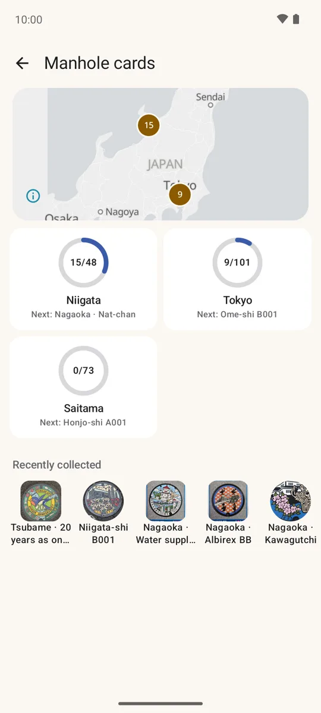

<div align="center">


# Meguri

**Collect all your favourite Japanese collectibles in one place.**<br>
Manhole cards, station stamps, Ekitag, goshuin, dam cards, roadside station stamps, and whatever else Japan hands out to people who go looking.

[](https://github.com/thisisartman/Meguri/releases/latest)
[](https://github.com/thisisartman/Meguri/actions/workflows/build.yml)
[](LICENSE)


**[Download the latest APK](https://github.com/thisisartman/Meguri/releases/latest)** · [How to use it](docs/APP_GUIDE.md) · [Roadmap](ROADMAP.md) · [日本語](#日本語)

</div>

The name comes from *meguri* (巡り): going round a circuit, the way you would on a pilgrimage or a stamp rally.

<p>
  
  
  
  
</p>

## Why Meguri

You're out wandering somewhere and you wonder: is there a manhole card around here? Does this station have a stamp? Is the shrine down the road handing out goshuin today?

The answers are out there, but they're scattered across dozens of websites and apps, and the ones that exist are often hard to use or hard to read. What you really want is simple: to see where everything is, so you can plan a day around it, and to keep track of what you've already got. And when you head somewhere off the beaten track, you don't want to be stuck waiting for a signal.

Meguri is made for exactly that. Everything is on your phone, logging a find takes one tap, and it all works offline.

## What you can do

- **See what's around you.** Nearby shows a map and a list of the closest things you can collect, with distances, a category filter and directions.
- **Watch your collection grow.** My book has a progress ring for each category (manhole cards, station stamps, Ekitag, goshuin, dam cards, roadside stations, and any collections you add yourself). Open one to see each prefecture or railway line, and what to get next.
- **Know before you go.** Every item has its official picture, where it's handed out, the phone number, and its opening hours. Meguri tells you if it's open now or closed today, and it knows about national holidays and the "closed Mondays, or Tuesday if Monday is a holiday" rule.
- **Keep your photos with your finds.** Snap the card, the manhole cover itself (Meguri cuts it out as a circle), the stamp, or an Ekitag screenshot (turned into a neat stamp tile). Photos are kept safely inside the app.
- **Get a nudge when you pass by.** Meguri can let you know when you're near something you don't have yet, even with the app closed. You choose the distance for each category and set quiet hours.
- **Sort your camera roll.** Share photos to Meguri from your gallery, and it groups them by where they were taken and suggests what each one shows.
- **Plan a day out.** Plan a trip along a railway line or from a Google Maps link, then get a report of everything you collected.
- **Never lose your collection.** Back up to a folder of your choice, with or without photos, and let Meguri do it automatically every week.
- Meguri speaks English and Japanese, and comes in light and dark.

<p>
  
  
  
</p>

## Where it works

Meguri works one prefecture at a time, and each prefecture has two parts:

- **The catalogue:** every card, stamp and goshuin spot in that prefecture, with where to get it and when it's open. It's only a few KB. The first time you open Meguri, you pick the prefectures you collect in and their catalogues download.
- **The offline map (optional):** a full map of the prefecture, 36 to 43 MB, so the map works with no signal at all. You can download it from Settings › Catalogue › Regions; without it, Meguri uses online map tiles.

You can add or remove prefectures any time in Regions, and when the data changes, "Update all" fetches the new version. No app update is needed. The data lives in its own repository, [meguri-data](https://github.com/thisisartman/meguri-data).

Right now the catalogue covers **Niigata, Saitama and Tokyo** (manhole cards, station stamps, dam cards and roadside stations), plus Niigata's Ekitag stations and the Joetsu Line stations in Gunma. The rest of Japan comes as people help fill it in (see [Helping out](#helping-out)).

## Getting the app

Meguri isn't on Google Play. You install it straight from this page:

1. On your phone, open the [latest release](https://github.com/thisisartman/Meguri/releases/latest) and download `Meguri-<version>.apk`.
2. Open the downloaded file and follow Android's prompts to allow the install.

**Which phones:** Android 10 or newer, on a 64-bit ARM processor (`arm64-v8a`). That's almost every Android phone from the last several years; very old 32-bit phones and Intel-based devices can't run it.

**Updating:** new versions install over the old one and keep all your data. It's still a good idea to back up first (Settings › Backup and data › Back up now).

**Is it the real one?** Every release is signed with the same key. Its signing certificate's SHA-256 is:

```
06:7F:32:50:E8:46:AA:0B:E0:B6:A4:8B:89:3B:21:B7:56:8E:1C:5E:9C:FC:17:D9:30:A8:63:F9:40:38:79:13
```

You can check it on your phone with [AppVerifier](https://github.com/soupslurpr/AppVerifier), or on a computer with `apksigner verify --print-certs`.

## Learning the app

The [app guide](docs/APP_GUIDE.md) walks through every page and feature, with screenshots.

## Your privacy

Meguri has no accounts and no servers. Your finds, photos and backups stay on your phone and in the folders you choose, and nothing is collected about you: no analytics, no ads, no tracking. Meguri only goes online when you use something that needs it, like map tiles outside your offline maps or a region download.

[PRIVACY.md](PRIVACY.md) lists every online service, what it receives, and every permission the app asks for and why.

Card pictures belong to GKP and each city. They're only downloaded to your phone when you ask, and they're never put in backups.

## Building it yourself

You'll need [JDK 17](https://adoptium.net/) and the [Android SDK](https://developer.android.com/studio) (installing Android Studio gives you both). Then:

```sh
git clone https://github.com/thisisartman/Meguri.git
cd Meguri
./gradlew assembleDebug testDebugUnitTest
```

On Windows, use `gradlew.bat` instead of `./gradlew`. The first build downloads its tools and takes a while.

The app ends up in `app/build/outputs/apk/debug/app-debug.apk`. Install it with `adb install app/build/outputs/apk/debug/app-debug.apk`, or open the project in Android Studio and press Run. The debug build installs as a separate app, "Meguri (dev)", so it never touches your real collection.

Region packs are built with the scripts in `tools/packs/` (see its README). Every pull request is built and tested automatically.

## Why I made this

I made Meguri for myself. I collect these things, and I wanted one place on my phone where I could look back and say: I went to this railway station once, and this shrine, and I got a stamp here and a goshuin there, all laid out on a map and by date, a bit like Google Photos does for pictures (something I've always been fascinated by). Meguri has made my own trips easier, and that was the whole point.

I'm not a programmer. I'm a product tester and a UI/UX designer, and what I'm good at is working out how something should flow and feel. Meguri was built with a lot of help from Claude, an AI model, which wrote most of the code while I designed the app, decided how it should work, and tested every version on my own phone and trips.

I believe in open source. AI like the one that helped build this was trained on open source work, and that's one of the main reasons Meguri is open source too, and free. I don't expect to make any money from it. If someone else finds it fun or useful, that's more than enough.

Information like this can't come from one person, though. Opening hours change, new cards come out, stamps get retired. The catalogue only gets better if collectors help keep it right, so I'm looking forward to working with everyone out there who enjoys this as much as I do.

## Helping out

The most useful thing you can do is help the catalogue grow and stay correct. Each of these is an issue form:

- **[Add a place or a collectible](https://github.com/thisisartman/Meguri/issues/new?template=new_place.yml):** a new spot, or something new at a place Meguri already knows.
- **[Report availability](https://github.com/thisisartman/Meguri/issues/new?template=availability.yml):** sold out, back in stock, new hours, no longer handed out.
- **[Correct something](https://github.com/thisisartman/Meguri/issues/new?template=data_correction.yml):** a wrong position, name or picture.

When someone else has seen the same thing, a 👍 or a comment on the issue confirms it. Confirmed changes go into the next region data update, which everyone gets through "Update all". [CONTRIBUTING.md](CONTRIBUTING.md) explains how it works, and the [roadmap](ROADMAP.md) shows what's planned, including a way to suggest places straight from the app.

Bug reports, ideas and code are welcome too. If you find a security problem, please report it privately as described in [SECURITY.md](SECURITY.md) rather than opening an issue.

## Thanks

- Map data © OpenStreetMap contributors (ODbL), tiles by [Protomaps](https://protomaps.com), drawn with [MapLibre](https://maplibre.org)
- Station positions from OpenStreetMap, dam cards from the Ministry of Land, Infrastructure, Transport and Tourism, and Ekitag stations from JR East's announcements
- Manhole card pictures via [駅からマンホール](https://ekikaramanhole.whitebeach.org/ext/manholecard/)
- Icons from Mapbox Maki and Temaki (CC0), and the M PLUS Rounded 1c font (OFL)

## License

Meguri is free and open source under the MIT licence. See [LICENSE](LICENSE).

## 日本語

Meguri（巡り）は、マンホールカード、駅スタンプ、エキタグ、御朱印、ダムカード、道の駅スタンプなど、日本のさまざまな「集めもの」をひとつにまとめるアプリです。近くで集められるもの、もう集めたもの、まだ集めていないものがどこにあるかが、ひと目でわかります。アカウントもサーバーも使わず、記録や写真はすべてお使いの端末の中に保存されます。電波のない場所でも使えます。

[最新版のAPKはこちらからダウンロードできます](https://github.com/thisisartman/Meguri/releases/latest)（Android 10以降、64ビットARM）。アプリは日本語と英語に対応しています。新しいスポットや集めもの、配布状況の変化、データの誤りに気づいたら、[Issues](https://github.com/thisisartman/Meguri/issues/new/choose) か、アプリの「フィードバックを送る」から気軽にお知らせください。
