# Meguri application guide

Draft. Written from the source code of version 0.3.0-beta.9 (version code 11), application id `io.github.thisisartman.collectibles` (`app/build.gradle.kts:22`, `app/build.gradle.kts:30-36`). The dev build adds `.dev` to the id and is labelled "Meguri (dev)" (`app/build.gradle.kts:52-55`). The app runs on Android 10 (API 29) and later and targets API 37 (`app/build.gradle.kts:31-32`).

Line numbers follow the working copy as checked on 2026-11-09: commit `c5e5a75` plus edits not yet committed in `ui/CollectionCheck.kt`, `ui/FindPhotos.kt`, `ui/ItemScreen.kt`, `ui/NearbyScreen.kt` and both `strings.xml` files. The behaviour those uncommitted edits add is not described.

## How to read this guide

- Words in double quotes are the exact English text the app shows, taken from `app/src/main/res/values/strings.xml`, `values/plurals.xml` or text written in code. Japanese text is in `app/src/main/res/values-ja/`.
- An icon-only control is named by its screen-reader label, in quotes, followed by "(icon)".
- `%1$d`, `%s` and similar marks in quoted text are filled in by the app (a number, a name, a time).
- Where a text has a singular and a plural form, both are given ("%d photo" / "%d photos"), or the guide writes "(s)" to stand for both.
- Quoted examples such as "86 Station stamps · 48 Manhole cards" show how filled-in text looks; they are not fixed strings.
- Source references have the form `path:line`. A path that does not start with `app/` is relative to `app/src/main/java/io/github/thisisartman/collectibles/`. For example `ui/App.kt:205` means `app/src/main/java/io/github/thisisartman/collectibles/ui/App.kt`, line 205.
- Pictures were taken from the 0.5 development build on a phone in light theme; the moving pictures are from 0.4.0 in dark theme, with a real collection; they show taps that were cancelled or undone, so nothing in the collection changed.
- "Not confirmed from code" marks something the code does not settle, or that would need a test on a phone.
- A dash shown as a value (no date) is the string `no_date`.

## Contents

1. Overview
2. Pages
3. Features
4. Facilities
5. Reference tables

---

## 1. Overview

### 1.1 What the app is for

Meguri is a personal, offline-first record of Japanese collectibles: what you have, what is still uncollected near you, and where to get it. It ships with a catalogue of what there is to collect and where, and an offline map of Niigata, Saitama and Tokyo (`settings_catalogue_note`). You log each thing you collect (a "find"), with the time, your position and your own photos.

The app has no account and no server. Its own words: "Meguri has no account and no server. Your finds, photos and settings stay on this phone, and in the backups you save. Nothing is collected about you." (`privacy_intro`).

### 1.2 Who uses it

One person, on one phone. There is no sign-in, no sharing of a collection between people and no sync. Data moves between phones only through the app's own backup files (section 3.13). Android cloud backup and device-to-device transfer are switched off (`app/src/main/AndroidManifest.xml:31-33`, `app/src/main/res/xml/data_extraction_rules.xml`).

### 1.3 Categories

What you collect is a "category". The app has seven built-in categories, and you can add your own (section 3.15). The internal names are the values of `ItemType` (`data/Entities.kt:13`).

| Internal name | Singular label | Plural label | Card or stamp | Icon | Colour, light theme | Colour, dark theme |
|---|---|---|---|---|---|---|
| `MANHOLE_CARD` | "Manhole card" | "Manhole cards" | Card | `ic_type_manhole` | #3A5BA8 | #6A87D2 |
| `EKI_STAMP` | "Station stamp" | "Station stamps" | Stamp | `ic_type_station` | #C62845 | #F25C6E |
| `EKITAG` | "Ekitag" | "Ekitag" | Stamp | `ic_type_ekitag` | #00806A | #2EA88B |
| `GOSHUIN` | "Goshuin" | "Goshuin" | Stamp | shrine, temple or goshuin icon (below) | #B83A1E | #E2603F |
| `DAM_CARD` | "Dam card" | "Dam cards" | Card | `ic_type_dam` | #5A6470 | #9AA6B2 |
| `MUSEUM_STAMP` | "Museum stamp" | "Museum stamps" | Stamp | `ic_type_museum` | #5F6B12 | #A8B84E |
| `ROADSIDE_STATION` | "Roadside station stamp" | "Roadside stations" | Stamp | `ic_type_roadside` | #B85C00 | #E89A4A |
| `CUSTOM` | "Your own category" (fallback) | same | from its icon | its chosen icon | its chosen colour (fallback #7A5AA8) | its chosen colour (fallback #A88AD2) |

Sources: labels `ui/Format.kt:86-95` and `ui/Format.kt:170-177`; card or stamp `ui/CustomTypes.kt:65-69`; icons `ui/Marks.kt:103-113`; colours `ui/Theme.kt:115-116`.

Notes:

- Station stamps and Ekitag share one colour. An Ekitag tile on Nearby carries a small Ekitag badge so the two can be told apart (`ui/NearbyScreen.kt:599-617`).
- A goshuin's icon comes from its Japanese name: a torii for a shrine (神社, 大社, 神宮, 八幡宮, 天満宮, 稲荷, 宮), the GSI temple symbol for a temple (寺, 院, 不動, 観音, 大師, 坊), else the general goshuin icon (`ui/CustomTypes.kt:126-144`).
- Goshuin and museum stamps are "open-ended": they count up with no total (`ui/BookKinds.kt:71`). The other built-in categories count against the catalogue ("12/48").
- Ekitag is never offered on the Add form ("Ekitags come from the station", `ui/NewItemScreen.kt:57-58`) and never alerts (`data/CollectionDao.kt:40-49`, which leaves out `EKITAG`).

What the bundled catalogue holds (counted from `app/src/main/assets/catalogue/trip-niigata.csv`, 754 rows; a station on two lines is two rows):

| Prefecture | Rows by category |
|---|---|
| 新潟県 Niigata | Station stamps 86, Manhole cards 48, Roadside stations 42, Dam cards 32, Ekitag 20 |
| 埼玉県 Saitama | Station stamps 94, Manhole cards 73, Roadside stations 21, Dam cards 12 |
| 東京都 Tokyo | Station stamps 203, Manhole cards 101, Dam cards 2, Goshuin 1, Roadside stations 1 |
| 群馬県 Gunma | Station stamps 18 |

There are no museum stamps in the bundled catalogue. Museum stamps exist only as items you add yourself or load from a CSV.

### 1.4 The core model

**Item.** One thing that can be collected: a card, a station's stamp, a shrine's goshuin. It has a Japanese name and an optional romaji name, an optional code (manhole cards: "15-202-A001"), series and release date, prefecture and town, the place that hands it out, address, phone, hours, closed days, notes, and a position (`data/Entities.kt:73-105`). Distances are measured to the item's position. An item has an origin: from the catalogue file (`CSV_IMPORT`), seeded (`SEED`), or added by you (`USER`) (`data/Entities.kt:55`).

**Find.** One time you collected an item (stored as an "acquisition", `data/Entities.kt:118-132`). A find has a time, an optional position and accuracy, a quantity (1 to 99, for duplicates), an optional price in yen, optional notes, and how it was logged (`MANUAL`, `NOTIFICATION`, `SUGGESTION` or `BULK`, `data/Entities.kt:57`). An item can have many finds. The item page calls each find "a collection" ("This collection", "Remove this collection?").

**Collected and uncollected.** An item with at least one find is "Collected"; with none it is "Uncollected" (`data/Entities.kt:194`, `state_collected`, `state_to_get`).

**Had before Meguri.** A find with no date, no place and no photo, marked `beforeApp` (`data/CollectionRepository.kt:172-184`). It records something you had before you used the app. The onboarding picker, Collection check and notebook stamps make these finds. They count as collected, show on the item page as "Added" with the day they were added (`ui/ItemScreen.kt:383-387`), and never appear on the Timeline or a Trip report, which need a date.

**No stamp here / None here.** You can mark an uncollected item as checked and empty (`noneHereAt`, `data/Entities.kt:99-100`). Such an item is left out of "uncollected" counts, alerts, map pins on Nearby and My book totals, and is shown faded and last on Nearby (`data/Entities.kt:196-197`). Stamps use "No stamp here", everything else "None here" (`ui/ItemScreen.kt:439-441`).

**Photo.** A picture attached to a find (`data/Entities.kt:145-159`). Meguri keeps its own copy of each photo (section 3.2). Each photo has a kind ("role"): the collectible itself (`stamp`), an Ekitag screenshot (`ekitag`), a manhole cover (`manhole`), where you got it (`place`), the old `proof` kind, or `other` (`data/Entities.kt:36-43`). Deleting a find deletes its photo rows (`ForeignKey.CASCADE`, `data/Entities.kt:141`).

**Display picture.** The photo that stands for an item on tiles, lists, the item page and map pins. It is the photo you chose ("Use as display picture"), else the newest photo of the newest find (`data/CollectionDao.kt:11-22`). For a manhole card with no photo, a downloaded card picture is used instead (section 3.14).

**Line.** A railway line with its stations in order (`data/Entities.kt:162-184`). A station on two lines is one item with two line rows. Lines drive the station stamp books and the Trip planner.

**Your own category.** A name, colour, icon and a "Note what I paid" switch (`data/Entities.kt:19-28`). Items in it have category `CUSTOM`.

### 1.5 How the app is laid out

- A bottom bar with three places: "Nearby" (pin icon), a gold + circle in the middle (read as "Scan, search or add"), and "My book" (list icon) (`ui/App.kt:212-263`). The bar shows only on Nearby and My book (`ui/App.kt:205`).
- The + circle opens the + card with "Scan", "Search" and "Add" (section 2.5).
- My book has a "Menu" (icon) at the top right with "Trip", "Collection check", "Settings" and "Logs" (`ui/MenuButton.kt:32-61`). Nearby has no menu; its top is the search bar only (`ui/NearbyScreen.kt:454`).
- Every other page opens on top, with a "Back" (icon) arrow at the top left. Page changes have no animation (`ui/App.kt:270-276`).
- On wide screens and in landscape, page content keeps a width of at most 640 dp, centred (`ui/App.kt:266-271`).

---

## 2. Pages

Pages are listed in the order a person meets them. Each page names its route (section 5.3). Settings sub-pages are not routes: they are states inside the Settings page (section 2.21).

### 2.1 First-open splash

**When it shows.** On the first open only, until a catalogue has been loaded once. A saved flag (`onboarding` preferences, key `has_catalogue`) decides this at once, so the splash also covers the moment before the database answers (`ui/NearbyScreen.kt:559-586`).

**What is on it.** The word "Meguri" in large gold type and "巡り" under it, on the page colour. Once the database has answered, it waits 0.4 s and fades out over 0.9 s, showing the map of Japan and the onboarding sheet under it.

There are no controls.

### 2.2 Onboarding

**How you get there.** It runs inside the Nearby sheet, over the map of Japan, while no catalogue is loaded (no item whose origin is not `USER`) (`ui/NearbyScreen.kt:169`, `ui/NearbyScreen.kt:241-257`). The search bar is hidden while it runs (`ui/NearbyScreen.kt:426`). The map stays on all of Japan, and the prefectures you choose are shaded in gold (`ui/NearbyScreen.kt:408-410`).

The sheet sits at the height of its content, capped per step (60% of the screen for the first step, 75% for permissions, 40% while asking or loading, 60% for regions, 45% for the picker when pulled down, 50% for the closing sheet) (`ui/Onboarding.kt:80-92`).

**Step 1, start.**
- Title "Welcome to Meguri".
- Text "Are you starting fresh, or do you already have cards, stamps or goshuin to put in?".
- Choice card "I'm starting fresh", with "Pick where you collect and start". Tap: go to step 2; at the end you land on Nearby.
- Choice card "I already have some", with "Pick where you collect, then tick off what you have". Tap: go to step 2; after loading you get the picker (step 5).
- Text button "I have a catalogue file". Tap: opens the Settings page (top list) (`ui/NearbyScreen.kt:251`). From there the CSV loader is under "Catalogue", "Installed catalogues", "Load catalogue (CSV)".

**Step 2, permissions.**
- Title "What Meguri needs", text "Android asks for each one next. You can change them any time in Settings."
- Four rows, each with an icon, a name and why:
  - "Location": "To show what is near you and how far. Precise or approximate both work; approximate shows the area around you."
  - "Notifications" (Android 13 and later only): "To tell you when you are near something you don't have yet."
  - "Location all the time (later)": "Only if you want alerts while Meguri is closed. Asked later, from Alerts."
  - "Photos and camera": "Nothing to allow: you pick each photo or open the camera yourself, and Meguri keeps its own copy."
- Button "Next". Tap: asks Android for precise and approximate location, and notifications on Android 13 and later (`ui/Onboarding.kt:141-150`).

**Step 3, asking.** "Allow what you're comfortable with" and "Android's own questions appear on top of this." This shows only between Android's own prompts. Whatever you answer, even a refusal, the next step is regions (`ui/Onboarding.kt:112-116`).

**Step 4, regions.**
- Title "Where do you collect?", text "Meguri loads what's in each region: cards, stamps and where to get them. Chosen ones are shaded on the map."
- Group "Where you are": the bundled prefecture you are in, if your position is inside one. It is ticked to start with (`ui/Onboarding.kt:162-163`).
- Group "Popular choices": the other bundled prefectures, in a fixed order (`data/Prefectures.kt` `POPULAR`), then any others A to Z.
- Each row: a checkbox, the prefecture name, and a line of counts such as "86 Station stamps · 48 Manhole cards". Tap the row or the box to tick or untick.
- Text button "Select all of Japan": ticks every listed prefecture.
- Note "More prefectures are coming."
- Button "Load 1 region" / "Load %d regions", disabled while nothing is ticked. Tap: loads the chosen prefectures from the bundled catalogue and remembers the choice for later catalogue updates (`data/CatalogAndBackup.kt:57-76`).

**Loading.** A spinner and "Loading…". When done: starting fresh, the onboarding ends and Nearby shows as normal; already having some, the picker opens.

**Step 5, "What do you already have?" (picker).** (`ui/OnboardingPicker.kt`)
- The sheet opens fully expanded. Pulled down, the map above shows the places the picker lists and frames them.
- Title "What do you already have?", text "Search, tap a place, tick what you have there. Ticked ones are added as "had before the app"; add photos later."
- Search field "Search stations, cards, places", using the shared search (section 3.8). While you type, the best match comes first.
- A chip that shows the current order, "A to Z" or "Nearest". Tap to switch.
- A grid of places, four to a row. A place is one or more uncollected items with the same Japanese name within about 100 m, such as a station's stamp and its Ekitag (`ui/PickerPlaces.kt:13-17`). Each tile shows the mark and the name. A small check shows on a tile when everything at that place is in your list.
- Tap a tile: a small card opens beside it, with the place's name, one checkbox per item (its category name), and "OK". A place with one item has it ticked already. "OK" puts the ticked items in your list, closes the card, selects the whole search text and keeps the keyboard up, so one backspace clears it for the next name.
- Under the grid: up to 14 small circles in each added item's category colour, stacked, with "%d added" and the last added item's name and category.
- Button "Skip for now" (nothing added) or "Done".
  - "Skip for now": back to step 1. As a catalogue is now loaded, the onboarding no longer shows, and you see Nearby.
  - "Done": marks every item in the list as had before Meguri, vibrates, shows the toast "%d added to your profile", and opens the closing sheet.
- Back closes an open place card. With no card open, Back does nothing, so picks are not lost (`ui/OnboardingPicker.kt:99-100`, `ui/NearbyScreen.kt:198-203`).

**Step 6, closing sheet.**
- Title "%d added to your profile".
- Text "Your finds are in My book (bottom right), with your photos and details; open one there to add photos.", with a picture of the My book icon.
- Outlined button "Done": closes the onboarding (Nearby).
- Button "Go to My book": closes the onboarding and opens My book.

**Back during the onboarding.** On permissions or regions, Back returns to step 1. On asking, loading, the picker and the closing sheet, Back stays (`ui/NearbyScreen.kt:198-203`). On step 1, Back leaves the app.

### 2.3 Nearby

**How you get there.** It is the start page (`ui/App.kt:277`), and "Nearby" in the bottom bar. Tapping "Nearby" or "My book" keeps each tab's state (`ui/App.kt:69-73`).

**Layout.** A map fills the screen (section 3.9). A sheet of round tiles sits over its lower part. A search bar floats at the top. Two small items float over the map: the "Back to where you are" (icon) button and the map's credit button. (Figure 1)

<p>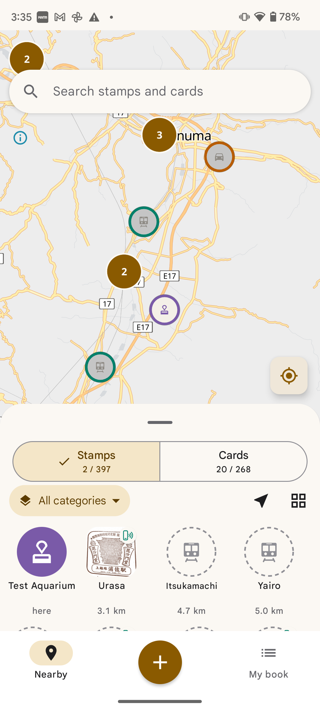</p>

*Figure 1. Nearby. Zoomed out, the gold circles are groups with how many items each holds, and single items show their category icon (their picture from street level). In the sheet: the "Stamps" and "Cards" tabs with how many you have, the "All categories" menu, "Sort" and "Tile size", then the tiles, nearest first. Urasa's tile carries the Ekitag badge in its corner.*

**Search bar (top).**
- Search icon, then a text field with the hint "Search stamps and cards". Typing searches everything (section 2.4). The keyboard's search key closes the keyboard.
- "Clear search" (icon, a cross), shown while there is text. Tap: clears the text, closes the result list and the keyboard.
- Under the bar, when there is no live position, a line about your position and a button (`ui/NearbyScreen.kt:526-549`). It is not shown during the onboarding.

| Situation | Line | Button | What the button does (`ui/App.kt:153-162`) |
|---|---|---|---|
| Allowed, looking for a position | "Finding your position…" | none | |
| Location not allowed | "Location not allowed · showing recent items" | "Allow location", or "Allow location in Settings" after Android has stopped asking | Asks Android, or opens the app's system settings page |
| Allowed, phone's location off | "Location is switched off · showing recent items" | "Turn on location" | Opens the phone's location settings |
| Allowed and on, no position | "No position yet · showing recent items" | "Try again" | Asks for a position again |
| An older position is known | "From your position at %1$s" (a time) | none | |

"Allow location in Settings" appears once Android refuses twice and stops showing its prompt; the app remembers this in the `location` preferences, key `blocked` (`ui/App.kt:142-151`).

Not confirmed from code: "showing recent items" does not match what the grid shows. Without a position, distances are unknown, so the grid falls back to name order (`ui/NearbyScreen.kt:157-158`).

**Map.**
- Opens on all of Japan, then flies in to you a moment after your position arrives, framing you and the eight nearest pins (`ui/MeguriMap.kt:363-381`). The camera is remembered while the app runs, so coming back to Nearby keeps the view.
- Pins are the tiles now shown in the sheet (after tab, filter or search), except items marked "None here" (`ui/NearbyScreen.kt:161`). See section 3.9 for how pins look and group.
- Tap a pin: the pin card opens (below). Tap a group: the map zooms in on it. Tap empty map: closes the pin card, the search list and the keyboard. (Figure 2)

<p>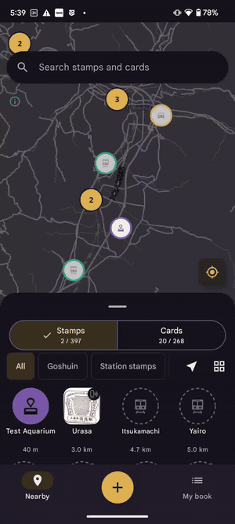</p>

*Figure 2. Tapping a group. The gold "2" zooms in until it opens into Urasa's station stamp and its Ekitag, side by side. Tapping the stamp opens its pin card; Back closes the card.*

- "Back to where you are" (icon), bottom right just above the sheet, shown only when a position is known. Tap: the map moves to you at street level (zoom 15) (`ui/MeguriMap.kt:454-459`).
- The map credit button sits top left under the search bar (`ui/MeguriMap.kt:160-164`).

**Pin card** (`ui/MapScreen.kt:146-211`). It grows out of the tapped pin and stays on it while the map moves; above the pin, or below it when there is no room above. On one line:
- The item's category icon, its name and its distance with an arrow (section 3.10). Tap this part: opens the item page.
- "Directions" (icon). Tap: opens Google Maps directions (section 3.11).
- "Collect" (icon, a filled round button), only while the item is uncollected. Tap: logs a find now, closes the card and shows the "Collected" snackbar with "Undo" (section 3.1).

**Sheet.** Drag the handle to pull it up or down. At rest it shows its header and one whole row of tiles, measured, between 220 dp and 480 dp tall (`ui/NearbyScreen.kt:170-194`). It tucks away while the search bar is in use.

Top to bottom:

1. **Tabs** (hidden while searching): "Stamps", "Cards", and "Other" when you have items in your own categories that are neither a card nor a stamp. Each tab shows a second line "collected / total" for the tab, blank until the list has loaded (`ui/NearbyScreen.kt:259-280`). Your own categories go under Stamps or Cards by their icon (section 3.15). Tap a tab: shows its items and resets the category filter to "All".
2. **Filter row.**
   - While searching: "%1$d found for “%2$s”" in place of the category pill.
   - Otherwise, when the tab holds more than one category: the category pill, the same one as on Alerts (`ui/CategoryPill.kt`). It shows "All categories" with a layers icon, or the chosen category with its colour dot, and a drop-down arrow. Tap: Android's menu with "All categories" and each category in the tab (plural label), the chosen line highlighted. Pick one to show only that category.
   - "Sort" (icon, right). The icon shows the order in use: an arrow for nearest, A over Z for name. Tap: a menu with "Nearest" and "A to Z", the current one ticked. Until you dismiss it, the menu also holds a tip under the two orders: "Nearest: how far each item is from you" and "A to Z: names in alphabetical order", with "Got it". "Got it" saves `tips` preferences key `sort`, and the tip never shows again. (Figure 3)
   - "Tile size" (icon, right). Tap: shows or hides a slider with three stops, small to large circles at its ends (48, 64 and 84 dp; 64 dp to start) (`ui/NearbyScreen.kt:588`). The size is kept while the app runs, not saved.
3. **Tiles**, in a grid that fills the width. Each tile shows the item's mark (section 3.3), its short name on two lines, and its distance, or "No stamp here" / "None here" for an item marked empty. Empty items are faded and always last. An Ekitag tile has a small Ekitag badge at its top right. Tap a tile: opens the item page. The grid holds collected and uncollected items alike.
   - Order "Nearest": by distance, then name. Order "A to Z": by name (`ui/NearbyScreen.kt:154-159`).
   - Changing the order, tab, filter or search scrolls back to the top.
   - Empty: "Nothing here yet."

<p>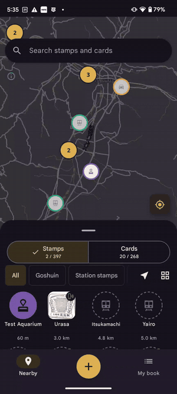</p>

*Figure 3. The Sort menu, opened from the arrow at the right of the filter row. "Nearest" is ticked; the lines under it say what each order means, and "Got it" hides them.*

**Back.** On Nearby, Back leaves the app, unless the + card, a pin card, a sort menu or the onboarding is open; then it closes that first.

### 2.4 Search (on Nearby)

**How you get there.** Tap the Nearby search bar, or tap + then "Search" (the app goes back to Nearby and focuses the bar after 0.25 s, so the keyboard comes up) (`ui/App.kt:360-364`, `ui/NearbyScreen.kt:128-131`).

<p>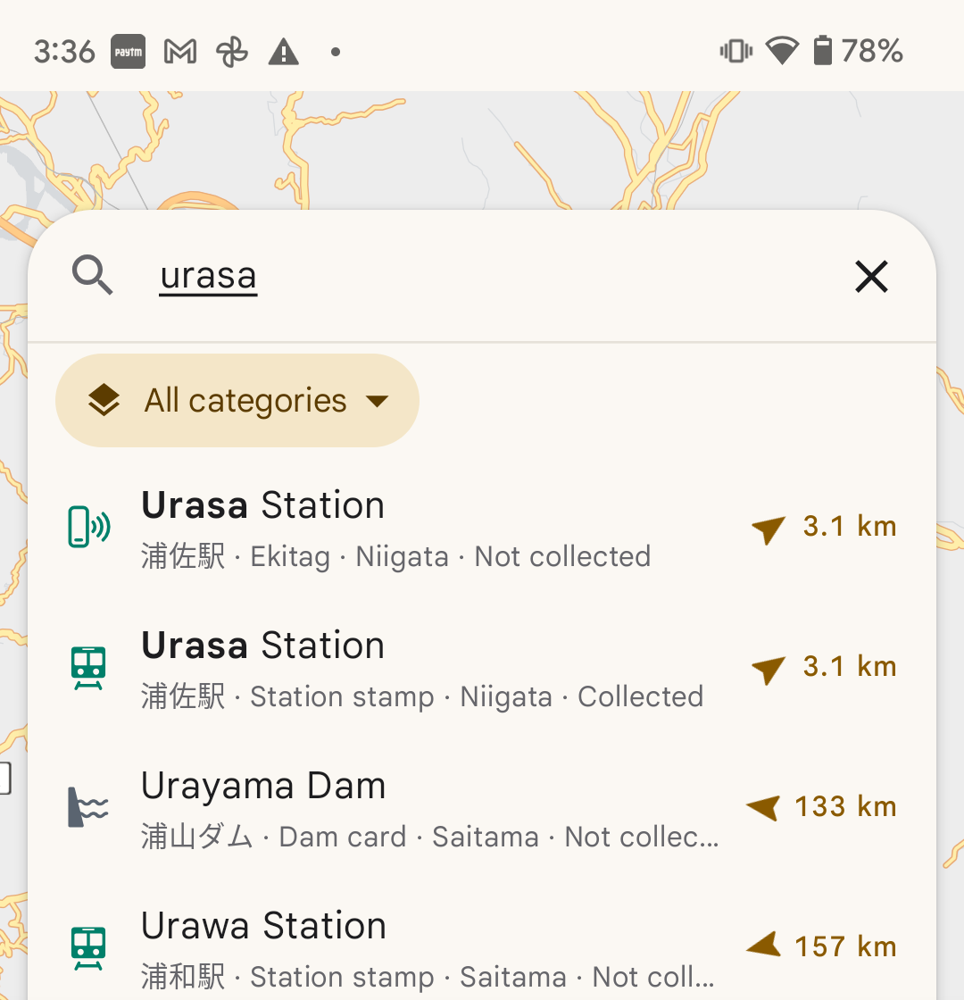</p>

*Figure 4. Searching "urasa". The "All categories" menu narrows the results to one category. Each row gives the category, prefecture and whether you have it, so Urasa's Ekitag and its station stamp read apart. The keyboard is cut off the picture.*

**What it searches.** Every item in both tabs and every category, with the shared forgiving search (section 3.8): Japanese and romaji names, any part of a card code, the town and the place name (`ui/Search.kt:20-21`). Results are ordered by match score, then distance.

**What is shown.**
- The sheet tucks away while the bar has focus or results are open (`ui/NearbyScreen.kt:183`, `ui/NearbyScreen.kt:210`).
- A list drops down under the search bar. It stays open after the keyboard closes. A tap on the map, a result, the cross or "Show on map" closes it.
- The category pill, when the results hold more than one category: "All categories" or one category, picked from its menu, narrows the results (same pill as on the sheet).
- Up to eight result rows (`ui/NearbyScreen.kt:483`). Each row: the category icon; the name with the typed text in bold where it appears as written; a second line with the card code (for a manhole card whose name does not contain it), the Japanese name (English mode), the category (so a station's stamp and its Ekitag read apart), the prefecture, and "Collected" or "Uncollected"; on the right the distance with an arrow. Tap a row: opens the item page. (Figure 4)
- "Nothing here yet." when nothing matches.
- "Show on map", when any result has a position. Tap: closes the list and fits the map to every result, not only the eight listed (`ui/NearbyScreen.kt:514-524`).
- While searching, the sheet's grid and the map pins also show the results, and the filter row shows "%1$d found for “%2$s”".

### 2.5 The + card

**How you get there.** Tap the gold + circle in the bottom bar, on Nearby or My book (`ui/App.kt:225-246`). (Figure 5)

<p>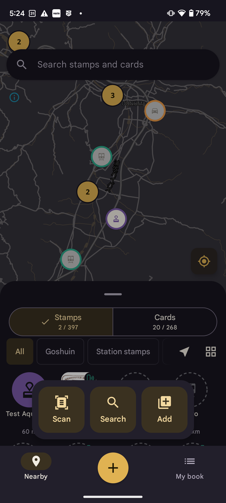</p>

*Figure 5. The + card: "Scan", "Search" and "Add", just above the + button. The bottom bar stays usable.*

**What is on it.** A small card rises from just above the + circle, with three square buttons, and the page behind it dims (`ui/LogSheet.kt:44-68`). The bottom bar stays usable.

| Button | What it does |
|---|---|
| "Scan" | Closes the card and opens the card scanner (section 2.6) |
| "Search" | Closes the card, returns to Nearby and focuses the search bar (section 2.4) |
| "Add" | Closes the card and opens the "New item" page (section 2.9) |

Each tap gives a short vibration. A tap on the dimmed page, a second tap on +, Back, or switching tabs closes the card.

### 2.6 Scanning a card or cover

**How you get there.** + then "Scan". The scanner is Google's on-device document scanner (ML Kit, through Google Play services). It finds the card's edges, straightens it and lets you move the corners. It takes one page, and also allows picking a picture from the gallery (`ui/ScanCard.kt:261-272`). On first use of the screen, the app asks Play services to download the Japanese text reader in the background (`ui/ScanCard.kt:132-140`).

**If the scanner cannot start.** A dialog: "The scanner isn't available on this phone (it needs Google Play services). Add the photo from the item page instead." with "OK".

**While reading.** A dialog with a spinner and "Reading the card…". It cannot be dismissed.

**If the text reader is still downloading.** A dialog: "The card reader is still downloading (once, through Google Play services). Try again in a minute." with "OK" (`ui/ScanCard.kt:206-209`).

**What the app does with the page** (`ui/ScanCard.kt:146-258`):
1. Reads the text as the page came, then turned 180, 90 and 270 degrees, and looks for a card code (section 3.4). The turn that reads a code is upright, adjusted so the code sits top right where every manhole card prints it.
2. If nothing was read, it cuts the card out by its blue frame and reads that alone.
3. A card that was read is turned upright and trimmed to the top card by its blue frame. A page that cannot be trimmed is kept upright as it was.
4. If no code was read and the page does not look like a card, it checks whether the page is a notebook page (mostly plain paper). If so, it finds the stamps and opens "Stamps on this page" (section 2.7).
5. Otherwise, if a clear circle is found, the page is taken for a manhole cover.

**The result dialog.** It always shows the photo at card size; tap the photo or its "View full screen" (icon) button for the full-screen viewer (section 2.11). The rest depends on what was found:

| Found | Title | Text | Other buttons | Confirm button | Dismiss button |
|---|---|---|---|---|---|
| A code that matches a card | The card's design name, with place and code under it (section 3.5) | "Code %1$s" | "Or is it %1$s?" for each look-alike card (section 3.4) | "Collect with this photo" (uncollected) or "Add this photo" (collected) | "Open" |
| A code not in the catalogue | "Which card is this?" | "Code %1$s is not in your catalogue yet. Pick the card by hand, or load its region." | none | "Pick by hand" | "Cancel" |
| A manhole cover | "A manhole cover" | "Which card is this cover for? The nearest ones:" | The three nearest manhole cards, by short name | "Pick by hand" | "Cancel" |
| No code, not a cover | "Which card is this?" | "No card code could be read. Retake the photo, or type the code." | none | "Type code" | "Retake photo" |

What each button does:
- "Collect with this photo" / "Add this photo": puts the photo on the card as its "Card" photo and opens the item page. If the card is uncollected, a new find is made first, the way shared photos make one (section 2.8) (`ui/ScanCard.kt:332-336`, `ui/MainViewModel.kt:303-309`). Unlike "Collect", this find gets no position: the saved scan is a new picture with no position data in it, and the app does not ask for your position afterwards. No "Collected" snackbar or "Undo" shows (`data/CollectionRepository.kt:264-277`).
- "Open": opens the card's item page without adding the photo.
- "Or is it %1$s?": switches the dialog to that card; the first card is then offered as the look-alike.
- A nearest card's name (cover case): puts the photo on that card as a "Manhole cover" photo, cut out as a circle, and opens its item page (`ui/ScanCard.kt:323-328`).
- "Pick by hand": opens the share page with this one photo, to choose the item (section 2.8).
- "Type code": opens the Type code dialog; the first time, a short tutorial comes first.
- "Retake photo": opens the scanner again.
- "Cancel": closes the dialog.

**Tutorial "Where the code is"** (first "Type code" only; `tips` preferences key `code_tutorial_seen`). An animated drawing of a card zooms into its top right corner, where a pale box pulses round "15-202-A001". Text "Every manhole card prints its code in the top right corner, in small letters like 15-202-A001." Button "Got it" (`ui/ScanCard.kt:427-485`).

**Dialog "Type the card's code"** (`ui/ScanCard.kt:379-421`).
- A text field with the hint "15-202-A001" and the helper line "Like 15-202-A001. Dashes are optional." It takes capitals, up to 16 characters.
- As you type any part of a code ("A001", "202-A"), up to six matching cards are listed as "code · design · distance", best match first, then nearest. Tap one to pick it.
- "Find", enabled once the text is a whole code. Tap (or the keyboard's done key): if a card has that code, the result dialog returns for that card; else the helper line turns red: "No card with this code in Meguri."
- "Cancel" closes it.

Not confirmed from code: a cover scan with no known position lists no nearest cards, since the list is built from distances (`ui/ScanCard.kt:251`).

### 2.7 Notebook stamps

**How you get there.** Scan a notebook page (+ then "Scan"). When no card code is read, the page is not a card, and it is mostly plain paper, the app finds the stamps on it and opens this flow (`ui/ScanCard.kt:229-243`). Station, roadside station, museum and goshuin stamps and your own stamp categories can be matched (`ui/NotebookScreen.kt:76-82`).

**Page 1, "Stamps on this page"** (route `stamps`, `ui/NotebookScreen.kt:233-346`).
- "Back" (icon).
- Hint "Drag a box to move it or its corner to resize it. Tap a box, then its cross, to remove it."
- The page, as large as fits, with a box round each stamp found, in the gold accent with a dark edge and a dot at each corner.
  - Drag inside a box: moves it, kept inside the page.
  - Drag a corner: resizes it, to at least 5% of the page each way.
  - Tap a box: selects it (thicker outline) and shows a red cross at its top right corner. Tap the cross: removes the box.
- Outlined button "Add a box": adds a box in the middle of the page and selects it.
- Button "Next (1 stamp)" / "Next (%d stamps)", disabled with no boxes. Tap: opens page 2.

**Page 2, "Which station?"** (route `stamps-match`, `ui/NotebookScreen.kt:89-218`).
- While working: a spinner and "Reading the stamps…". Each box is cut from the full photo, cleaned (section 3.7), and read twice, as photographed and cleaned.
- One card per stamp:
  - The stamp's picture, cleaned to start with.
  - "Stamp %1$d".
  - "Show original" / "Show cleaned": switches the picture. The one shown is the one saved.
  - "Skip" / "Keep": leaves this stamp out, or brings it back. A skipped stamp shows nothing more.
  - When a station is chosen: its name and "Change" (clears the choice).
  - When none is chosen and the best match scores 0.60 or more: an outlined button "This seems to be %1$s". Tap to choose it.
  - When none is chosen: a field "Type the station or place". As you type, up to five matches show as "name · distance"; tap one to choose it. Then "Not in Meguri? Add it", which opens the "New item" page.
  - A match that scores 0.75 or more is chosen to start with (section 3.7).
- Button "Save 1 stamp" / "Save %d stamps" (stamps kept and chosen), disabled at 0. Tap: saves each stamp's picture on its item as the collectible's photo. An uncollected item gets a find marked had before Meguri (no date). Then the app returns to Nearby and shows "1 stamp saved, as had before Meguri" / "%d stamps saved, as had before Meguri" (`ui/App.kt:318-325`, `data/CollectionRepository.kt:284-291`).

**Back.** Page 2 goes back to page 1, with the boxes as you left them. Page 1 goes back to where the scan started.

Not confirmed from code: after "Not in Meguri? Add it" and saving, Back from the new item returns to page 2, but page 2 holds its readings in non-saved state (`ui/NotebookScreen.kt:97`), so it may read the stamps again and lose the choices made. "Add it" also saves the new item with a find dated now, not as had before Meguri (section 2.9).

### 2.8 Adding shared photos

**How you get there** (route `share`, `ui/ShareScreen.kt`):
- Share one or more pictures to Meguri from the gallery or any app. Meguri accepts `SEND` and `SEND_MULTIPLE` of `image/*` (`app/src/main/AndroidManifest.xml:50-56`, `ui/AppRequest.kt:18-24`).
- "Pick by hand" in the scan result (section 2.6).
- "Pick another" on a photo suggestion notification, or a tap on the notification itself (section 3.12).

**What is on it, top to bottom.**
- "Cancel" (icon, a cross) at the top left. Tap: leaves without adding anything.
- Title "Add 1 photo" / "Add %d photos".
- A spinner while the photos are read for where and when they were taken (section 3.12).
- "Grouped by where they were taken".
- When the gallery hid some positions: a card "Your gallery hid where %d photo(s) was taken, so it can't be grouped by place. Meguri can read it if you allow photo access and photo locations." with "Allow". Tap: asks for photo access and photo locations, then reads the photos again (`ui/ShareScreen.kt:82-84`, `ui/ShareScreen.kt:114-123`).
- One card per group. Photos within 250 m of each other form one group; photos with no position form one group of their own, last (`data/ShareGrouping.kt:16-45`).
  - Title: "Near %s" (the chosen item's place, or in English mode its name), "No location", or "Where these were taken", then " · " and "%d photo(s)".
  - A row of thumbnails.
  - When no item is chosen: outlined button "Choose what this is".
  - When an item is chosen: its mark, name, category and distance from the group's centre, and "Change". Tap the row or "Change" to open the pick sheet.
  - A group with a position starts with the nearest item within 2 km chosen for it. A group with no position starts with none (`ui/ShareScreen.kt:89-94`).
- Button "Add · 1 item" / "Add all · %d items" (groups with an item), disabled when none. Tap: a spinner while the photos are copied, then the page closes and the snackbar says "Added 1 photo to %2$s" / "Added %1$d photos to %2$s", where %2$s is "%d item(s)".

**Pick sheet.**
- The group's thumbnails.
- Search field "Search stations, cards, places" (shared search, section 3.8).
- One chip per category (singular label). Tap to narrow; tap again to clear.
- A label: "Near where these were taken", "Near you" (group without a position) or "Results" (while searching).
- A grid of items: up to 12 suggestions within 2 km, or up to 24 search results, best match first and then nearest to the group. Empty: "Nothing here. Try a search."
- Tap an item: chooses it for the group. "Leave these out": removes the group's choice, so its photos are not added.

**What "Add all" does.** Each group's photos go on the chosen item's newest find. An item with no find gets a new find dated when its earliest photo was taken and placed at the group's centre, so the item becomes collected on that day. Every photo is copied into Meguri with the kind "Other photo" (`data/CollectionRepository.kt:264-277`).

### 2.9 Add ("New item")

**How you get there.** + then "Add"; or "Not in Meguri? Add it" on the notebook stamp page (route `new`, `ui/NewItemScreen.kt`).

**What is on it, top to bottom.**
- "Back" (icon), title "New item".
- "Name": the item's name, up to 80 characters.
- "Name in another language (optional)": up to 80 characters.
- "Card or stamp", with chips "Card", "Stamp" and "Other". Tap a chip to choose it; tap it again to clear it.
- "Category", with a field "Pick one, or write a new one" (up to 40 characters).
- Category chips: the built-in categories you can add by hand ("Manhole card", "Dam card", "Goshuin", "Station stamp", "Museum stamp", "Roadside station stamp"), then your own categories. A chosen "Card or stamp" narrows them. Typing ranks them with the shared search. Tap a chip: writes its name in the field, and sets "Card or stamp" if none was chosen.
- When the text in the field matches no category exactly:
  - A label (not a button) "New category: %1$s", with a card, stamp or general icon.
  - "Choose card, stamp or other for the new category." while no "Card or stamp" is chosen, else "It becomes a category of its own, with its own place in My book."
- "Where".
  - With no place chosen: "Your position now, unless you find the place." and a field "Find the place on OpenStreetMap" (its hint is the name you typed). The search icon or the keyboard's search key looks the text up on OpenStreetMap (or the name, if the field is empty) (section 4.6). "Finding…" while waiting. Results list name and address. With none: "No place found. OpenStreetMap often knows only the Japanese name: try that. Otherwise your position is used." Under results: "Places © OpenStreetMap contributors". Tap a result: chooses it, and fills an empty name with the place's name in the app's language.
  - With a place chosen: its name and address, and "Use my position" to drop it.
- "What you paid", with a "¥" prefix and digits only, shown when the category is "Goshuin" or one of your own with "Note what I paid" on.
- "Type a name to save." while the name is empty.
- Outlined button "Save + photo" and button "Save and log". Both are enabled when there is a name and either an existing category, or a new category name with "Card or stamp" chosen.

**What saving does** (`ui/NewItemScreen.kt:99-114`, `data/CollectionRepository.kt:101-127`).
- A name in Latin letters only is stored as the English name, and the other name as the Japanese one (or the same name if none). Any other name is stored as the Japanese name.
- A new category is made first, with the first colour not yet used, the card, stamp or general icon, and "Note what I paid" off.
- The item is made, with a find dated now. Its position is the chosen place, else your position if it is at most 2 minutes old. A fresh position fills the find and any missing item position a moment later.
- The page is replaced by the new item's page, so Back goes to where + was pressed. "Save + photo" opens the camera straight away. The snackbar "Collected %1$s · %2$s" with "Undo" shows (section 3.1).

### 2.10 Item page

**How you get there.** Tap any tile, list row, search result, pin card text or timeline row; an alert or its "Collect" action; or the end of a scan or add (route `item/{id}`, `ui/ItemScreen.kt`). (Figure 6)

<p>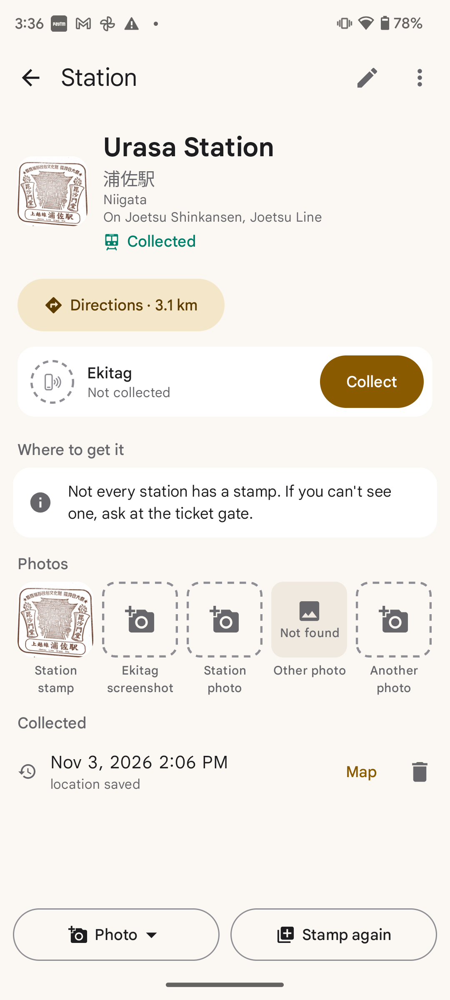</p>

*Figure 6. The Station page for Urasa, top to bottom: the header (the stamp's picture, names, prefecture, lines, "Collected"), "Directions", the Ekitag with its own "Collect", "Where to get it", the photo squares for both, the stamp's find under "Collected", and "Photo" and "Stamp again" at the bottom.*

**Top bar.** "Back" (icon); the category name as the title (your own category by its own name); "Edit details" (icon, a pencil), which opens the Edit details sheet; "More options" (icon, three dots), shown for an item you added or one you have collected. Its menu has "Remove item" for an item you added ("Remove this item?", "It leaves Meguri with its finds and photos. Photos you took with the camera stay in your gallery."), or "Remove from my collection" for a catalogue item ("Remove from your collection?", "Every find of it and their photos leave Meguri; it goes back to not collected. Photos you took with the camera stay in your gallery."). Each asks first, with "Cancel" and "Remove" (`ui/ItemScreen.kt`, `data/CollectionRepository.kt` `removeItem`). (Figure 7)

<p>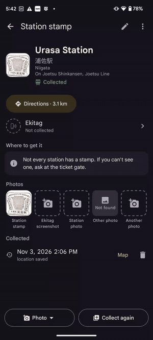</p>

*Figure 7. "More options" (three dots) on a collected catalogue item, then "Remove from my collection", which asks first. Here "Cancel" was chosen, so nothing changed.*

**Header.**
- The item's mark, 64 dp. When it has a picture (your photo or a downloaded card picture), tap it to open the picture full screen (`ui/ItemScreen.kt:127-136`).
- The name. A manhole card shows its design as the title and the place and code under it (section 3.5). In English mode the Japanese name follows in grey.
- A grey line: code · prefecture · town (the town in Japanese mode only, and only when it differs from the name).
- For cards with a series: "Wave %1$s · %2$s" (series and release date) or "Wave %1$s".
- For stations on lines: "On %1$s" (the line names).
- The category icon and the state: "Collected" in the category colour, "No stamp here" / "None here", or "Uncollected".

**Directions.** A tonal button "Directions · %1$s" (with the distance), or "Directions" when the distance is unknown. Shown when the item has a position and you are not already within 25 m of it (`ui/ItemScreen.kt:223-238`). Tap: section 3.11.

**Station page** (a station stamp whose station has an Ekitag, since 0.5). The stamp and its Ekitag share one page: opening either, from a pin, a tile, search or the timeline, shows the station (title "Station"). Under Directions, an Ekitag section shows the Ekitag's mark, "Collected" or "Not collected", and its own "Collect" / "Collect again"; the Ekitag's finds follow under it. The photo grid holds both: an "Ekitag screenshot" goes on the Ekitag, every other photo on the stamp. The bottom button is the stamp's: "Collect stamp" / "Stamp again" (`ui/ItemScreen.kt`, `stationPair` in `ui/NearbyScreen.kt`).

<p>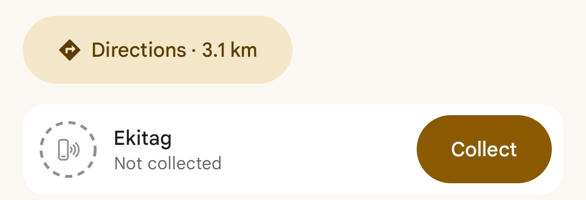</p>

*Figure 8. The Ekitag on the Station page: its mark, "Not collected", and "Collect". Once collected it reads "Collected" and "Collect again", and its finds appear under it.*

**None here** (uncollected items only, `ui/ItemScreen.kt:443-464`).
- Not marked: text button "No stamp here?" or "None here?". Tap: marks the place as checked and empty, with today's date.
- Marked: "No stamp here · checked %2$s" (or "None here · ...") and "There is one", which clears the mark.

**"Where to get it"** (shown when there is anything to show). One card of rows (`ui/ItemScreen.kt:277-309`):

| Row | Label by category | Value |
|---|---|---|
| Hours | "Hours" (manhole and dam cards, roadside, museum, your own); "Office hours" (goshuin); "Stamp location" (station stamp, Ekitag) | Hours and closed days, as in the catalogue |
| Place | "Handed out at" (manhole and dam cards); "Shrine or temple office" (goshuin); "Station" (station stamp, Ekitag); "Where" (roadside, museum, your own) | Place name (when it differs from the item's name) and address |
| Phone | "Call" | The number in the gold colour. Tap: opens the phone's dialler with it filled in |
| Notes | none | The item's notes. The catalogue's two generated station notes are replaced by "Not every station has a stamp. If you can't see one, ask at the ticket gate." (Japanese in Japanese mode) (`ui/Format.kt:125-140`) |
| Offline map | none | "The map for this place is not saved on this phone, so it needs internet here." when the item lies outside the offline pack |

A row with no value is not shown.

**"Photos".** A grid of squares, up to four to a line (`ui/FindPhotos.kt:104-212`):
- One square per photo kind for the category, filled with the first photo of that kind, or dotted with a camera and the kind's name.
- Then any other photos, then a dotted "Other photo" square.
- The display picture's label ends with " ★".
- Tap a dotted square: the dialog "Add: %1$s" with "Take a photo", "Choose from the gallery" and "Cancel".
- Tap a photo: a dialog titled with the photo's kind, such as "Station stamp": (Figure 9)
  - The photo at card size, whole. Tap it, or "View full screen" (icon), for the full-screen viewer.
  - "Type": a drop-down of the kinds for this category plus "Other photo".
  - "Use as display picture" or "Stop using as display picture". Either closes the dialog. With no display picture chosen, the photo shown by default (the newest) says "This is the display picture for now: with none chosen, the newest photo is shown." and its button reads "Keep as display picture".
  - "Done": saves a changed kind and closes.
  - "Remove photo" (red): asks first ("Remove this photo?"), then removes the photo and Meguri's copy. A long press shows "Removes Meguri's copy. A photo you took with the camera stays in your gallery."

<p>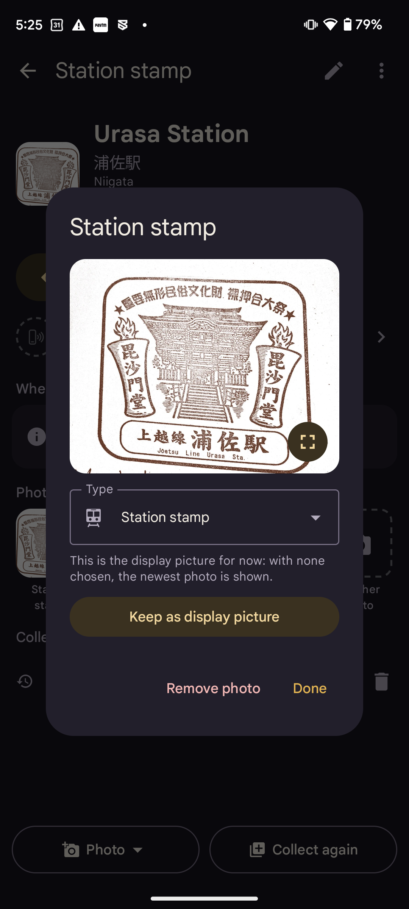</p>

*Figure 9. Tapping the station stamp photo. The dialog is titled with the photo's kind and shows the whole photo, its "Type", the line saying it is the display picture for now, "Keep as display picture", "Remove photo" and "Done".*

Photo kinds by category (`ui/FindPhotos.kt:68-95`):

| Category | Kinds, in order |
|---|---|
| Station stamp, Ekitag | "Station stamp", "Ekitag screenshot", "Station photo" |
| Manhole card | "Card", "Manhole cover", "Where you got it" |
| Goshuin | "Goshuin", "Shrine or temple" |
| Dam card | "Card", "Where you got it" |
| Museum stamp, roadside station | "Stamp", "Where you got it" |
| Your own | "The item", "Where you got it" |

Every category also has "Other photo".

**"Collected"** (shown when the item has finds). One row per find, newest first (`ui/ItemScreen.kt:336-436`):
- The date and time of the find; for a find had before Meguri, "Added %1$s" with the day it was added; else a dash (`no_date`). Then "×%1$d" when more than one, and the price as "¥500" when noted.
- "location saved" once a position is stored; "finding position…" for up to 2 minutes after the find while none is stored yet.
- The find's notes, if any.
- "Map" (text button), when the find has a position. Tap: opens the maps app at the find's position (`geo:`).
- "Remove the collection from %1$s" (icon, a bin). Tap: the dialog "Remove this collection?" with "This removes the collection from %1$s. If it is the only one, the item goes back to Uncollected. Its photos leave Meguri; ones you took with the camera stay in your gallery.", "Remove" (red) and "Cancel". For a find had before Meguri, "Remove" removes every had-before-Meguri find of the item (`data/CollectionRepository.kt:199-203`).
- Tap the row: the dialog "This collection" with "How many" and the buttons "One fewer" and "One more" (icons; 1 to 99), and, for goshuin and your own categories with "Note what I paid", "What you paid" in yen. "Done" saves; "Cancel" closes.

**Bottom buttons.**
- Outlined "Photo" with a drop-down arrow. Tap: a sheet "Add a photo" listing the kinds for this category and "Other photo". Tap one: the dialog "Add: %1$s" with "Take a photo", "Choose from the gallery" and "Cancel".
- "Collect" (filled, when uncollected) or "Collect again" (outlined, when collected). Tap: a firmer vibration, a new find now, and the "Collected" snackbar with "Undo" (section 3.1).
- Adding a photo to an uncollected item collects it first, then adds the photo (`ui/ItemScreen.kt:107-123`). New photos go on the newest find.
- On this page the snackbar sits 72 dp higher, above these buttons (`ui/App.kt:210-211`).

**Edit details sheet** (`ui/ItemEdit.kt`).
- Title "Edit details".
- Fields "Name in Japanese", "Name in English", "Where to get it", "Address", "Hours" (several lines), "Notes" (several lines).
- "Position on the map", with the position as "lat, lng" or "Not set". An error line shows in red under it when a lookup fails.
- "Use where I am": takes your current position, or shows "No position yet."
- "Google Maps link" and "Read": reads a place from a pasted link, opening a short link online first, or shows "That link has no place Meguri can read (a short link needs the network once)." (`ui/MainViewModel.kt:270-277`).
- "Search for the place" and "Find": looks the text up on OpenStreetMap, or shows "Nothing found." Up to five results; tap one to take its position (and its name for an empty "Where to get it").
- "Cancel" and "Save" ("Save" needs a Japanese name).
- "Your changes stay when the catalogue is updated."

Saving marks the item as edited. From then on a catalogue load leaves the whole item as it is, not only the fields you changed (`data/CatalogAndBackup.kt:180-181`).

**Back.** Goes to the page the item was opened from.

### 2.11 Photo viewer

Two views of one picture, used on the item page, in the photo dialog and in the scan result (`ui/PhotoViewer.kt`).
- **Card size.** The whole photo on black, up to 420 dp tall, read at 1200 px. A spinner while loading; a grey picture icon if it cannot be read. Tap the photo or "View full screen" (icon, bottom right) for full screen.
- **Full screen.** The photo on black over the whole screen, at the stored copy's full size (3000 px on the long side). Pinch to zoom from 1 to 6 times; drag to look around while zoomed; double-tap to zoom to 2.5 times, or back. "Close" (icon) at the top right, or Back, closes it.

### 2.12 My book

**How you get there.** "My book" in the bottom bar; "Go to My book" at the end of the onboarding (route `book`, `ui/BookScreen.kt`, `ui/ProfileScreen.kt`). (Figure 10)

<p>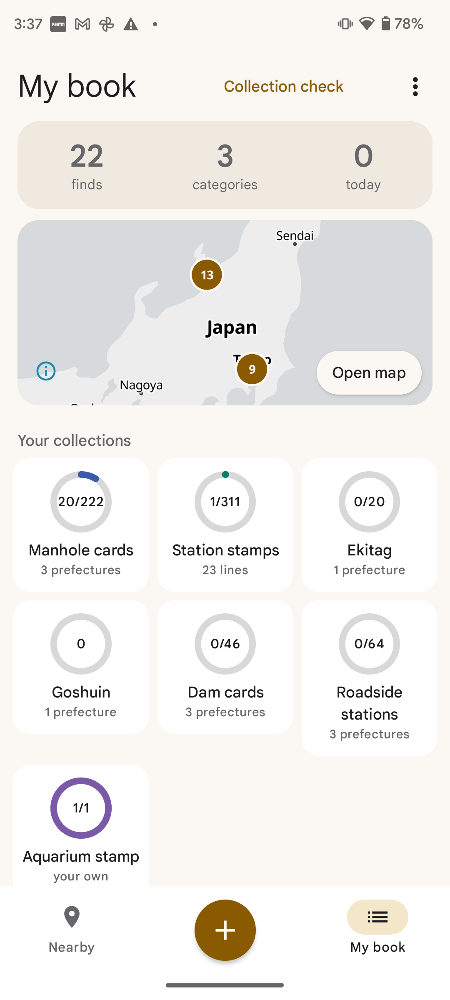</p>

*Figure 10. My book: the totals (finds, categories, collected today), the small map, and one tile per collection with how many you have of how many.*

**Top row.**
- "My book" as the title.
- Text button "Collection check", shown while any catalogue item is uncollected. Tap: opens Collection check (section 2.17).
- "Menu" (icon, three dots). Tap: a menu with "Trip" (Trip page), "Collection check", "Settings" (Settings page) and "Logs" (Logs page). (Figure 11)

<p>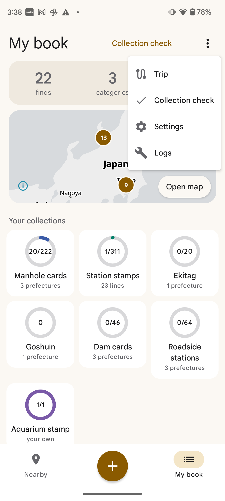</p>

*Figure 11. The menu under the three dots on My book: "Trip", "Collection check", "Settings" and "Logs".*

**Totals card** (`ui/ProfileScreen.kt:41-100`), three numbers:
- "find" / "finds": the number of finds (each time you collected something; "How many" is not added in).
- "category" / "categories": collections started. Not confirmed from code that this is the intended meaning: it counts collection groups with at least one find (each prefecture of manhole cards, each railway line, other stations, goshuin, dam cards, museum stamps, roadside stations), not categories, and leaves out your own categories and Ekitag (`ui/ProfileScreen.kt:75`, `ui/MainViewModel.kt:366-393`).
- "today": items whose newest find is today, not counting things marked had before Meguri.

**Small map** (when anything is collected). A 170 dp map of everything collected, which cannot be moved. "Open map" (bottom right) or a tap on the map opens "Where you collected" (section 2.20). Tapping a pin on this small map does nothing.

**"Your collections".** One tile per category you have anything of, three to a row, in the order manhole cards, station stamps, Ekitag, goshuin, dam cards, roadside stations, museum stamps, then your own categories, oldest first (`ui/BookKinds.kt:68`, `ui/BookKinds.kt:78-87`). Each tile:
- A progress ring in the category colour, with "collected/total" inside, or the count alone for goshuin and museum stamps (a full ring once you have one).
- The category's plural name.
- "%d line(s)" (station stamps), "your own" (your categories), or "%d prefecture(s)".
- Items marked "None here" are left out of the counts.
- Tap: opens the category page.

**"Timeline".** A row "Timeline", "Everything you collected, by day". Tap: opens the Timeline.

**Empty.** With no items at all: "Nothing logged yet. Tap + to log your first find."

**Back.** Goes to Nearby.

Not confirmed from code: `ui/BookScreen.kt:71-210` also holds a "marking" mode (a long list with checkboxes and "Mark %1$d as collected"). Nothing sets it on, so it never shows (section 3.21).

### 2.13 Category page

**How you get there.** Tap a tile under "Your collections" on My book (route `kind/{key}`, `ui/BookKinds.kt:186-253`).

**What is on it.**
- "Back" (icon), and the category's plural name or your category's name as the title.
- A small map of what you collected in this category, when anything. A tap opens "Where you collected", which shows every category, not only this one (`ui/BookKinds.kt:211`).
- The category's collections, two to a row: station stamps by line (a station on two lines counts on both; stations on no line last as "Other stations"); everything else by prefecture ("No prefecture" last); your own category as one group. Each tile has a 64 dp progress ring, the title, and "Next: %s" with the nearest uncollected one in it when your position is known. Tap: opens the line's stamp book (section 2.15) or the collection page (section 2.14).
- "Recently collected": up to 20 collected items, newest first, in a row you can scroll sideways. Tap one: its item page.

### 2.14 Collection page (one prefecture, or one of your categories)

**How you get there.** Tap a prefecture tile, or your own category's tile, on a category page (route `group/{kind}/{group}`, `ui/BookKinds.kt:270-317`).

**What is on it.**
- "Back" (icon), and the title "prefecture · category" (for example "Niigata · Manhole cards"), or your category's name.
- Two chips, "Have" and "To get", both on to start with. Tap to switch one off or on. The last one on cannot be switched off.
- A grid of round tiles (64 dp), ordered by card code or name, with short names (a manhole card drops the part in brackets, section 3.5) and distances. Items marked "None here" are faded. Tap: item page.

### 2.15 Line stamp book

**How you get there.** Tap a line on the station stamps category page (route `line/{id}`; "Other stations" uses the id `_other`) (`ui/BookScreen.kt:286-357`).

**What is on it.**
- "Back" (icon) and the line's name (or "Other stations").
- "Station stamps · x / y".
- "Nearest uncollected: %2$s · %1$s" (distance, then the station), when your position is known.
- The stations in line order, three to a row (two with large text). Each shows its mark at 72 dp, the name without "駅" or " Station", and the date collected, or the distance. The nearest uncollected station has a solid dark ring and a bold name.
- "Other stations" lists station stamps on no line, by Japanese name.
- Tap a station: its item page.

### 2.16 Timeline

**How you get there.** "Timeline" on My book (route `timeline`, `ui/Timeline.kt`).

**What is on it.**
- "Back" (icon) and "Timeline".
- Empty: "Nothing with a day yet. Each find you log keeps its day; things you had before the app have none."
- One block per day, newest first. The day header shows the full date and "%d find(s)" (finds, not quantities). Tap the header: opens the Trip report.
- Under each header, that day's finds, newest first: the mark, the name, the category, and the time (HH:mm). Finds made with "Already went" have no time shown (`data/TripReport.kt:28-32`). Tap: item page.

Not confirmed from code: tapping a day header opens the Trip report on the newest day, not the day tapped, because the day is not passed (`ui/Timeline.kt:74`).

### 2.17 Collection check, and Already went

Two screens share a route family: Collection check is a card deck (`ui/CollectionDeck.kt`); Already went keeps a page of tiles (`ui/CollectionCheck.kt`).

**How you get there.**
- "Collection check": the text button on My book, or "Collection check" in the My book menu (route `check`).
- "Already went": the button on the Trip page (route `trip-check`). It shows only what today's route counts (`ui/App.kt`).

**Collection check: three steps.**

**Step 1, categories.** Intro: "Choose a category, then a prefecture. Then swipe right for each one you have, left to skip." One row per category that has catalogue items: Manhole cards, Station stamps, Ekitag, Goshuin, Dam cards, Museum stamps, Roadside stations, then your own categories. Each row shows its icon, its name, "%d to check" and "have / total". Tap a row for step 2. (Figure 12)

<p>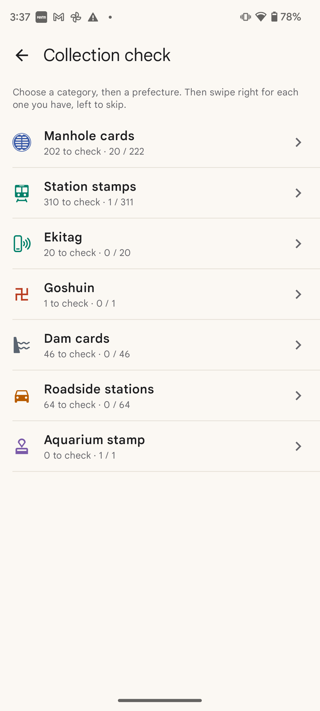</p>

*Figure 12. Step 1: every category with how many are left to check and how many you have.*

**Step 2, prefectures.** "Choose a prefecture." One row per prefecture with the same counts ("No prefecture" for items without one). Tap a row for step 3. (Figure 13)

<p>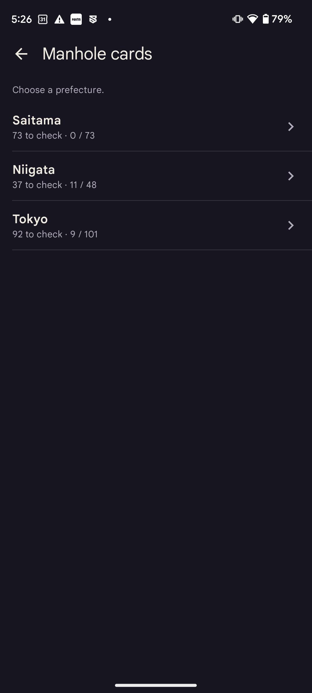</p>

*Figure 13. Step 2, for Manhole cards: each prefecture with what is left to check and what you have (Niigata: 37 to check, 11 of 48).*

**Step 3, the deck.** The title reads "<category> · <prefecture>"; under it, "%d to check". One card at a time, in code order, only what you don't have yet: (Figure 14)

<p>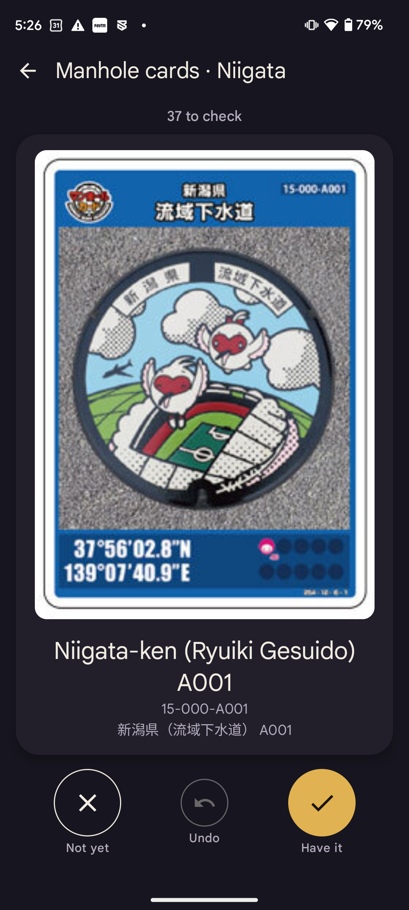</p>

*Figure 14. Step 3, the deck: one card at a time, the whole card large, with "Not yet", "Undo" and "Have it" under it.*

- A manhole card with a downloaded picture shows the whole card, as large as fits, in colour. Anything else shows its category seal.
- Under the picture: the name (for a manhole card, the design as title and place and code under it), the Japanese name in English mode, and the municipality.
- Swipe right, or tap "Have it": the item is saved as had before Meguri (no date, no place) and the next one shows. While dragging right, a "Have it" label in the category colour fades in.
- Swipe left, or tap "Not yet": nothing is saved; the next one shows. While dragging left, "Not yet" fades in. (Figure 15)
- A short drag springs back.
- "Undo" takes back the last swipe: a saved one is taken off again. Undo history lasts while the Collection check screen is open, including after going back to the prefecture list and opening another.

<p>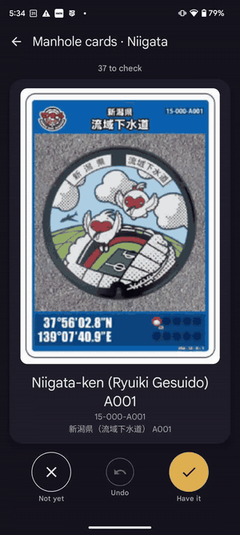</p>

*Figure 15. Swiping a card left skips it ("37 to check" becomes 36), and "Undo" brings it back. A left swipe saves nothing.*

- When the pile is empty: "All checked" and "Choose another prefecture". If you already have every one: "You have them all".
- "Back" (icon or the system Back) goes deck, then prefectures, then categories, then out.
- The pile is fixed when the deck opens, so saving one does not reshuffle the rest.

**Already went** (unchanged).
- A date chip at the top right, today to start with. Tap: a date picker where future days cannot be chosen.
- Hint: "Tick what you got along this route. They are saved on the day at the top."
- Pages, one per group, swiped left or right; a grid of marks with short names (a manhole card reads "Saitama-ken A001"). Tap an uncollected item to tick it; tap again to untick.
- Button "Add %d to my collection": makes a find for each ticked item on the chosen day, at noon, with no place or photo. The snackbar "Added %1$d to your collection" offers "Undo".

### 2.18 Trip

**How you get there.** "Trip" in the My book menu (route `trip`, `ui/TripScreen.kt`). A trip is one day. The plan is kept for today only and forgets itself after 23:59 (`data/TripStore.kt:11-36`). (Figure 16)

<p>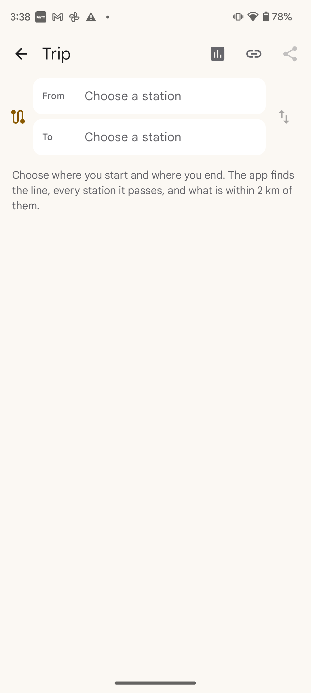</p>

*Figure 16. Trip with no plan yet: "From" and "To", the swap button, and Trip report, a Google Maps link and Share in the top bar.*

**Top bar.**
- "Back" (icon), title "Trip".
- "Clear the plan" (icon, a cross), shown once either end is set. Tap: clears both ends and today's saved plan. Proximity mode, if on, keeps running.
- "Trip report" (icon). Tap: opens the Trip report.
- "Paste a Google Maps link" (icon). Tap: opens the link dialog.
- "Share trip" (icon), enabled when there is a route. Tap: shares the plan as text (below).

**Ends.**
- "From" and "To", each showing a station or "Choose a station". Tap: opens the station picker.
- "Swap start and end" (icon), enabled once either end is set.

**Station picker.** A dialog "Choose a station" with a field "Station name" and "Clear search" (icon). It lists every station on the lines in the app: name, the name in the other script, and the distance from you. Exact names come first, then names that start with the text, then others, each by distance (`ui/TripScreen.kt:374-425`). Tap a station: sets that end. Choosing the station at the other end swaps the two. "Cancel" closes.

**Choosing a route** (section 3.17).
- Chips "Shinkansen" and "Local lines" appear when a route with the Joetsu Shinkansen and one without it both exist and differ.
- Without both ends: "Choose where you start and where you end. The app finds the line, every station it passes, and what is within 2 km of them."
- With no route: "These two stations are not joined by the lines in the app."

**With a route, top to bottom.**
- A 200 dp map with the route as a gold line and pins for what is near it. Tap a pin: item page.
- "%1$d stations · %2$d to collect", and the outlined button "Already went" (section 2.17).
- The stops in order, on a drawn line with a dot for each station (larger and filled where you get off):
  - The station's name, bold for the two ends and where you get off. When the station's own stamp is listed, a line under it: its category, then "Collected" with a check, or "if you get off" while it would not count. Tap the name: opens the station's item page.
  - Chip "Get off" (walking icon), read as "Get off at %1$s". Tap to mark or clear. Both ends start marked.
  - "Change to %1$s" where you change lines.
  - Each thing within 2 km of this station (listed once, at its nearest station on the route): mark, name, then category, distance (from 25 m) and "if you get off" when it does not count. Faded when it does not count. A check when collected. Tap: item page.
- When Proximity mode is on: "Proximity mode is on until %1$s: it tells you where to get off next and what is close."
- Button "Start trip" or "Stop trip". "Start trip" asks for location (and notifications) if needed and starts Proximity mode until 23:59 (section 4.1). "Stop trip" stops it.

**Link dialog "Paste a Google Maps link".**
- A field "A directions link from Google Maps: Share, or the address bar", filled from the clipboard when it holds a web address.
- "Read link" (a spinner while reading) and "Cancel".
- Errors under the field: "That is not a Google Maps directions link.", "A short link needs the internet once. Try again online, or paste the long link from the address bar.", "The link has no start or end that matches a station on the lines in the app."
- On success the ends are set, and a snackbar may say "%1$s is the nearest station on the lines in the app, %2$s from the place in the link." (an end more than 3 km from its station) and "The link is for %1$s; the app plans the train between the two stations." (a link for walking or driving) (`ui/TripScreen.kt:253-270`).

**Shared text** (`ui/TripScreen.kt:479-510`), for example:

```
Trip: Urasa → Niigata
Lines: (line names, joined by " → ")
Get off at: Urasa, Niigata

To collect within 2 km of the line:
· Urasa: (items, with distance from 25 m)

Directions: https://www.google.com/maps/dir/?api=1&origin=...&destination=...&travelmode=transit
```

With nothing left: "Nothing left to collect along the line." The text goes to Android's share chooser, titled "Share trip".

**Back.** Goes to My book.

### 2.19 Trip report

**How you get there.** "Trip report" (icon) on the Trip page, or a day header on the Timeline (route `trip-report`, `ui/TripReportScreen.kt`). (Figure 17)

<p>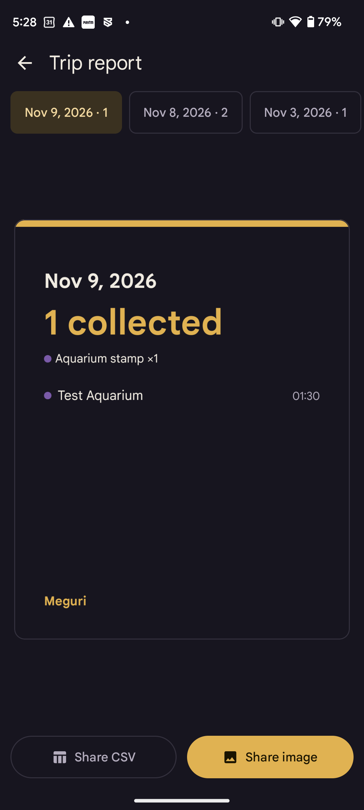</p>

*Figure 17. Trip report: one chip per day with how many were collected; the day's card lists each item with its time; "Share CSV" and "Share image" at the bottom.*

**What is on it.**
- "Back" (icon) and "Trip report".
- Empty: "Nothing collected on a known day yet. Each find you log keeps its day; things you had before the app have none."
- A row of day chips, "date · n" (n finds), newest first. The newest day is chosen to start with. Tap a chip to choose that day.
- A preview of the report image, 9:16.
- "Share CSV" (outlined) and "Share image". Each opens Android's share chooser.

**The image** (1080 × 1920 px, in the current theme's colours, `ui/TripReportScreen.kt:200-271`): a gold band at the top; the date; the route ("From → To") when today's plan is for that day; "%1$d collected" (quantities added up) in large gold type; one coloured dot and "category ×n" per category; up to six photos in a 3 × 2 grid; up to ten finds with their times; "+%1$d more"; and "Meguri" at the bottom.

**The CSV** (`data/TripReport.kt:38-53`): a header row `date, time, type, collection, name_ja, name_romaji, code, prefecture, quantity, cost_yen, lat, lng`, then one row per find, in the phone's time zone. The file starts with a byte-order mark so spreadsheet apps read Japanese as UTF-8.

**Files.** `meguri-trip-YYYY-MM-DD.png` and `.csv`, written to the app's cache folder `shared/` and shared read-only through the app's file provider (`ui/TripReportScreen.kt:273-294`, `app/src/main/res/xml/shared_files.xml`).

### 2.20 Map: "Where you collected"

**How you get there.** "Open map" or a tap on the small map on My book or a category page (route `map/COLLECTED`, `ui/MapScreen.kt:91-139`).

**What is on it.**
- A full-screen map with a pin for everything you have collected, framed to fit.
- At the top left, a pill with "Back" (icon) and the title "Where you collected".
- Tap a pin: the pin card (section 2.3). As everything here is collected, the card has no "Collect" button.

The route also accepts `ALL`, `STAMPS`, `CARDS` and `MINE`, titled "Map", "Stamps on the map", "Cards on the map" and "Categories". Nothing in the app opens them (section 3.21).

### 2.21 Settings

**How you get there.** "Settings" in the My book menu (route `more`, `ui/MoreScreen.kt`). Also "I have a catalogue file" in the onboarding.

**Work started here.** Backups, restores, catalogue loads and card picture downloads started from Settings run in the Settings page's own scope (`ui/MoreScreen.kt:87`). Not confirmed from code, but likely: leaving Settings while one runs stops it, and its result message is not shown. Weekly backups and "Back up now" on the Weekly backup page run as background jobs and are not affected.

**How its pages work.** Settings is one route. Its sub-pages are states of that page, not routes of their own (`ui/MoreScreen.kt:288-289`). The title at the top changes to the sub-page's name. "Back" (icon, top left) and the system Back both go up one level, as below (`ui/MoreScreen.kt:637-644`); on the top list they leave Settings.

| Sub-page | Back goes to |
|---|---|
| "Appearance", "Alerts", "Backup and data", "Catalogue", "Help and about" | Settings list |
| "Alert categories" | "Alerts" |
| "Weekly backup", "Photos kept in Meguri", "Categories" | "Backup and data" |
| "Installed catalogues" | "Catalogue" |
| "About" | "Help and about" |
| "Map and data sources", "Fonts and icons", "Third-party licences", "Privacy" | "About" |

#### 2.21.1 Settings list

Title "Settings". Five rows, each with a round icon badge, a bold name, a grey line saying what is set now, and an arrow (`ui/MoreScreen.kt:334-386`). (Figure 18)

<p>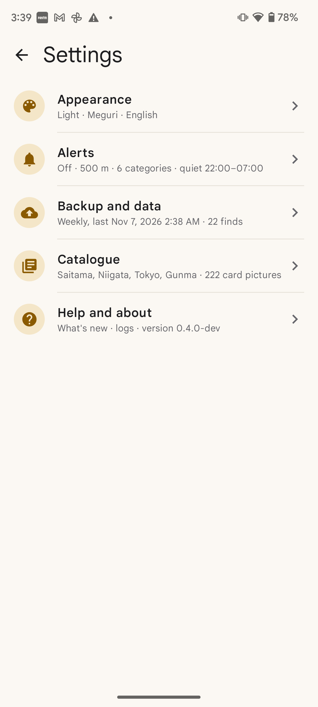</p>

*Figure 18. Settings: five rows, each with a grey line saying what is set now.*

| Row | Grey line |
|---|---|
| "Appearance" | Theme · colours · language, for example "Phone · Meguri · English" |
| "Alerts" | "Always", "While travelling" or "Off" · the default distance · "%1$d categories" · "quiet 22:00–07:00" when quiet hours are on |
| "Backup and data" | "Weekly backup off · %1$s" (finds), "Weekly, last %1$s · %2$s" (date and finds), "The last backup failed. Tap to pick the folder again.", or "On. The first backup is on its way." |
| "Catalogue" | The loaded prefectures, and "%1$d card pictures" when any; with neither, "Niigata, Saitama and Tokyo built in · card pictures · load a CSV for more" |
| "Help and about" | "What's new · logs · version %1$s" |

Tap a row to open its page.

#### 2.21.2 Appearance

<p>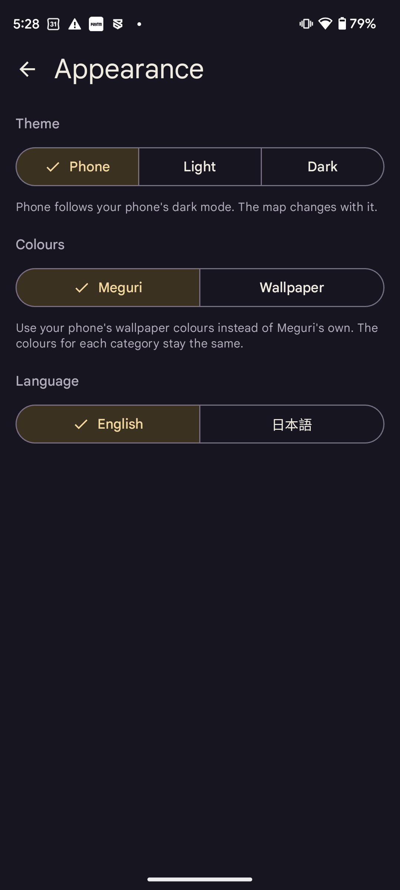</p>

*Figure 19. Appearance: Theme, Colours and Language, each a one-tap choice with the current one ticked.*

- "Theme": "Phone", "Light", "Dark". "Phone follows your phone's dark mode. The map changes with it." The status bar and navigation bar icons follow the chosen theme (`ui/Theme.kt:192-216`). (Figure 19)
- "Colours" (Android 12 and later only): "Meguri", "Wallpaper". "Use your phone's wallpaper colours instead of Meguri's own. The colours for each category stay the same."
- "Language": "English", "日本語".
  - Android 13 and later: switches the app's language at once (`ui/AppLanguage.kt:22-26`).
  - Android 10 to 12: opens the phone's language settings, with the note "On this Android version the language is set in your phone's settings. Tapping opens them."

Each choice is one tap and is saved at once (section 5.1).

#### 2.21.3 Alerts

(`ui/AlertsSection.kt:98-251`)

<p>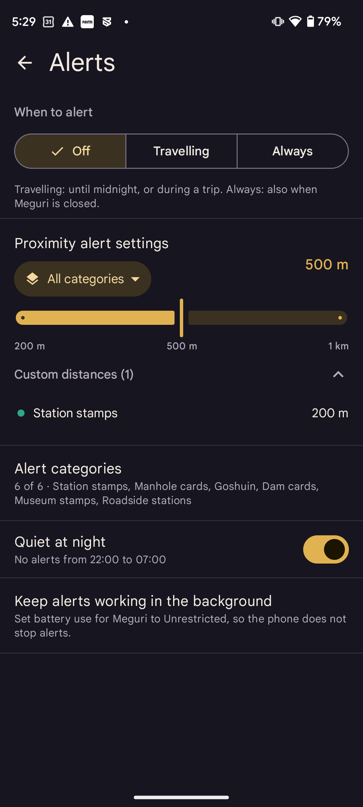</p>

*Figure 20. Alerts, top to bottom: "When to alert", then Proximity alert settings with the "All categories" menu, the slider at 500 m and one custom distance (Station stamps, 200 m), then Alert categories, Quiet at night and Keep alerts working in the background.*

**"When to alert"**: "Off", "Travelling", "Always". (Figure 20)
- "Off": stops Proximity mode and removes the background alerts.
- "Travelling": switches background alerts off if they were on, asks for location (and notifications on Android 13 and later), then starts Proximity mode until 23:59 (section 4.1).
- "Always": needs Google Play services. Without them nothing changes, and the line under says "Not available on this phone (no Google Play services). Use Proximity mode." Without location it asks for location first, then for "Allow all the time". With location but not all the time, it shows the dialog "Allow location all the time?", "Android asks on a separate page. Choose "Allow all the time" so alerts can come while the app is closed. Meguri never sends your location anywhere.", with "Continue" (opens Android's page) and "Cancel". Once allowed, background alerts (geofences) switch on. A running Proximity mode stays on, so a planned trip keeps its "get off next" line.

The mode shown is "Always" when background alerts are on, else "Travelling" while Proximity mode runs, else "Off" (`ui/AlertsSection.kt:145`).

**Status line** under the choice. A red line can be tapped to fix the problem.

| Situation | Line | Tap |
|---|---|---|
| Proximity mode refused for lack of location | "Proximity mode needs location access." | Asks again |
| "Always", not ready | "Needs location set to "Allow all the time". Tap to allow it." | Opens the "Allow location all the time?" dialog |
| "Always", Google Location Accuracy off | "Not working: Google Location Accuracy is off. Tap to open Location settings, then turn on Location services › Location Accuracy." | Opens location settings |
| "Always", another registration error | "Not working right now. Tap to try again." | Registers again |
| "Always" and Proximity mode | "Tells you when you are near something uncollected, even with Meguri closed. On until %1$s. Turn it off here or from its notification." | |
| "Always" | "Tells you when you are near something uncollected, even with Meguri closed." | |
| "Travelling" | "On until %1$s. Turn it off here or from its notification." | |
| No Play services | "Not available on this phone (no Google Play services). Use Proximity mode." | |
| "Off" | "Travelling: until midnight, or during a trip (Proximity mode). Always: also when Meguri is closed." | |

When alerts are on but notifications are off: a red line "Notifications are off for Meguri. Alerts need them: tap to turn them on." Tap: opens the app's notification settings.

**"Proximity alert settings"** (`ui/AlertsSection.kt:354-470`).
- A pill under the title: "All categories" (a layers icon) or one category (its dot), with a drop-down arrow. Tap: a menu of "All categories" and the six alerting categories. The chosen line is highlighted, and a category with its own distance shows it on the right.
- The distance now set, in gold, on the right.
- A slider with three stops, "200 m", "500 m", "1 km". Moving it sets the default distance (with "All categories") or the chosen category's own distance. The slider is kept out of the phone's back-swipe edge. (Figure 21)

<p>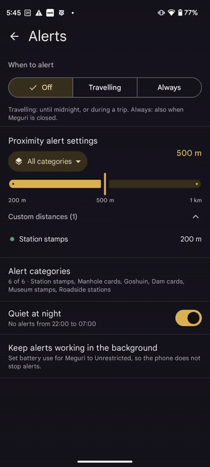</p>

*Figure 21. Dragging the slider from 500 m to 1 km and back; the distance above it follows.*

- With one category chosen: "Custom distance. The other categories use the default." and "Revert to default", or "Uses the default. Move the slider to set a custom distance."
- "Custom distances (%1$d)", when any category has its own distance, with "Hide custom distances" / "Show custom distances" (icon, an arrow). The list shows each such category and its distance; tap one to choose it in the pill.
- Station stamps start with their own 200 m, so this list shows one line on a new install (`alerts/AlertSettings.kt:110-111`).

**"Alert categories"** row, with "%1$d of %2$d" and the names switched on. Tap: opens the Alert categories page.

**"Quiet at night"** switch, "No alerts from 22:00 to 07:00". On to start with.

**"Keep alerts working in the background"**, with "Set battery use for Meguri to Unrestricted, so the phone does not stop alerts." (on Samsung phones: "Set battery use for Meguri to Unrestricted and keep it out of Sleeping apps, so the phone does not stop alerts."). Tap: opens the app's page in Android settings.

Each change re-registers the background alerts (section 4.1).

#### 2.21.4 Alert categories

(`ui/AlertsSection.kt:279-311`)
- Six rows, each with the category's dot, its name and a switch: "Station stamps" (with "Only where you get off today"), "Manhole cards", "Goshuin", "Dam cards", "Museum stamps", "Roadside stations". All on to start with. Tap the row to switch.
- Note: "Station stamps alert only at stations you get off at in today's trip (menu, Trip). Riding through a station never alerts, and with no trip planned there are no station alerts."

Ekitag and your own categories are not listed and never alert (`ui/AlertsSection.kt:274-277`).

#### 2.21.5 Backup and data

(`ui/MoreScreen.kt:463-499`)

<p>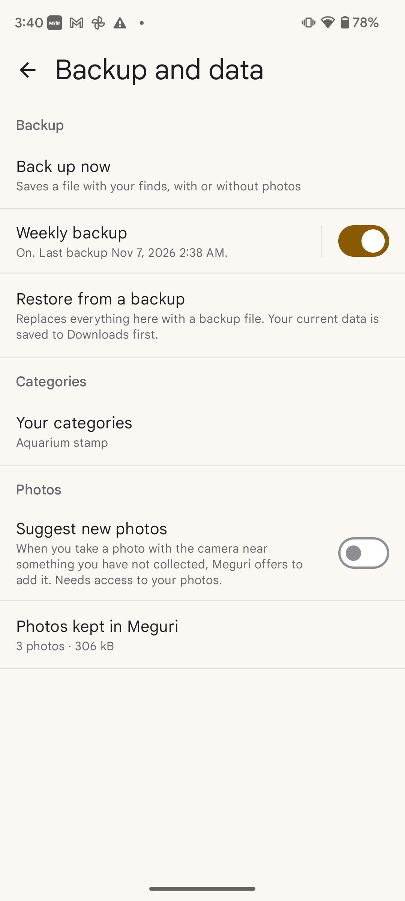</p>

*Figure 22. Backup and data: Backup (Back up now, Weekly backup with its switch, Restore from a backup), your categories, and Photos (Suggest new photos, Photos kept in Meguri).*

**"Backup"** (Figure 22)
- "Back up now", with "Saves a file with your finds, with or without photos". Tap: a dialog, "Include your photos? The file is larger with them.", with "Cancel", "Without photos" and "With photos". Either choice opens Android's save dialog, named `meguri-backup-photos-YYYYMMDD-HHMM.zip` or `meguri-backup-YYYYMMDD-HHMM.zip`. Then a snackbar "Saved %1$s: %2$s" (file name and counts, such as "21 finds, 119 items"), "Backup saved: %1$s", or "Couldn't save the backup".
- "Weekly backup": the words, with the state line, open the Weekly backup page; the switch on the right, behind a thin line, turns it on or off. On opens Android's folder picker, starting in Documents; picking a folder turns it on and starts the first backup. Off stops it at once (`ui/MoreScreen.kt:474-476`, `data/AutoBackup.kt:68-90`).
- "Restore from a backup", with "Replaces everything here with a backup file. Your current data is saved to Downloads first." Tap: Android's file picker, then the restore dialog (below).
- "Find my photos again", with "Needs access to all photos, to match them to your finds.", shown only while photos from a restore still need finding. Tap: asks for photo access, then matches photos to gallery pictures (section 3.13).

**"Categories"**
- "Your categories", with their names, or "Categories you added yourself, and adding one". Tap: the Categories page.

**"Photos"**
- "Suggest new photos" switch, "When you take a photo with the camera near something you have not collected, Meguri offers to add it. Needs access to your photos." Turning it on asks for photo access, photo locations and notifications; it stays off unless photo access and photo locations are both allowed (`ui/AlertsSection.kt:253-271`).
- "Photos kept in Meguri", with "%1$d photos · %2$s" (count and size). Tap: the Photos kept page.

**Restore dialog** (`ui/MoreScreen.kt:717-744`).
- Title "Restore this backup?".
- "Backup from %1$s: %2$s" (the date and the backup's counts, for example "21 finds, 119 items, 4 photos").
- "On this phone now: %1$s".
- "Everything on this phone is replaced by the backup. A copy of the current data is saved to Downloads first."
- "Restore" (red) and "Cancel".
- When the backup has no finds but the phone has some: the title is first "This backup has no finds", with "Restoring it removes all of your finds. A copy of the current data is saved to Downloads first.", and the red button is "Continue". Only a second tap restores.
- When the backup holds photos and the app cannot see the gallery, "Restore" first asks for photo access; the restore goes ahead whatever the answer.
- Success: the toast "Restored: %1$s", and the app restarts from its first page.
- A file that cannot be restored leaves the data unchanged, with a snackbar: "That file isn't a backup from this app. Your data is unchanged.", "That backup is from a newer version of the app. Update the app first. Your data is unchanged.", "That backup is damaged. Your data is unchanged.", or "Couldn't restore. Your data is unchanged."

#### 2.21.6 Weekly backup

(`ui/MoreScreen.kt:500-525`)
- "Weekly backup" switch, "Once a week Meguri saves a backup to a folder you choose, and keeps the last few." Same as the switch on Backup and data.
- When on:
  - "Folder", with the folder's name ("?" when unknown). Tap: pick another folder.
  - "Include photos" switch, "Bigger files, and the photos come back on a new phone". On to start with.
  - "Keep": "Last 2", "Last 4", "Last 8" ("Last 4" to start with). "Older backups are removed, unless the newest has fewer finds than the one before."
  - "Back up now", with the state line. Tap: starts a backup in the background, and the snackbar "Backing up…".

#### 2.21.7 Photos kept in Meguri

(`ui/MoreScreen.kt:526-547`)
- "…" while counting.
- "Meguri keeps its own copy of each photo you add, so it stays even if you delete it from the gallery. Backups with photos carry them to a new phone. %1$d photos, %2$s."
- "No photos yet. Photos you add to a find show here." when there are none.
- One heading per category (your own by name), and under it one line per photo kind: "%1$d photo(s) · size".
- "%1$d more photo(s) is/are a link to your gallery, from before Meguri kept copies." and "%1$d photo(s) can no longer be found." when there are any.

Nothing on this page can be tapped.

#### 2.21.8 Categories

(`ui/MoreScreen.kt:387-435`, `ui/CustomTypes.kt:164-244`)
- With none: "Categories you add yourself show here. Add one below, or from + then Add."
- One row per category of your own: its icon in its colour, its name, "Card", "Stamp" or "Other" and "%d item(s)", and an arrow. Tap: the edit dialog.
- "New category" (text button). Tap: the new category dialog.

**Category dialog**, title "New category" or "Edit category":
- "Name" (up to 40 characters). A name you already use (case ignored) shows "You already have a category with this name." and blocks saving.
- "Colour": six swatches, read as "Colour 1" to "Colour 6".
- "Icon": nine icons in the chosen colour (general, card, stamp, museum, dam, station, goshuin, manhole, Ekitag). The icon also decides whether the category is a card, a stamp or other (`ui/CustomTypes.kt:71-75`).
- "Note what I paid" switch. On to start with in this dialog.
- Editing a category that has items: "It has %1$d item(s). To remove the category, move or delete it/them first."
- "Remove" (red; editing only, and only when the category is empty), "Cancel", "Save".

#### 2.21.9 Catalogue

(`ui/MoreScreen.kt:548-575`)

<p>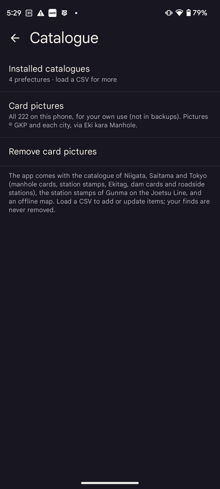</p>

*Figure 23. Catalogue: the installed prefectures, card pictures (all 222 on this phone) and "Remove card pictures".*

- "Installed catalogues", with "%1$d prefecture(s) · load a CSV for more". Tap: the Installed catalogues page. (Figure 23)
- "Card pictures", with one of:
  - "Downloading %1$d of %2$d…" while downloading;
  - "All %1$d on this phone, for your own use (not in backups). Pictures © GKP and each city, via Eki kara Manhole.";
  - "%1$d of %2$d on this phone. Tap to download the rest from the card site (Eki kara Manhole), for your own use: they stay on this phone, not in backups. Pictures © GKP and each city."

  Tap: downloads the missing pictures (section 3.14), then the snackbar "Card pictures: %1$d downloaded, %2$d not found". With every picture already there, a tap reports "Card pictures: 0 downloaded, 0 not found". A download keeps going while you move between Settings pages. Not confirmed from code, but likely: closing Settings stops it, since it runs in the Settings page's own scope (`ui/MoreScreen.kt:165-177`).
- "Remove card pictures", shown when any are on the phone and none are downloading. Tap: deletes them all at once, with no second question.
- Note: "The app comes with the catalogue and an offline map of Niigata, Saitama and Tokyo: manhole cards, station stamps, Ekitag, dam cards and roadside stations. Load a CSV to add or update items; your finds are never removed."

#### 2.21.10 Installed catalogues

(`ui/MoreScreen.kt:576-589`)
- One line per loaded prefecture: its name, and each category's plural name and count, such as "Station stamps 86 · Ekitag 20". These lines cannot be tapped.
- "Load catalogue (CSV)", with "Adds or updates items and railway lines. Your finds are never removed." Tap: Android's file picker, then a snackbar (section 3.16).

#### 2.21.11 Help and about

<p>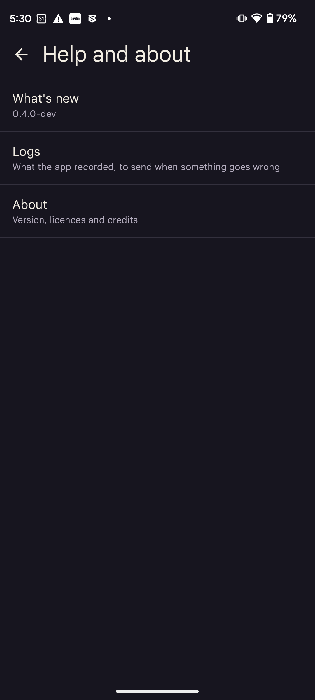</p>

*Figure 24. Help and about: What's new (with the version), Logs and About.*

- "What's new", with the version. Tap: the What's new dialog. (Figure 24)
- "Logs", with "What the app recorded, to send when something goes wrong". Tap: the Logs page.
- "About", with "Version, licences and credits". Tap: the About page.

#### 2.21.12 About

(`ui/MoreScreen.kt:595-627`, `ui/AboutPages.kt`)

<p>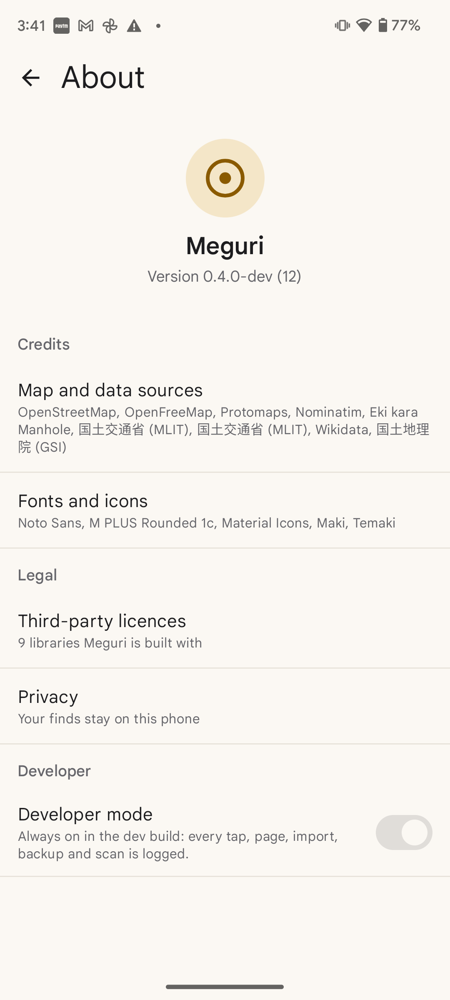</p>

*Figure 25. About: the icon, name and version, then Credits, Legal and Developer.*

- The app icon, "Meguri", and "Version %1$s" with the version and code, such as "Version 0.3.0-beta.9 (11)". Tap the version: copies it and shows "Version copied". (Figure 25)
- "Credits": "Map and data sources" (with the sources' names) and "Fonts and icons" (with their names).
- "Legal": "Third-party licences" ("%1$d libraries Meguri is built with", 9) and "Privacy" ("Your finds stay on this phone").
- "Developer": "Developer mode" switch, "Logs every tap, page, import, backup and scan, so a problem can be traced. Open them in Help and about, then Logs." In the dev build the switch is on and cannot be changed, with "Always on in the dev build: every tap, page, import, backup and scan is logged."

#### 2.21.13 Map and data sources, Fonts and icons, Third-party licences

Each is a list of credits (`ui/AboutPages.kt:43-142`). "Map and data sources" starts with "Where the map, places and catalogue come from. Tap a name to open its site, or the licence beside it."; "Third-party licences" with "Tap a name to open the project, or its licence." Each row shows the name in gold, what it is used for, and the site address. Tap the row: opens the site. Tap the licence button on the right: opens the licence. (Figure 26)

<p>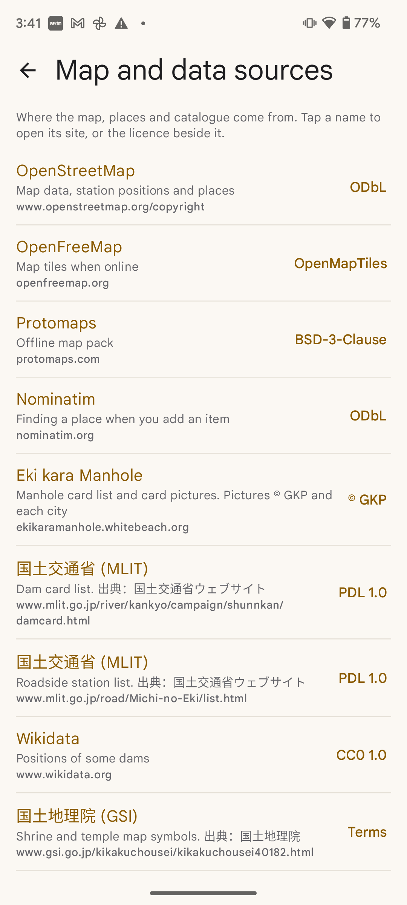</p>

*Figure 26. Map and data sources: each source with what it is used for and its licence; a name or a licence opens its page.*

| Page | Name | Used for | Licence button |
|---|---|---|---|
| Sources | OpenStreetMap | "Map data, station positions and places" | ODbL |
| Sources | OpenFreeMap | "Map tiles when online" | OpenMapTiles |
| Sources | Protomaps | "Offline map pack" | BSD-3-Clause |
| Sources | Nominatim | "Finding a place when you add an item" | ODbL |
| Sources | Eki kara Manhole | "Manhole card list and card pictures. Pictures © GKP and each city" | © GKP |
| Sources | 国土交通省 (MLIT) | "Dam card list. 出典：国土交通省ウェブサイト" | PDL 1.0 |
| Sources | 国土交通省 (MLIT) | "Roadside station list. 出典：国土交通省ウェブサイト" | PDL 1.0 |
| Sources | Wikidata | "Positions of some dams" | CC0 1.0 |
| Sources | 国土地理院 (GSI) | "Shrine and temple map symbols. 出典：国土地理院" | Terms |
| Fonts and icons | Noto Sans | "Map labels" | SIL OFL 1.1 |
| Fonts and icons | M PLUS Rounded 1c | "Names on Ekitag pictures" | SIL OFL 1.1 |
| Fonts and icons | Material Icons | "Icons across the app" | Apache 2.0 |
| Fonts and icons | Maki | "Map and category icons" | CC0 1.0 |
| Fonts and icons | Temaki | "Map and category icons" | CC0 1.0 |
| Licences | Jetpack Compose and Material 3 | "The app's screens" | Apache 2.0 |
| Licences | AndroidX (Activity, Lifecycle, Navigation) | "Screens, lifecycle and navigation" | Apache 2.0 |
| Licences | Room | "The database on this phone" | Apache 2.0 |
| Licences | WorkManager | "Weekly backups and photo checks" | Apache 2.0 |
| Licences | Hilt (Dagger) | "Wiring the app together" | Apache 2.0 |
| Licences | kotlinx.serialization | "Backups and catalogue files" | Apache 2.0 |
| Licences | MapLibre Native | "The map" | BSD-2-Clause |
| Licences | Google Play services location | "Your position and alerts" | Android SDK terms |
| Licences | ML Kit (document scanner, Japanese text) | "Scanning cards and reading Japanese text, on the phone" | ML Kit terms |

#### 2.21.14 Privacy

(`ui/AboutPages.kt:144-166`)
- "Meguri has no account and no server. Your finds, photos and settings stay on this phone, and in the backups you save. Nothing is collected about you."
- "Online services", "Meguri connects to these services only when you use the feature listed. Tap a name to open the service, or the button for its privacy policy."
- Five rows, each opening the service, with a button for its policy:
  - OpenFreeMap: "Map tiles outside the offline pack: the area you look at" ("Privacy").
  - Nominatim: "Place search when adding an item: the name you type" ("Policy").
  - Eki kara Manhole: "Card pictures, when you tap Download: the card codes" ("Site").
  - Google Maps: "Directions open Google Maps with the place" ("Privacy").
  - Google Play services: "Position for alerts and the card scanner run through Google Play services on this phone" ("Privacy").

Section 4.6 lists every online call found in the code, including two this page leaves out.

### 2.22 Logs

**How you get there.** "Logs" in the My book menu, or "Logs" under Help and about (route `logs`, `debug/LogsScreen.kt`).

**What is on it.**
- "Back" (icon) and "Logs".
- "Export logs": Android's save dialog, named `meguri-log-YYYYMMDD-HHMM.txt`. The file starts with the app id, version, phone model, Android version and whether the detailed log is on, then every kept log file (`debug/LogsViewModel.kt:39-65`). Then a snackbar "Logs saved" or "Couldn't save the logs" (English in both languages).
- "Refresh": reads the log again.
- "Crash test" (dev build only): crashes the app on purpose, to test crash logging.
- "What Meguri recorded: errors and crashes, and with Developer mode every page and action. Saved on this phone only. Export them to send with a bug report."
- The last 300 log lines in a small fixed-width font, scrolled to the newest.

### 2.23 What's new

A dialog, not a page (`ui/WhatsNew.kt`).

**When it shows.** On the first open after an app update, once a catalogue is loaded (`ui/App.kt:112-119`). Never on a fresh install: a fresh install marks the version as seen without showing it (`ui/WhatsNew.kt:83-95`). Any time from "What's new" under Help and about.

**What is on it.** The title "What's new · " and the version (Japanese "新しくなったこと · "). Sections in the app's language: "New in beta.9", "New in beta.8", "Also new since beta.6", "Fixed", "Faster", each a list of lines starting with "•". The text is written in `ui/WhatsNew.kt:30-81`, not in `strings.xml`. The button is "Got it" (Japanese "OK"). Closing it marks the version as seen.

---

## 3. Features

### 3.1 Collecting, and Undo

**Where you can collect.** "Collect" on a pin card, "Collect" or "Collect again" on the item page, "Collect" on an alert, "Save and log" or "Save + photo" on the Add form, adding a photo to an uncollected item, a scan result, "Add all" for shared photos, and "Attach" on a photo suggestion.

**What a tap on Collect does** (`ui/MainViewModel.kt:124-135`, `data/CollectionRepository.kt:42-54`).
1. A second tap on the same item within 2 seconds is ignored, so a double tap never logs twice.
2. A find is saved at once with the time now and no position. Saving never waits for GPS.
3. In the background the app asks for a fresh position for up to 20 seconds, else uses a last-known position no more than 2 minutes old, and writes it into the find. The item page shows "finding position…" meanwhile and "location saved" once done.
4. The snackbar "Collected %1$s · %2$s" (name and time) shows for a long while, with "Undo". "Undo" deletes the find, and with it the find's photo rows.

**After the camera.** Android stops a "while using the app" location request while the camera is in front. When the camera closes, the app asks for the position again, and shows the "Collected" snackbar again so a cancelled photo still leaves a sign that the find was kept (`ui/App.kt:124-133`, `data/CollectionRepository.kt:74-88`).

**From an alert.** "Collect" on an alert uses the position that set the alert off when it is at most 10 minutes old; else it looks for a position as above (`data/CollectionRepository.kt:56-72`). The app then opens the item page.

**Collect again.** Each "Collect again" adds another find. Duplicates of one find are counted with "How many" on the find instead (section 2.10).

**Taking a find back.** "Undo" on the snackbar, "Undo" on a Collection check snackbar, or "Remove" on the item page. An item you added yourself stays in the app as uncollected when its last find is removed. The app has no way to delete an item (section 3.21).

### 3.2 Photos and Meguri's own copies

**Taking a photo.** The phone's own camera app writes into a new gallery entry in `DCIM/CollectiblesTracker/`, named `CT_YYYYMMDD_HHMMSS_xxxxxx.jpg`. A cancelled photo's empty entry is deleted, and empty entries left by a crash are cleaned up at the next start (`photo/CameraCapture.kt:13-30`, `photo/CameraCapture.kt:73-83`, `ui/App.kt:163`). The camera's full-size original stays in the gallery as your own picture.

**Meguri's copy.** Every photo you add gets Meguri's own copy: at most 3000 px on the long side, WebP at quality 85, about 0.6 to 1 MB each, in the app's private `files/photos/` folder (`photo/PhotoStore.kt:12-31`). Copies made before 0.3.0-beta.9 are 1600 px. A photo picked from the gallery gets only this copy, with no second gallery entry (`data/CollectionRepository.kt:215-237`). The copy is written to a temporary file and renamed, so a crash never leaves half a picture.

**Special copies.**
- A photo of kind "Manhole cover" is cut out as a circle (section 3.6). With no clear circle, the whole photo is kept.
- A gallery picture of kind "Ekitag screenshot" becomes a titled stamp picture (section 3.6). With no stamp found, the screenshot is kept.

**If a copy fails.** The photo points at the gallery picture instead. At each start the app copies such photos into its own folder until none are left (`photo/PhotoCopier.kt:116-151`).

**Removing.** "Remove photo" deletes the photo and Meguri's copy. Removing a find deletes its photo rows; their copies are deleted at the next start, once they are more than 10 minutes old and nothing points at them (`photo/PhotoCopier.kt:141-147`). Camera originals in the gallery are never deleted by the app.

**The kind of a camera photo** is held in memory while the camera is open. If Android stops the app meanwhile, the photo is still attached, as "Other photo", and its kind can be changed later (`data/CollectionRepository.kt:205-213`).

**Automatic display picture.** When an item has no display picture yet, the first photo of its main kind becomes it (`data/Entities.kt:45-53`): a manhole card's "Manhole cover", a station's or Ekitag's "Ekitag screenshot", a goshuin's "Goshuin" photo. Changing a photo's kind applies the same rule (`data/CollectionRepository.kt:299-304`). Other categories get a display picture only when you choose one.

### 3.3 Marks

A mark is the round or rounded-square picture that stands for an item on tiles, lists and the item page (`ui/Marks.kt:40-64`). In order:
1. The display picture, in a rounded square. A picture that cannot be read falls back to the next step.
2. A manhole card whose card picture is downloaded: that picture, grey and faded until collected (section 3.14).
3. A collected manhole card with a code: a seal in the category colour with the code's last part, such as "A001".
4. Anything else collected: a seal in the category colour with the category icon.
5. Uncollected: an empty dashed circle.

On a line's stamp book the nearest uncollected station shows a solid dark ring instead (`ui/Marks.kt:148-162`).

### 3.4 Card codes, scanning and Type code

**The code.** Every manhole card prints a code such as `15-202-A001` in its top right corner: two digits for the prefecture, three for the town, a letter and three digits for the card (`data/CardCode.kt:5-10`).

**Reading a code from text** (`data/CardCode.kt:29-41`, `data/CardCode.kt:64-68`).
- Full-width characters and every kind of dash are made plain first.
- Spaces around the dashes are allowed.
- In digit places, the letters O and o become 0, and I and l become 1. In the letter place, 0 becomes O, 1 becomes I, 8 becomes B and 5 becomes S.
- Of all codes found, the first one in the catalogue wins; else the first one found.

**Look-alikes.** The reader can take an L for an I, and mixes O, Q and D. When another catalogue card's code differs only by such a letter, the scan result offers "Or is it %1$s?" (`data/CardCode.kt:43-52`).

**Which way is up.** The scanner straightens a card but does not know which way is up. The app reads the page as it came and turned, and then turns the saved picture until the code sits top right (`data/CardCode.kt:11-27`, `ui/ScanCard.kt:153-188`).

**Trimming.** A read card is trimmed to the top card by its deep blue frame inside a thin white border, so cards under it or a box edge are cut away. The card's shape is 63 × 88 mm. A page with a large blue patch is treated as a card even when no code was read, so it is never taken for a manhole cover (`photo/CardTrim.kt:12-23`, `photo/CardTrim.kt:141-145`).

**Typing a code.** "Type code" accepts the code with or without dashes or spaces, in any case and in full-width digits; it must make two digits, three digits, a letter or digit, and three digits (`data/CardCode.kt:54-62`).

**Where it runs.** The document scanner and the Japanese text reader run on the phone through Google Play services. The text reader downloads once in the background (section 4.5).

### 3.5 Manhole card names

(`ui/Format.kt:14-67`)
- **Title and subtitle.** A card's design is its title and the place and code its subtitle. In English the catalogue's romaji name "Tsubame · 20 years as one city" becomes the title "20 years as one city" and the subtitle "Tsubame · 15-213-E001". In Japanese a name that starts with the town and a space splits the same way. A card with no design name keeps its name, with the code under it.
- **Short names** in one collection's lists drop the part in brackets: "Saitama-ken (Ryuiki Gesuido) A001" reads "Saitama-ken A001".
- **Tile names** drop " Station" from stations in English and "Michi-no-Eki" or "道の駅" from roadside stations, since the icon already says what it is. Item pages keep the full name.
- **English and Japanese names.** English mode shows the romaji name, or the Japanese one when there is none. Prefectures show in romaji in English mode.

### 3.6 Manhole covers and Ekitag pictures

**Covers** (`photo/CoverCrop.kt:18-27`). The app looks for a circle on a small grey copy of the photo: every strong edge votes for centres along its slope, for radii from a fifth to a half of the picture, and the circle whose rim is most covered by edges wins, with at least 35% of the rim needed. A found cover is cut out as a circle.

**Ekitag screenshots** (`photo/EkitagArt.kt:18-26`, `photo/EkitagArt.kt:133-138`). The Ekitag app draws each stamp on a pure white outline. The app finds the largest pure white shape that does not touch the screen's sides (for collaboration stamps without an outline, the largest compact shape unlike the page), cuts the stamp out by that shape, and sets it on a rounded square tinted with its ink colour, with the station's name in two lines at the bottom: the app's language first, then the other. The font is M PLUS Rounded 1c.

### 3.7 Notebook stamps: finding and matching

**Is it a notebook page?** A page that is mostly plain paper is treated as one, after the card and code checks fail (`ui/ScanCard.kt:229-243`).

**Finding stamps** (`photo/StampFind.kt:10-15`). Ink is whatever is darker or more coloured than the paper around it; a stamp is a large compact patch of ink. Writing beside a stamp can join its box; the review page is where you fix that.

**Cleaning** (`photo/StampFind.kt:146-151`). The paper goes white; the ink goes to full strength in its own colour made vivid; grey or black ink goes black.

**Matching to a station** (`data/StationMatch.kt`).
1. The text is read twice, as photographed and cleaned, since faint ink may read only once cleaned.
2. Only station names printed on the stamp count. Japanese: up to eight kanji or kana before "駅", keeping what follows a line name ending in "線" (so "上越線浦佐駅" gives "浦佐"). English: three or more letters before "STATION" or "STA.". Line names, operator names and slogans are ignored.
3. Each candidate's names are compared after folding: in Japanese, "駅" is dropped and small ヶ and ヵ read as ケ; in English, accents, "station", "ou" and "uu" are folded. The score is 1 for an exact match, else the longest shared run of characters divided by the longer name's length.
4. The five best are kept.
5. **Bands:** 0.75 and up is chosen for you; 0.60 to 0.75 is offered as "This seems to be %1$s"; below 0.60 you type to find it.
6. **Near ties.** When the runner-up is within 0.10 of the best, or another station whose name holds this one scores 0.60 or more (三条 inside 東三条), the best is held just under 0.75, so it is offered, not chosen.
7. Distance never raises a score, since a notebook holds stamps from everywhere.

**Saving.** Each stamp is saved as the item's collectible photo. An item not yet collected gets a find had before Meguri, never at the photo's time and place, since the page is photographed long after (`data/CollectionRepository.kt:279-291`).

### 3.8 Search

One forgiving search is used in the Nearby search, the onboarding picker, the share pick sheet, the notebook station field, Type code (codes only) and the Add form's category chips (category names only) (`ui/Search.kt`).

**What it looks at.** An item's Japanese name, romaji name, code, town and place name (`ui/Search.kt:20-21`).

**Folding** (`ui/Search.kt:42-51`). Both the typed text and the names are:
- turned from full-width to plain (a Japanese keyboard's "Ａ００１" reads "a001"), and to lower case;
- stripped of accents and long-vowel marks (Ōkōchi = okochi);
- katakana read as hiragana (ウラサ finds うらさ);
- stripped of the word "station" and of "駅";
- "ou" read as "o" and "uu" as "u";
- stripped of everything but letters and digits (spaces and hyphens go).

So "minamiyoshida", "Minami Yoshida" and "南吉田" all find 南吉田駅.

**Scores** (`ui/Search.kt:56-68`).

| Score | When |
|---|---|
| 100 | The name starts with the text |
| 80 | The name contains the text |
| 50 | The text's letters appear in order in the name (Latin text of 3 or more letters only) |
| 30 | One typo (text of 4 to 6 Latin letters) or two (7 or more), compared with the start of the name |

No typo allowance is made for kanji or kana, where one wrong character is another place. Results are ordered by score, then by distance. In result rows, the typed text is shown in bold only where it appears exactly as typed (`ui/Search.kt:29-37`).

The Trip station picker uses a simpler match on station names (`ui/TripScreen.kt:377-390`).

### 3.9 The map

(`ui/MeguriMap.kt`, `ui/MapMarkers.kt`, `ui/OfflineMap.kt`)

**Tiles.**
- **Offline pack.** OpenStreetMap data for Niigata, Saitama and Tokyo, built by Protomaps (zoom 0 to 14), shipped in the app with its styles, Noto Sans glyphs and icons. It is copied once per app version into the app's files, because the map library reads it only from a file (`ui/OfflineMap.kt:6-55`).
- **Online.** Outside the pack's area, OpenFreeMap tiles ("liberty" in light, "dark" in dark) (`ui/MeguriMap.kt:482-483`).
- The choice is made once each time a map opens, from your position or the first pin (`ui/MeguriMap.kt:88-92`).

**Look.** Flat: hill shading, land cover, parks, woods and buildings are hidden; land and water are two flat colours worked out from the theme (land a shade apart from the page; water the land tinted with the gold accent). In dark mode roads are lifted so they show. Place names are in one language, the app's (`ui/MeguriMap.kt:102-179`, `ui/MeguriMap.kt:491-517`). Rotating and tilting are off.

**You.** A blue dot with a soft halo, under the pins.

**Pins as pictures.** Each item is a round marker, 40 dp (26 dp on the small maps), with a ring in its category colour (your own category's colour). Inside: your display picture, else the downloaded card picture, else the category icon in colour. Uncollected items are grey inside; the ring keeps its colour. Pins first show their icons, then switch to pictures once drawn. Pictures and collected items sit on top of the rest (`ui/MapMarkers.kt:17-80`, `ui/MeguriMap.kt:308-343`).

**Grouping.** Items close together on screen merge into a gold circle with how many there are, up to zoom 16 (`ui/MeguriMap.kt:216-250`). Tap a group: the map zooms in until it opens. Items on exactly the same spot (a station's stamp and its Ekitag) sit side by side round the spot once their group opens.

**Tapping.** A tap counts within a 48 dp square round the finger; when several pins fall inside, the one nearest the finger wins (`ui/MeguriMap.kt:253-280`).

**Camera.** Nearby remembers its camera while the app runs. A map is placed once, round you and the eight nearest pins, and placed again when you have moved more than about 5 km. A trip map frames the whole route once.

**Credits.** The map's own attribution button sits at the top left (`ui/MeguriMap.kt:156-165`).

### 3.10 Distances and the direction arrow

**Wording** (`ui/Format.kt:104-107`, `ui/Format.kt:154-155`): under 25 m, "here"; under 1 km, rounded to 10 m ("%1$s m"); under 10 km, one decimal ("%1$s km"); else whole kilometres. Alerts and the Proximity mode notification use the same wording.

**When distances update.** From the position the app last had. It asks for a new position each time the app comes to the front and after a permission answer, and on "Try again" (`ui/App.kt:168-173`). Not confirmed from code: Nearby does not follow you continuously while it stays open.

**Arrow** (`ui/Compass.kt`). In search results and the pin card, an arrow beside the distance points at the place, turned by where the phone points (rotation-vector sensor, about 10 updates a second, changes under 2 degrees ignored). Without a compass or either position, only the distance shows.

### 3.11 Directions

(`ui/Directions.kt`)
- Opens Google Maps directions to the real place, not a pin at the item's position: a station by its Japanese name, anything else by the place that hands it out (else its name), with the town added when the name does not contain it.
- Walking under 2 km, public transport beyond (or when the distance is unknown).
- If nothing can open the link, it falls back to the maps app searching for that name near the item's position.

### 3.12 Shared photos and photo suggestions

**Where and when a photo was taken** (`data/SharedPhotoReader.kt`). Read from the photo's own data (EXIF): position, and the time taken with its time-zone offset. A gallery that shares a gallery address hides the position unless Meguri may see the original, which needs photo access and "photo locations" together. Positions of 0,0 or unreadable ones are dropped. Without a time in the file, the gallery's "date taken" is used.

**Photo suggestions** (`photo/NewPhotoWatcher.kt`), off until "Suggest new photos" is switched on:
- A background job wakes within about 5 to 30 seconds of a new picture in the gallery.
- It looks at up to five pictures added since its last look. Only the camera's own photos count: pictures in `DCIM/`, but not in Meguri's own `DCIM/CollectiblesTracker/` folder. Screenshots and downloads are not visits.
- Where it was taken: the photo's own position; else your position, if both the photo and your position are less than 10 minutes old.
- If an uncollected item lies within 300 m, a quiet notification "Photo near %1$s" says "%1$s · %2$s from where it was taken" (category and distance), with "Attach" and "Pick another".
- "Attach": puts the photo on that item as "Other photo" and opens its page. An uncollected item gets a find dated when the photo was taken, placed where it was taken. "Pick another", or a tap on the notification: opens the share page with that photo.
- The first run after switching on only notes the time; it suggests nothing for older photos.

### 3.13 Backups and restore

**What a backup file holds** (`data/CatalogAndBackup.kt:210-267`). A zip with:
- `collectibles.db`: a copy of the database, with every write included (taken in one transaction, then merged into one file). This is what a restore reads.
- `items.csv`, `finds.csv`, `photos.csv`, `lines.csv`: readable copies for a spreadsheet. Not confirmed from code that this is meant: these files leave out some fields (an item's category of your own and edit time, a find's quantity) and your categories (`data/CatalogAndBackup.kt:299-323`).
- `photos/<photo id>`: each photo's picture, in a backup with photos. A picture that cannot be read is left out; its row still travels.
- `backup.json`: the app id, version, database schema, when it was made, and counts.

App settings (alerts, theme, language, weekly backup) are not in backups.

**Restore** (`data/BackupRestore.kt:64-230`).
1. The file is checked without changing anything: it must be a zip with the database (at most 256 MB; each picture at most 64 MB); the database must open, pass SQLite's integrity and link checks, and have a schema from this version or older (`data/BackupRestore.kt:121-155`). Otherwise the restore is refused with one of the messages in section 2.21.5.
2. An older backup is opened as its own database, so it is brought up to date the way the app is.
3. A safety copy of the current data, with photos, is saved to Downloads as `meguri-pre-restore-YYYYMMDD-HHMMSS.zip`. If it cannot be saved, nothing is replaced (`data/BackupRestore.kt:252-276`). With no data on the phone there is nothing to protect and no copy is made.
4. Everything is replaced in one transaction, so a failure leaves the old data.
5. Pictures carried in the backup are put back as Meguri's copies, for every photo whose picture this phone cannot open.
6. Any photo still without a picture is searched for in the gallery (relinking), if the app may see all photos. A picture matches by its gallery id and name, else name, folder and size, else date taken and size; two equal matches count as none, so a photo is marked missing rather than showing the wrong picture (`data/PhotoMatcher.kt:12-31`). Without full access, "Find my photos again" shows on Backup and data until it is done; a restart part-way through carries on at the next start.
7. The app restarts from its first page.

**Weekly backup** (`data/AutoBackup.kt`).
- Turning it on keeps access to the chosen folder, makes one backup at once, and schedules one every 7 days (first after 7 days).
- Each start of the app also makes one if the last success is more than 7 days old, since Android can stop scheduled work for an app left unused.
- Name: `meguri-auto-YYYYMMDD-HHMMSS` (the dev build uses `meguri-dev-auto-`, so it never prunes the real app's backups). Files from before 0.4.0, named `collectibles-auto-` (dev: `collectibles-dev-auto-`), count as the app's own too, and the newest are kept by the date in the name (`data/AutoBackup.kt`).
- Each backup is read back and checked like a restore before it counts.
- Then older backups of this app in the folder are deleted down to "Keep", unless the new one has fewer finds than the one before, in which case all are kept.
- A failed attempt is tried up to three times. Lost access to the folder, or a failure, shows "The last backup failed. Tap to pick the folder again."

### 3.14 Card pictures

(`photo/CardPictures.kt`)
- The manhole cards' official pictures belong to GKP and each city, so they never ship in the app or go into backups.
- On request ("Card pictures" in Catalogue), the phone downloads each missing picture from Eki kara Manhole, one at a time, with a 0.4 s pause between them.
- Only cards with a well-formed code are asked for. Only a real JPEG picture is kept; anything else counts as "not found".
- They are stored in the app's `files/cards/` folder as `<code>.jpg`.
- They show as marks, map pins and on the item page (tap to see full screen), grey and faded until collected. Your own photo always comes first.

### 3.15 Categories of your own

- **Making one.** "New category" in Settings, "Backup and data", "Your categories"; or type a new category name on the Add form (section 2.9).
- **Look.** Six colours (#7A5AA8, #2F6F8F, #A8611F, #4F7A2E, #A83A6E, #5A6470) and nine icons (`ui/CustomTypes.kt:53-57`).
- **Card, stamp or other.** Taken from the icon: card, manhole and dam icons make a card category; stamp, museum, station, goshuin and Ekitag icons a stamp category; the general icon "other" (`ui/CustomTypes.kt:71-75`). Nearby lists card categories under "Cards", stamp categories under "Stamps", and others under "Other".
- **"Note what I paid".** Adds "What you paid" to the Add form and to each find's dialog. On by default in the category dialog; off for a category made from the Add form.
- **Where they show.** A tile on My book (always "your own", counted against the items in it), a page in Collection check, a heading on Photos kept in Meguri, the share pick sheet, and notebook stamp matching for stamp categories.
- **Limits.** Your own categories never alert. A category can be removed only when it holds no items.

### 3.16 Loading a catalogue (CSV)

(`data/CatalogAndBackup.kt:40-208`, `data/Csv.kt`)
- **Columns.** `type, catalog_key, code, name_ja, name_romaji, series, release_date, prefecture, municipality, place_name, address, place_phone, lat, lng, hours_text, closed_days, notes, source_url, line_id, line_name_ja, line_name_romaji, line_seq`, with a header row. `type` is one of the internal names in section 1.3.
- **Required.** `type` and `name_ja`; a manhole card also needs `code`. A row missing these is skipped.
- **Matching.** Each row is matched to an existing item by `catalog_key`, which defaults to `MANHOLE_CARD:<code>` for manhole cards and `<TYPE>:<name_ja>` for everything else (`data/Csv.kt:79-86`).
- **Adds and updates, never deletes.** An empty cell keeps what is stored. Your finds, display picture, "None here" mark and category of your own are always kept. An item whose details you edited is left exactly as you made it.
- **Lines.** A row with `line_id` and `line_seq` puts the item on that line at that place. A station on two lines is two rows with the same key.
- **Messages.** "Catalogue loaded: %1$d new, %2$d updated, %3$d railway lines", "Catalogue already up to date: %1$d items, %2$d railway lines", "No catalogue rows found in that file. Is it the catalogue CSV?", or "Couldn't read the catalogue: %1$s".
- **The bundled catalogue.** The onboarding loads it for the chosen prefectures and remembers them. When an app update brings a changed file, or a line it brings is missing, the next start loads it again for the same prefectures (`data/CatalogAndBackup.kt:115-139`). A phone that never loaded it is left alone.

### 3.17 Trip planning

(`data/RailGraph.kt`, `data/TripPlan.kt`, `data/TripStore.kt`, `ui/TripScreen.kt`)
- **Routes.** The lines in the catalogue form a graph; a change of train happens where two lines share a station. There is no timetable: the best route has the fewest stops, with each change of line costing four stops. "Local lines" leaves out the Joetsu Shinkansen.
- **What is listed.** Everything with a position within 2 km of any station the train passes, each listed once at its nearest station on the route. A station on the route is listed at its own stop.
- **What counts.** Station stamps and Ekitag count only at a station marked "Get off". Anything else near a passed station counts while uncollected.
- **Today's plan.** The ends, the "Local lines" choice, the stations to get off at and the stations in order are saved as you change them, until 23:59 that day.
- **What uses the plan.**
  - Station stamp alerts happen only at its get-off stations (section 3.18).
  - Proximity mode leads its notification with "Get off next: %1$s, %2$s", the first get-off station from the nearest station onwards, and titles it "%1$s → %2$s until %3$s".
  - "Already went" lists what the plan counts.
  - The Trip report names the route on the plan's day.
- **Reading a Google Maps link** (`data/MapsLink.kt`, `ui/MainViewModel.kt:331-350`). Directions links with `origin` and `destination`, `/maps/dir/<from>/<to>/` links, and short `maps.app.goo.gl` links (opened online once). Each end becomes a station:
  1. by name (the longest station name the link's name starts with, so "Nagaoka Station Niigata" is Nagaoka);
  2. else the nearest station to the link's position;
  3. else the nearest station to the name looked up on OpenStreetMap.

### 3.18 Alerts

**Modes.** "Off"; "Travelling" (Proximity mode, a foreground service until 23:59, section 4.1); "Always" (background geofences through Google Play services, as well as Proximity mode when it is on).

**What can alert** (`alerts/AlertHandler.kt:35-43`, `data/CollectionDao.kt:40-49`).
- An uncollected item with a position, not an Ekitag, not marked "None here".
- Station stamps only at stations marked "Get off" in today's trip; riding through a station never alerts, and with no trip planned, station stamps never alert.
- Only categories switched on in "Alert categories".

**When it alerts** (`alerts/AlertRules.kt:42-58`).
- Within the item's category distance: the default distance (500 m to start with), or the category's own. Station stamps start with their own 200 m.
- The choices are 200 m, 500 m and 1 km. A distance saved by an older version reads as the nearest choice (`alerts/AlertSettings.kt:104-120`).
- Not within 12 hours of the last alert for the same item.
- Not between 22:00 and 07:00 while "Quiet at night" is on.
- At most three alerts per check, nearest first (`alerts/AlertHandler.kt:85-88`).

Geofences and Proximity mode both go through the same rules, so they never disagree (`alerts/AlertHandler.kt:15-18`).

**Geofences** ("Always", `alerts/Geofences.kt`).
- Up to 99 of the nearest candidates are registered, each with its category's distance, notified within about a minute.
- One more, larger "refresh" area is centred on you, half the distance to the farthest registered item, between 1 km and 50 km. Leaving it registers the next nearest set.
- They are registered again whenever alert settings, the trip plan or the permissions change, after a reboot or app update, and at each start.
- An entry event with no position still alerts, keeping the cooldown and quiet hours.

**Proximity mode** (`alerts/TripModeService.kt`).
- Reads GPS and the network position directly from Android, without Play services. With approximate location only, it uses the blurred position.
- Checks again after about half the time it would take to reach the nearest alert edge at your speed (walking pace at least), between 20 seconds and 2 minutes.
- Shows an ongoing notification (section 4.2), and stops itself at 23:59.
- During quiet hours it keeps running and says why nothing alerts ("%1$s · quiet until %2$s").

### 3.19 Theme, colours, language and vibration

- **Theme** ("Phone", "Light", "Dark"). The map, the status bar and the navigation bar follow it. The palette is Meguri's "seal gold": a gold accent (#8A5A00 light, #E0B252 dark) on warm off-white (#FBF8F3) or dark violet-grey (#17151F) pages (`ui/Theme.kt:26-61`).
- **Colours.** "Wallpaper" (Android 12 and later) uses the phone's wallpaper colours; the category colours stay Meguri's own.
- **Language.** English or Japanese. On Android 13 and later the app starts in English unless a language was chosen for it (`ui/AppLanguage.kt:15-20`). Japanese text breaks lines between phrases (`ui/Theme.kt:178-190`).
- **Vibration.** A short tick on taps that do something (tiles, pins, + card buttons, place tiles, "None here"); a firmer buzz for "Collect" on the item page (`ui/Haptics.kt`). Both follow the phone's own touch-feedback switch.

### 3.20 Developer mode and the detailed log

- The log always records information, warnings, errors and crashes. The detailed lines (every page change with its item id, taps that change data, imports, backups, restores, scans, alert steps) are written only in the dev build, or in the release with "Developer mode" on (`debug/DevMode.kt`, `debug/FileLog.kt:15-18`).
- A change of "Developer mode" takes effect on the next line written.
- Each start writes a line with the app id, version, phone, Android version and whether the detailed log is on (`CollectiblesApp.kt:31-36`).

### 3.21 Parts of the code the screens never reach

These are in the code but no control leads to them, or they cannot do what their text says:
- The "marking" mode of My book (`ui/BookScreen.kt:71-210`), with "Mark %1$d as collected", "Choose the ones you have" and "Marked %1$d". The button that would start it opens Collection check instead (`ui/BookScreen.kt:90`).
- The map sections "Map", "Stamps on the map", "Cards on the map" and the MINE map ("Categories"); only "Where you collected" is opened (`ui/App.kt:67`, `ui/ProfileScreen.kt:87-89`, `ui/BookKinds.kt:211`).
- The welcome card and its buttons "Load the Niigata catalogue" and "Load a CSV file" (`ui/WelcomeCard.kt`), replaced by the onboarding.
- The Nearby card tile with "Collect" and "Photo" buttons (`ui/NearbyScreen.kt:671-690`), the item page's `NameBlock` (`ui/ItemScreen.kt:217-220`) and the alert distance menu with "Default (%1$s)" (`ui/AlertsSection.kt:317-345`).
- The "Undo" notification after "Done" on an alert, reached only from alerts posted by builds before 0.3.0-beta.6 (`alerts/AlertNotifier.kt:128-144`).
- Removing a category that holds items: the dialog says to "move or delete" its items first, but the app has no way to move an item to another category or to delete an item.

---

## 4. Facilities

### 4.1 Background work

| Part | Kind | What it does | Started by | Source |
|---|---|---|---|---|
| Weekly backup | WorkManager periodic job `auto-backup-weekly`, every 7 days | Writes, checks and prunes a backup in the chosen folder | Turning "Weekly backup" on | `data/AutoBackup.kt:68-81` |
| Backup now | WorkManager one-off job `auto-backup-now` | One backup, as above | Turning weekly backup on, "Back up now" on the Weekly backup page, or an app start when the last backup is over 7 days old | `data/AutoBackup.kt:92-101` |
| Photo suggestions | WorkManager one-off job `new-photo-hint`, woken by a new gallery picture | Looks at new camera photos and may post a suggestion; re-arms itself each run | "Suggest new photos" on; re-armed at each app start while on | `photo/NewPhotoWatcher.kt:103-122`, `CollectiblesApp.kt:41-42` |
| Background alerts | Play services geofences, events to `GeofenceReceiver` | Alerts near items while the app is closed | "Always" | `alerts/Geofences.kt` |
| Proximity mode | Foreground service of type location (`TripModeService`) | Checks your position every 20 s to 2 min and alerts; ongoing notification | "Travelling", "Start trip", the quick settings tile | `alerts/TripModeService.kt` |
| Quick settings tile | Tile service "Proximity mode", "On" / "Off" | Off: opens the app and starts Proximity mode. On: stops it straight from the tile | You, from the phone's quick settings | `alerts/TripTileService.kt` |
| Boot and update | Broadcast receiver | Registers geofences again; after a reboot, Proximity mode is switched off (Android does not allow it to start from here); after an update it restarts the next time the app is opened | Android | `alerts/Geofences.kt:173-186`, `MainActivity.kt:30-33` |

**At every app start** (`CollectiblesApp.kt:27-48`), in order: install the crash logger; set English as the app language on Android 13+ if none is set; write the start line to the log; make a weekly backup if one is overdue; create the notification channels; register geofences again; read which card pictures are on the phone; re-arm photo suggestions if on. Then, in the background: carry on an unfinished photo relink, copy gallery-only photos into the app and remove unused copies, and refresh the bundled catalogue if it changed.

**Each time the app comes to the front:** Proximity mode is started again if it is on but its service is gone (`MainActivity.kt:30-33`), and the app asks for a fresh position (`ui/App.kt:168-173`).

### 4.2 Notifications

Channels (`alerts/AlertNotifier.kt:30-44`):

| Channel name | Description | Importance |
|---|---|---|
| "Near something to get" | "When you are close to something you still need" | High |
| "Photo suggestions" | "A new photo taken near something you have not collected" | Low, no badge |
| "Proximity mode" | "Shown while Proximity mode is on" | Low, no badge |

Each notification is in section 5.2. Nothing is posted while notifications are off for the app (`alerts/AlertNotifier.kt:46-47`).

### 4.3 Permissions

From `app/src/main/AndroidManifest.xml:7-27`.

| Permission | Asked when | Used for |
|---|---|---|
| Internet, network state | Never (granted at install) | Map tiles, place search, card pictures, short links |
| Precise and approximate location | "Next" in the onboarding; each app start while a catalogue is loaded and location is not yet allowed (`ui/App.kt:164-167`); "Allow location" on Nearby; "Travelling" and "Always"; "Start trip"; the quick settings tile | Distances, the position of each find, alerts. Approximate works too |
| Notifications (Android 13+) | "Next" in the onboarding; "Travelling", "Always", "Start trip"; "Suggest new photos" | Alerts, Proximity mode, photo suggestions |
| Location all the time | "Always", through the "Allow location all the time?" dialog and Android's own page | Geofence alerts while the app is closed |
| Foreground service (location) | Never (granted at install) | Proximity mode |
| Start at boot | Never (granted at install) | Registering geofences again |
| Photos (Android 13+) or storage (Android 10 to 12) | Restoring a backup with photos; "Find my photos again"; "Allow" on the share page; "Suggest new photos" | Finding photos again after a restore, reading where shared photos were taken, seeing new camera photos |
| Photo locations | "Allow" on the share page; "Suggest new photos" | Reading the position in gallery photos |

The app never asks for the camera or for phone calls: photos go through the phone's own camera app, and "Call" opens the dialler with the number filled in.

Not confirmed from code: the onboarding says of photos "Nothing to allow", which holds for taking and picking photos but not for the four photo uses above.

### 4.4 Data and storage

All of the following is on the phone. Android's cloud backup and device-to-device transfer exclude every part of it (`app/src/main/res/xml/data_extraction_rules.xml`).

| What | Where | Notes |
|---|---|---|
| Database | `collectibles.db` (app database folder) | Room, schema version 4; tables `item`, `acquisition` (finds), `photo`, `line`, `line_station`, `collection_type`. Schema changes always come with a migration; there is no destructive fallback (`data/CollectiblesDb.kt:15-64`) |
| Meguri's photo copies | `files/photos/<photo id>.webp` | Section 3.2 |
| Card pictures | `files/cards/<code>.jpg` | Never in backups |
| Offline map pack | `files/map/region.pmtiles` | Copied from the app once per version |
| Log | `files/logs/app.log`, `app.1.log`, `app.2.log` | Section 4.7 |
| Scan and stamp pictures | Cache folder `scans/` | Upright scans, trimmed cards and saved stamps before they are copied in. Not confirmed from code that these are ever cleaned up, other than by Android clearing the cache |
| Trip report files | Cache folder `shared/` | Shared through the app's file provider |
| Backup snapshot | `no_backup/export-<id>.db` | Temporary, deleted after each backup |
| Debug pictures (dev build only) | App's external files, `scan-debug/` and `stamp-debug/` | What the scanner returned and read, for tuning (`ui/ScanCard.kt:216-223`, `ui/NotebookScreen.kt:121-126`) |
| Camera originals | Gallery, `DCIM/CollectiblesTracker/` | Yours; never deleted by the app |
| Safety copies before a restore | Downloads, `meguri-pre-restore-*.zip` | |
| Backups, weekly backups, exported logs | Where you choose | |
| Settings | App preferences files `alerts`, `trip`, `backup`, `catalogue`, `look`, `dev_mode`, `whats_new`, `tips`, `onboarding`, `location` | Section 5.1 and 5.4 |
| App language | Android's per-app language setting | Android 13+ |

### 4.5 Google Play services

- **Document scanner** (ML Kit) for "Scan": runs on the phone; without Play services "Scan" shows "The scanner isn't available on this phone (it needs Google Play services). Add the photo from the item page instead."
- **Japanese text reader** (ML Kit) for card codes and stamp names: downloaded once through Play services, asked for ahead of the first scan; until it is there, "The card reader is still downloading (once, through Google Play services). Try again in a minute."
- **Geofencing** for "Always". Needs Google Location Accuracy on; without it the status line says so (`alerts/Geofences.kt:112-116`, `ui/AlertsSection.kt:176`).
- Everything else, including Proximity mode and finding your position, uses Android's own location service and works without Play services (`location/LocationSource.kt:23-26`).

### 4.6 Online services

The app works offline inside the offline pack's area. It goes online only for the features below (requests from the app carry the User-Agent "Meguri/0.3 (personal collecting app for Android)").

| Service | When | What is sent | Source |
|---|---|---|---|
| OpenFreeMap | A map opened outside the offline pack's area | Map style and tile requests for the area you look at | `ui/MeguriMap.kt:482-483` |
| Nominatim (OpenStreetMap) | "Find the place on OpenStreetMap" on the Add form; "Find" in Edit details; a link with a place name and no position ("Read" in Edit details, "Read link" on Trip) | The text, the app's language, and, when your position is known, a box of half a degree round it so nearby places come first | `data/PlaceLookup.kt:30-45`, `ui/MainViewModel.kt:270-277`, `ui/MainViewModel.kt:344-346` |
| Eki kara Manhole | "Card pictures" on Catalogue | Each card code | `photo/CardPictures.kt:85`, `photo/CardPictures.kt:107-128` |
| Google short links (`maps.app.goo.gl`, `goo.gl`) | A short link in "Read" (Edit details) or "Read link" (Trip) | The link; the app follows its redirects (up to six) to read the long link | `data/MapsLink.kt:117-132` |
| Google Play services | Scanner, text reader download, geofencing | Handled by Play services on the phone | Section 4.5 |
| Google Maps | "Directions", "Map" on a find, the link in a shared trip | Opens the maps app or browser with the place name and town, or a position; the app itself sends nothing | `ui/Directions.kt:29-38` |

Not confirmed from code: the Privacy page lists place search only "when adding an item" and "the name you type". It does not mention Edit details or Trip links, the box round your position sent with a search, or the short-link lookups.

### 4.7 Crash and log handling

(`debug/FileLog.kt`, `debug/LogModule.kt`, `debug/CrashLogger.kt`)
- One plain-text log in the app's private files: `app.log`, rotated at 512 KB to `app.1.log` and `app.2.log` (three files kept).
- Each line: date and time to the millisecond, a level letter (D detailed, I information, W warning, E error, F crash), a tag, the message, and a stack trace for errors.
- A crash is written as an F line with its stack trace before Android's own crash dialog shows and the app ends.
- A detailed line never crashes the app, even on a full disk.
- The log stays on the phone. It leaves only when you use "Export logs".

### 4.8 Languages

- English and Japanese (`app/src/main/res/xml/locales_config.xml`). Every English string has a Japanese one; only the app name "Meguri" is the same in both.
- Some text is written in code: What's new (both languages, `ui/WhatsNew.kt`), the station note (both languages, `ui/Format.kt:136-137`), and the Logs snackbars "Logs saved" and "Couldn't save the logs" (English only, `debug/LogsViewModel.kt:53`).
- What changes with the language: names (Japanese, or romaji with the Japanese name as a second line on the item page), prefecture names, map labels, the separator (" · " or "・"), dates ("2026-11-09" or "2026/11/09"), and alert and notification names.
- On Android 13 and later the language is set in the app; on Android 10 to 12 the app follows the phone.

### 4.9 Accessibility

From the code:
- Controls are at least 48 dp tall, including chips, text buttons and rows (for example `ui/Theme.kt:120-140`).
- Icon-only buttons have screen-reader labels ("Back", "Clear search", "Sort", "Tile size", "Menu", "Edit details", "Swap start and end", "View full screen", "Close", "Directions", "Collect").
- "Collect" and "Photo" buttons that sit beside a name are read with it: "Collect %1$s", "Photo of %1$s" (`ui/Format.kt:117-119`).
- Rows and stamp book slots announce their state, "Collected" or "Uncollected" (`ui/Format.kt:121-123`).
- Whole rows act as one switch or checkbox and are read with their words (`ui/MoreScreen.kt:746-762`, `ui/AlertsSection.kt:498-516`).
- Colour swatches are read as "Colour 1" to "Colour 6" and act as radio buttons; icons are read by their meaning (`ui/CustomTypes.kt:191-218`).
- Photo squares are read as "Photo: %1$s. Tap to change or remove." or "Add: %1$s".
- Large text: tile cells and list columns widen or drop to two columns; seal text stays the seal's size; names break between words; numbers use tabular figures (`ui/NearbyScreen.kt:366-369`, `ui/BookScreen.kt:328-329`, `ui/Marks.kt:139-141`).
- Colours were picked for contrast; outlined buttons and chips use a stronger border than Material's default (`ui/Theme.kt:120-176`).
- The alert distance slider is kept out of the back-swipe edge (`ui/AlertsSection.kt:412-413`).

Not confirmed from code: map pins have no screen-reader access of their own; the same items are reachable through the Nearby grid and search.

---

## 5. Reference tables

### 5.1 Settings

| Setting | Where | Default | Stored as |
|---|---|---|---|
| Theme | Appearance | "Phone" | `look`: `theme` (`PHONE`, `LIGHT`, `DARK`) |
| Colours | Appearance (Android 12+) | "Meguri" | `look`: `device_colours` = false |
| Language | Appearance | English (Android 13+, first start) | Android per-app language |
| When to alert: Always | Alerts | Off | `alerts`: `geofence_on` = false |
| When to alert: Travelling (Proximity mode) | Alerts, Trip, quick settings tile | Off | `alerts`: `trip_until` (end time; 0 = off) |
| Default alert distance | Alerts | 500 m | `alerts`: `radius_m` |
| A category's own distance | Alerts | Station stamps 200 m; others the default | `alerts`: `radius_<TYPE>` (-1 = use the default) |
| Alert categories | Alert categories | All six on | `alerts`: `types` (with the marker `_kinds_v2`) |
| Quiet at night | Alerts | On (22:00 to 07:00, fixed) | `alerts`: `quiet_on` |
| Alert cooldown | Not changeable | 12 hours per item | `alerts`: `cool:<item id>` (time of last alert) |
| Suggest new photos | Backup and data | Off | `alerts`: `photo_hints`, with `photo_hints_seen` (seconds) |
| Weekly backup | Backup and data, Weekly backup | Off | `backup`: `auto_folder` (folder address) |
| Include photos | Weekly backup (also used by "Back up now") | On | `backup`: `auto_photos` |
| Keep | Weekly backup | "Last 4" | `backup`: `auto_keep` (2, 4 or 8) |
| Developer mode | About | Off (always on in the dev build) | `dev_mode`: `on` |
| Regions chosen | Onboarding | None until chosen | `catalogue`: `regions` |
| Today's trip | Trip | None | `trip`: `from`, `to`, `local_only`, `get_off`, `stations`, `until` |
| Nearby tab, filter, order, tile size | Nearby | "Stamps", "All", "Nearest", 64 dp | Not saved: kept while the app runs (`ui/NearbyScreen.kt:113-116`) |
| Category colours, icons, "Note what I paid" | Categories | Per category | Database table `collection_type` |

### 5.2 Notifications

| Notification | Channel | Title | Text | Buttons | Tap |
|---|---|---|---|---|---|
| Alert | "Near something to get" | The item's name | "%1$s · %2$s away" (category, distance) or "%1$s · you are here"; expanded, also the place and hours | "Collect" (logs a find, opens the item page), "Dismiss" | Opens the item page |
| Photo suggestion | "Photo suggestions" (silent) | "Photo near %1$s" | "%1$s · %2$s from where it was taken" | "Attach", "Pick another" | Opens the share page with the photo |
| Proximity mode (ongoing) | "Proximity mode" (silent) | "Proximity mode on until %1$s", or "%1$s → %2$s until %3$s" with a route | "Looking for things to get nearby", or lines "Get off next: %1$s, %2$s" and "Nearest: %1$s · %2$s", with "%1$s · quiet until %2$s" in quiet hours | "Stop" | Opens the app |
| Collected (old alerts only) | "Near something to get" (silent, 30 s) | "Collected %1$s" | none | "Undo" | none |

Sources: `alerts/AlertNotifier.kt:71-171`, `alerts/TripModeService.kt:102-137`. Opening the app for an item clears that item's alert (`ui/App.kt:180-192`).

The quick settings tile is labelled "Proximity mode", with "On" or "Off" under it on Android 10 and later (`alerts/TripTileService.kt:17-24`). Turning it on opens the app and starts Proximity mode, asking for location and notifications if needed; if they are refused, the app opens Settings (`ui/App.kt:177-187`).

### 5.3 Routes

From `ui/App.kt:62-78` and `ui/App.kt:276-353`.

| Route | Page | Opened from |
|---|---|---|
| `nearby` | Nearby (start page; onboarding inside) | Bottom bar; + then "Search" |
| `book` | My book | Bottom bar; "Go to My book" |
| `more` | Settings and all its sub-pages | My book menu "Settings"; "I have a catalogue file"; a refused tile start |
| `item/{id}` | Item page | Tiles, lists, search, pins, alerts, scans, Add |
| `line/{id}` (`_other` for stations on no line) | Line stamp book | Category page for station stamps |
| `map/{section}` (`ALL`, `STAMPS`, `CARDS`, `MINE`, `COLLECTED`) | Map; only `COLLECTED` ("Where you collected") is opened | My book and category page maps |
| `kind/{key}` (a category name, or `custom:<id>`) | Category page | My book tiles |
| `group/{kind}/{group}` (`p:<prefecture>`, or the category key) | Collection page | Category page tiles |
| `share` | Adding shared photos | Sharing to Meguri; "Pick by hand"; photo suggestions |
| `logs` | Logs | My book menu "Logs"; Help and about |
| `stamps` | "Stamps on this page" | A scanned notebook page |
| `stamps-match` | "Which station?" | "Next" on `stamps` |
| `new` | "New item" | + then "Add"; "Not in Meguri? Add it" |
| `check` | Collection check | My book button and menu |
| `trip` | Trip | My book menu "Trip" |
| `trip-report` | Trip report | Trip; Timeline day headers |
| `timeline` | Timeline | My book |
| `trip-check` | Already went | Trip |

Settings sub-pages (states of `more`, `ui/MoreScreen.kt:666-680`): `look`, `alerts`, `alert_categories`, `data`, `weekly`, `photos`, `collections`, `catalogue`, `installed`, `help`, `about`, `sources`, `art`, `licences`, `privacy`.

The app is also opened by intents carrying an item to open, an item to collect (with the alert's position), "start trip", a photo to attach to an item, or a photo to share (`MainActivity.kt:40-70`, `ui/AppRequest.kt`).

### 5.4 Other stored flags

| Preferences file: key | Meaning |
|---|---|
| `backup`: `auto_last_ms`, `auto_last_finds`, `auto_failed` | Last weekly backup time, its find count, whether the last one failed |
| `backup`: `relink_pending` | Restored photos still need finding in the gallery |
| `catalogue`: `bundled_sha`, `bundled_lines`, `region_counts`, `region_counts_sha` | Which bundled catalogue was loaded, its lines, and the onboarding's counts |
| `alerts`: `geofence_error` | Last geofence registration error (0 when it worked) |
| `whats_new`: `seen_version_code` | Last version whose notes were seen |
| `tips`: `sort`, `code_tutorial_seen` | The sort tip and the code tutorial have been seen |
| `onboarding`: `has_catalogue` | A catalogue has been loaded once (no first-open splash) |
| `location`: `blocked` | Android has stopped asking for location, so "Allow location in Settings" shows |

