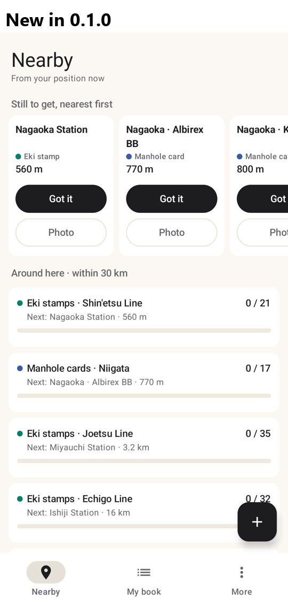
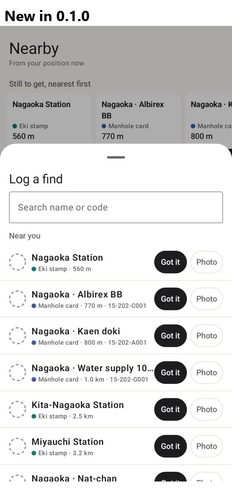
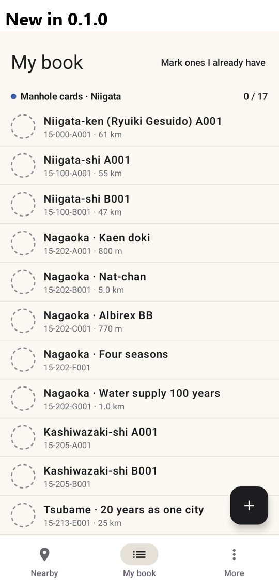
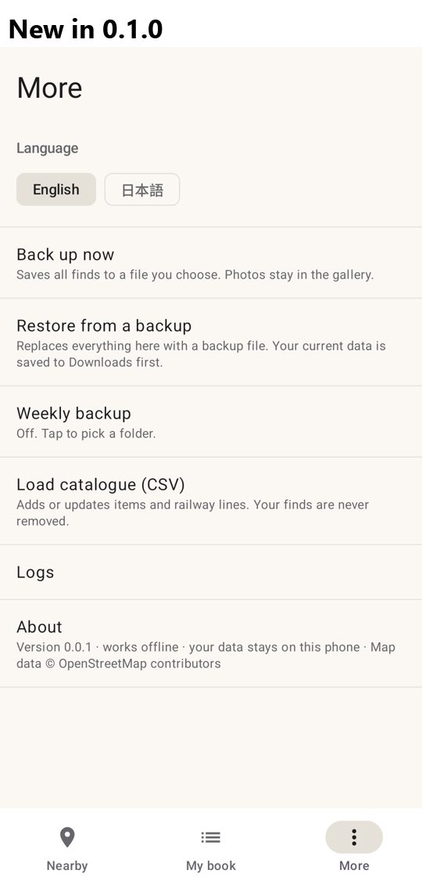

# What changed in 0.1.0

The first version, as it looked on a fresh install with the Niigata trip list loaded (Android emulator, phone-sized screen). There is no earlier version to compare with, so each picture shows a screen as it first was. Inside the app this version still called itself 0.0.1. The full list of what it did is in the [changelog](../../CHANGELOG.md).

## Nearby

The nearest things you still need, each with Got it and Photo, and your collections with progress below.

## Log a find

The + button: search by name or code, or pick from what is near you. Got it saves the time and place, with Undo for a few seconds.

## My book

Manhole cards by prefecture, station stamps as a stamp book per line, and goshuin; Mark ones I already have ticks off a set in one go.

## More

English or Japanese, backups to a file or weekly to a folder, loading a catalogue from a CSV, and the logs.

## Also in 0.1.0, without a picture here

- No internet permission; your data stays on the phone.
- An item's page with Directions and Call.
