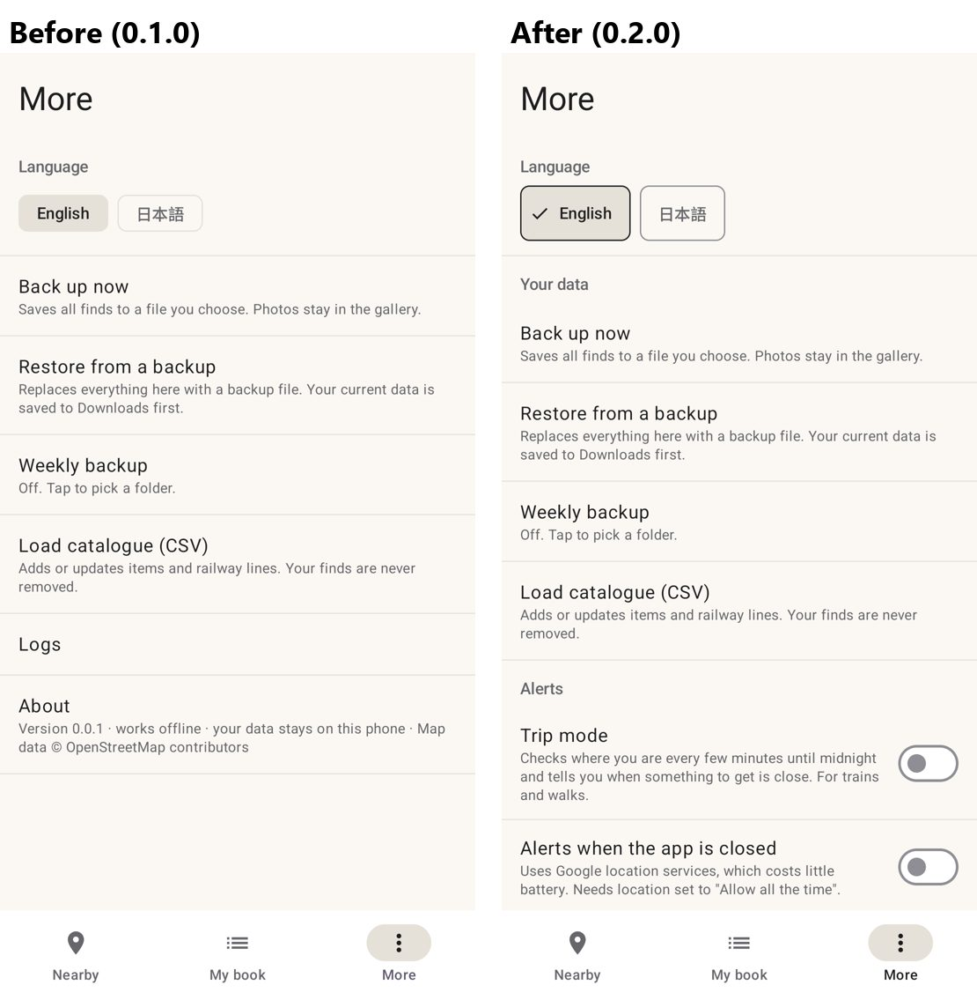
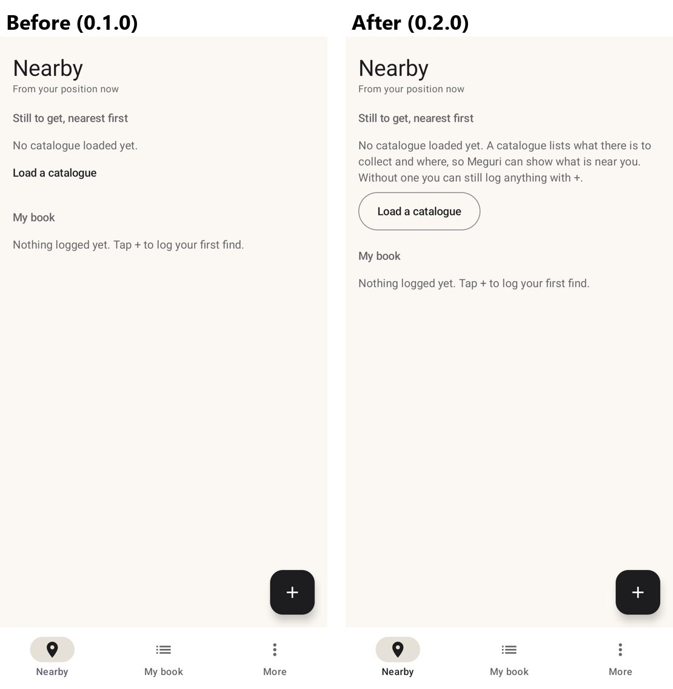
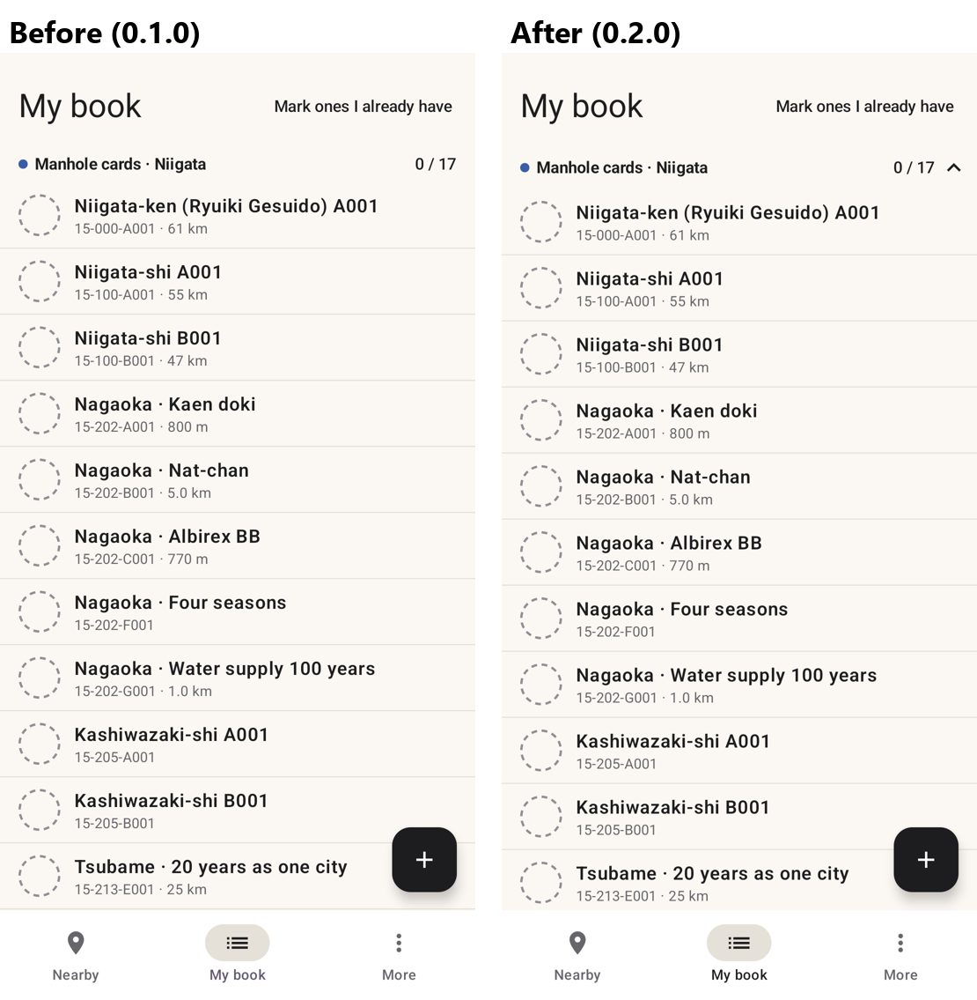
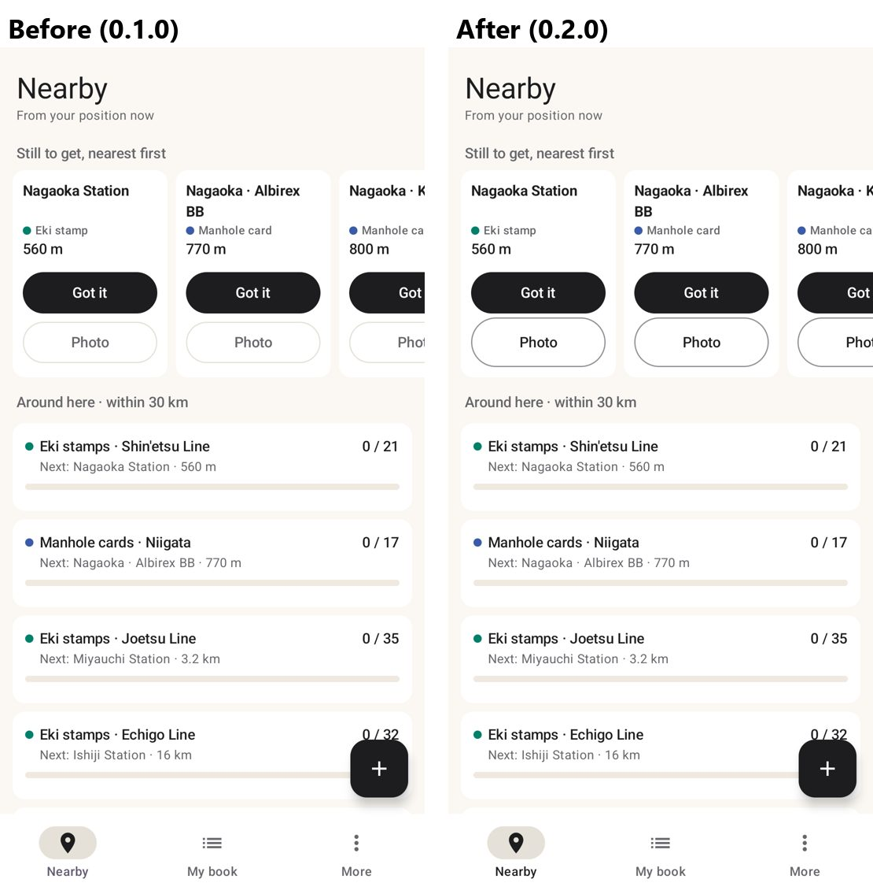

# What changed in 0.2.0

Pictures taken on an Android emulator with a phone-sized screen, 0.1.0 and 0.2.0 each on a fresh install with the same Niigata trip list loaded. Each pair shows the same screen in both versions. The full list of changes is in the [changelog](../../CHANGELOG.md).

## Alerts arrive

The same More tab. 0.2.0 adds Alerts: Trip mode, which checks where you are until midnight, and alerts while the app is closed, with Got it, Photo and Dismiss on the notification.

## Nearby explains itself

The same Nearby tab before any catalogue is loaded. 0.2.0 says what a catalogue is and why it matters, and the button has a border.

## My book sections fold

The same My book. Each section header has an arrow to fold it, and the header stays at the top while you scroll.

## Buttons you can see

The same Nearby list. Photo had a faint outline in 0.1.0; 0.2.0 uses one button style with visible borders and 48 dp touch targets everywhere.

## Also in 0.2.0, without a picture here

- Nearby says why there is no position, with the right button.
- Distances under 25 m read "here".
- Japanese mode reads more naturally.
- A double tap on Got it logs one find, not two.
- Screen readers hear which item a button is for.
