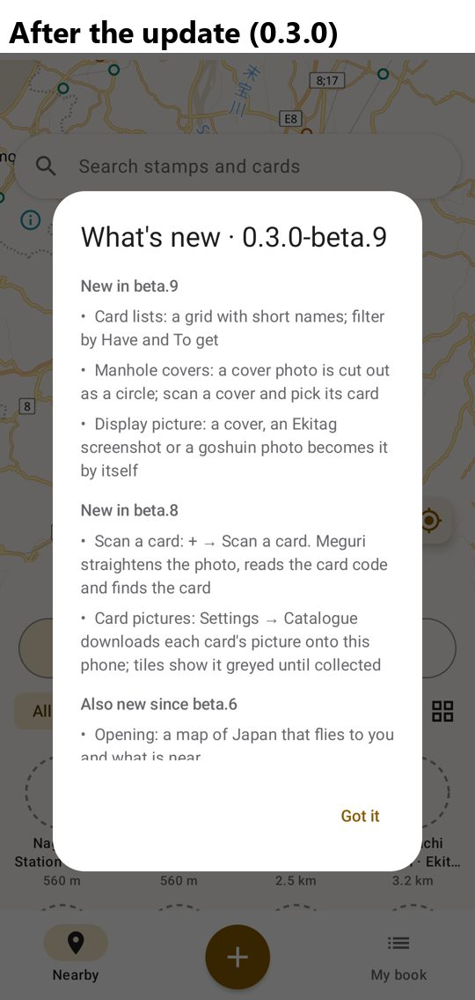
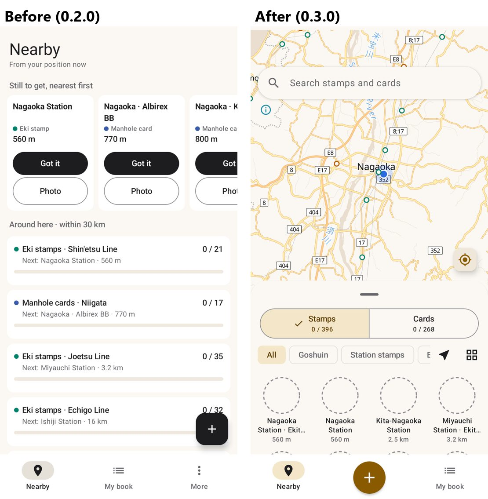
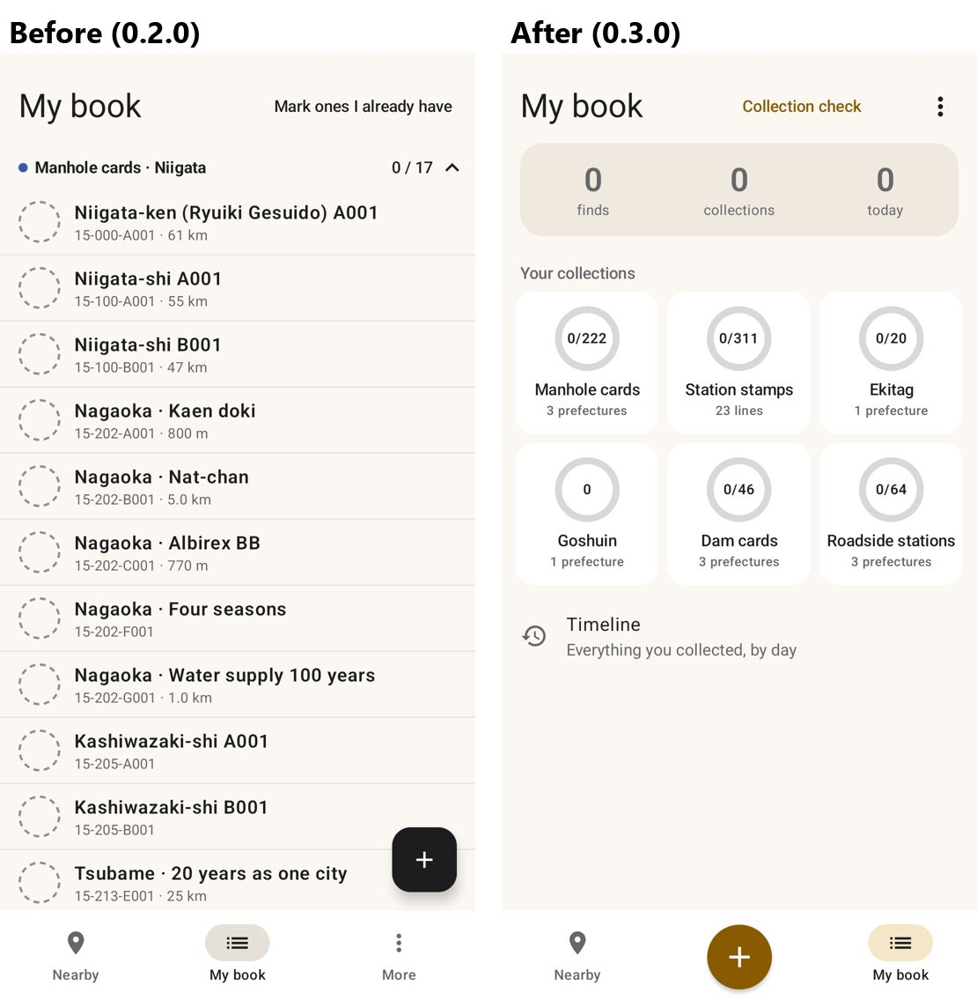
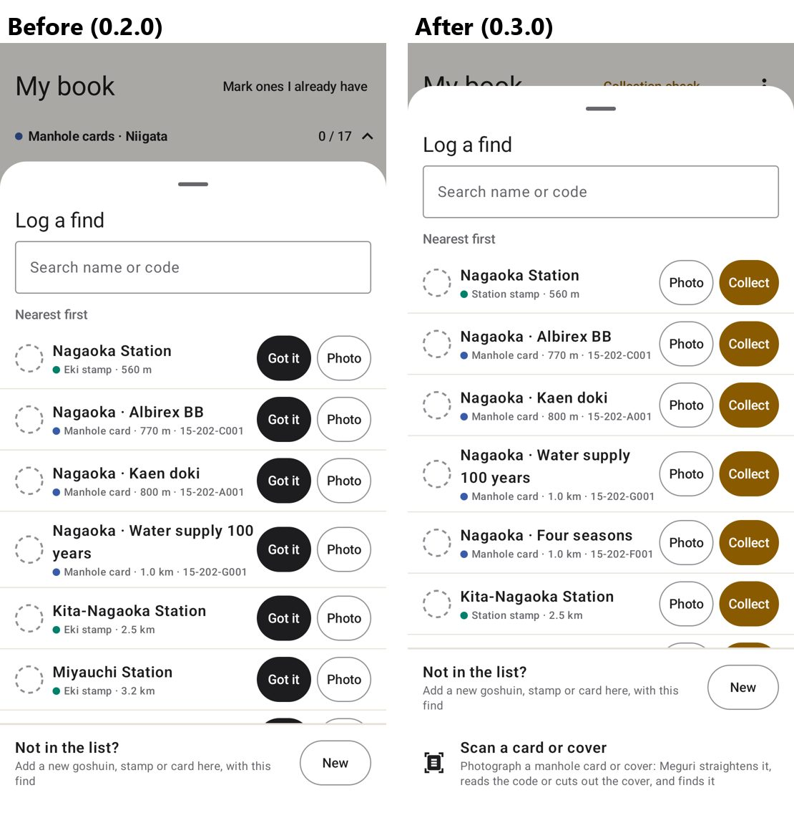
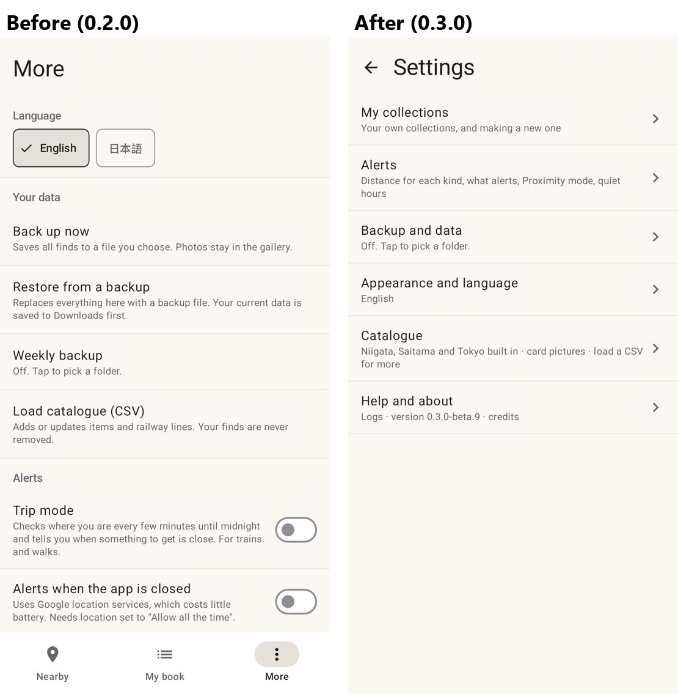

# What changed in 0.3.0

Pictures taken on an Android emulator with a phone-sized screen, before and after updating from 0.2.0 to 0.3.0 (its last beta). 0.2.0 had no catalogue of its own, so the Niigata trip list was loaded into it first; 0.3.0 brought its own catalogue for Niigata, Saitama and Tokyo, which is why its totals are larger. Each pair shows the same screen in both versions. The full list of changes is in the [changelog](../../CHANGELOG.md).

## What's new, after the update

From 0.3.0, Meguri says what changed the first time it opens after an update.

## Nearby becomes a map

The same Nearby tab. 0.2.0 listed what was near as cards and lines; 0.3.0 is a map with a sheet of round tiles, Stamps and Cards tabs, filters and three tile sizes.

## My book is one page

The same My book tab. A long list becomes your totals and one tile per category with a progress ring, and a Timeline of everything you collected.

## Collect, and scan a card

The same + sheet. Got it becomes Collect, and Scan a card or cover joins the bottom: Meguri straightens the photo, reads the card code and finds the card.

## Settings is a short list

The settings page. 0.2.0's More tab had everything on one long page; in 0.3.0 Settings (from My book's menu) is a list of sections, each with its own page.

## Also in 0.3.0, without a picture here

- First open explains permissions and lets you pick the prefectures you collect in.
- Trip: pick a route or paste a Google Maps link; station stamps count only where you get off.
- Trip report: share a day as a story image or a CSV.
- Card pictures download onto your phone; share photos to Meguri from other apps.
- Your own collections; Collection check to tick off what you have; No stamp here.
- Several photos per find, kept as Meguri's own copies.
