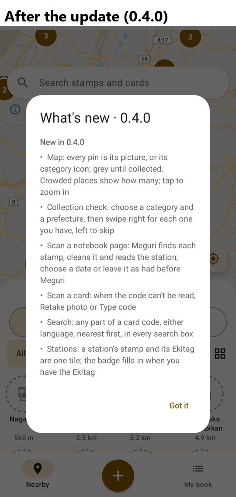
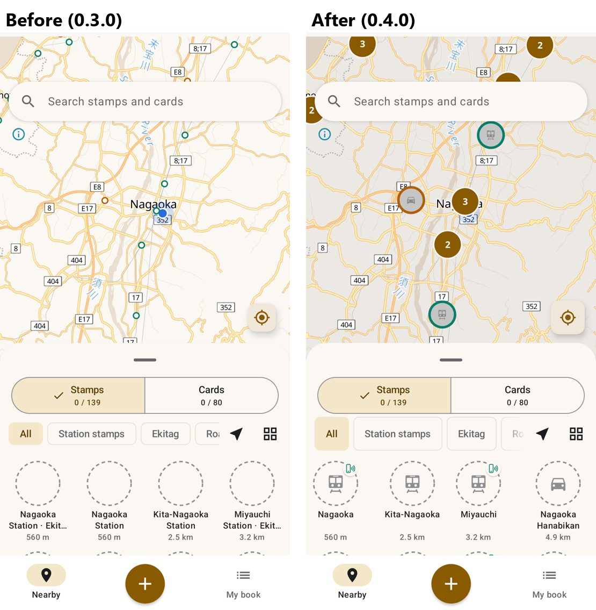
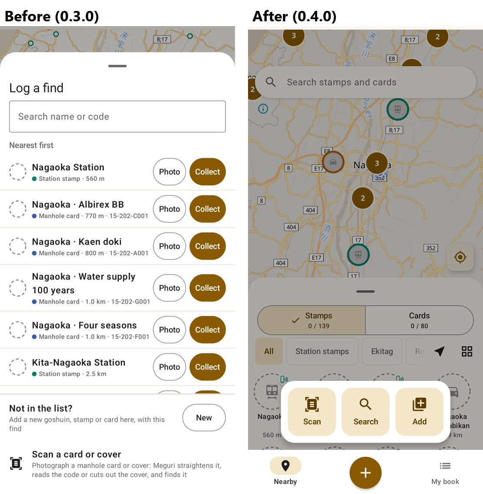
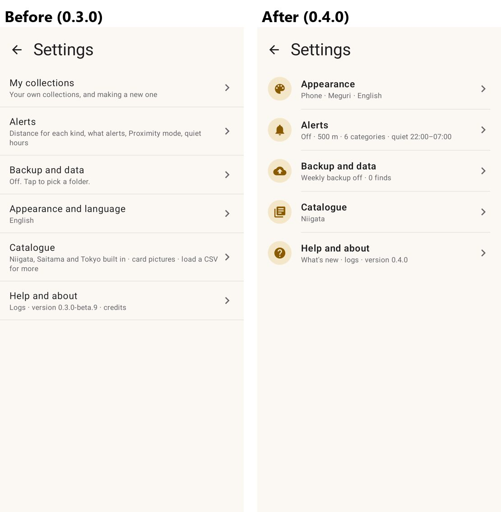
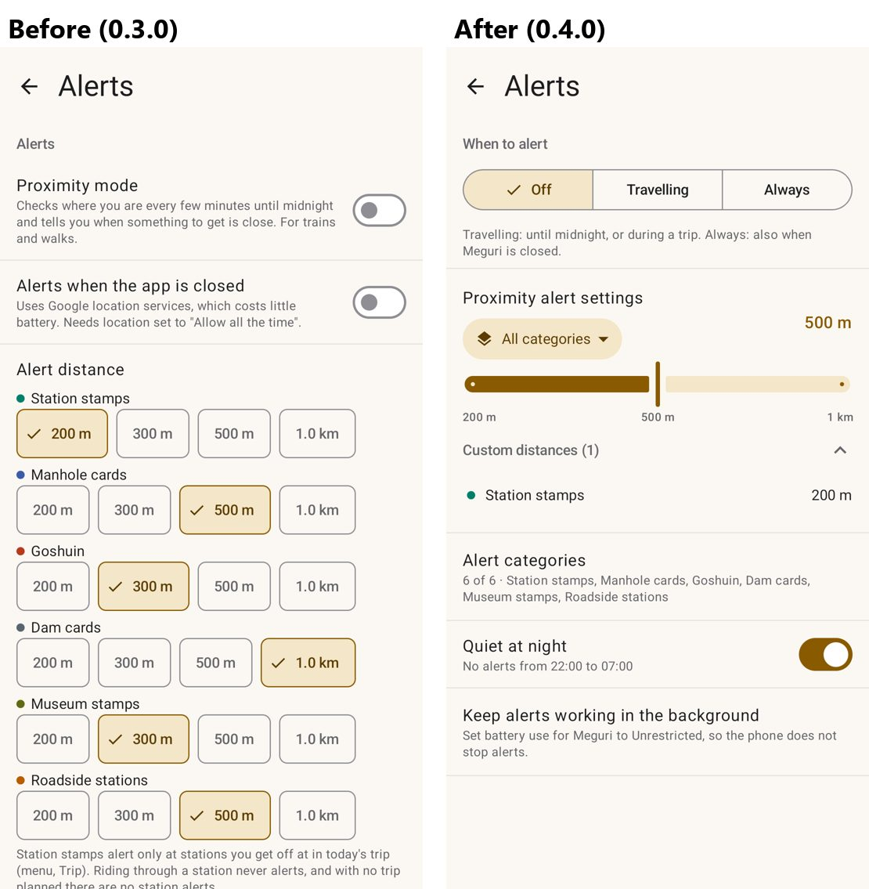

# What changed in 0.4.0

Pictures taken on an Android emulator with a phone-sized screen, before and after updating from 0.3.0 (its last beta) to 0.4.0 with the same data. Each pair shows the same screen in both versions. The full list of changes is in the [changelog](../../CHANGELOG.md).

## What's new, after the update

The first time 0.4.0 opens, it says what changed.

## Map pins and station tiles

The same Nearby screen. On the map, each pin is its item's picture or category icon in a ring, and crowded places show a count. In the list, a station's stamp and its Ekitag are one tile, with a badge for the Ekitag.

## + opens a small card

The same + button. 0.3.0 opened a full list to log a find; 0.4.0 opens a small card with Scan, Search and Add, and the bottom bar stays usable.

## Settings list

The same Settings page. Each section has an icon and a short summary of what is set.

## Alerts, simpler

The same Alerts page. Two switches and a row of buttons per category become When to alert (Off, Travelling or Always) and one slider for how close; any category can keep its own distance.

## Also in 0.4.0, without a picture here

- Notebook stamps: scan a notebook page and Meguri finds, cleans and reads each stamp.
- Collection check is a card deck: swipe right for Have it, left for Not yet.
- Scan a card: trims to the card, turns it the right way up, and offers Retake photo or Type code.
- Theme (Phone, Light or Dark), colours and language as one-tap choices.
- Backup and data: Back up now, a weekly backup page, Restore, Suggest new photos.
- Search is forgiving everywhere: any part of a card code, either language, the town.
