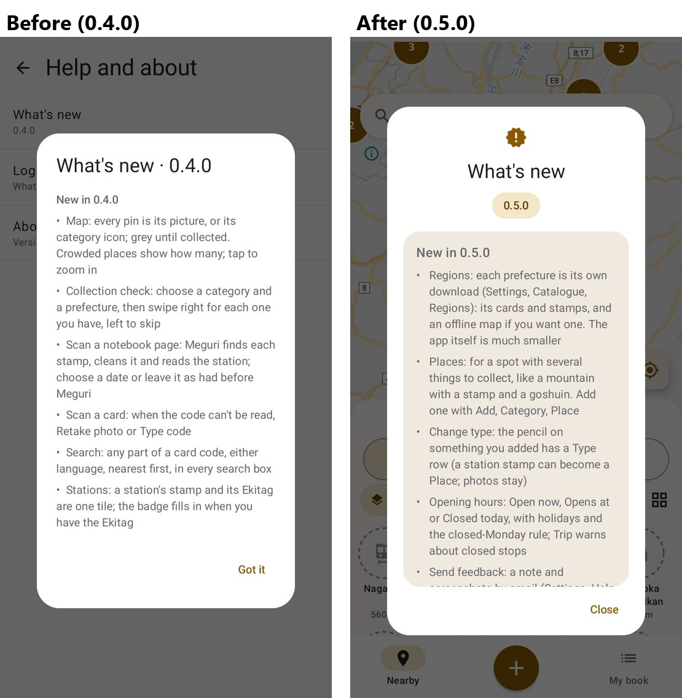
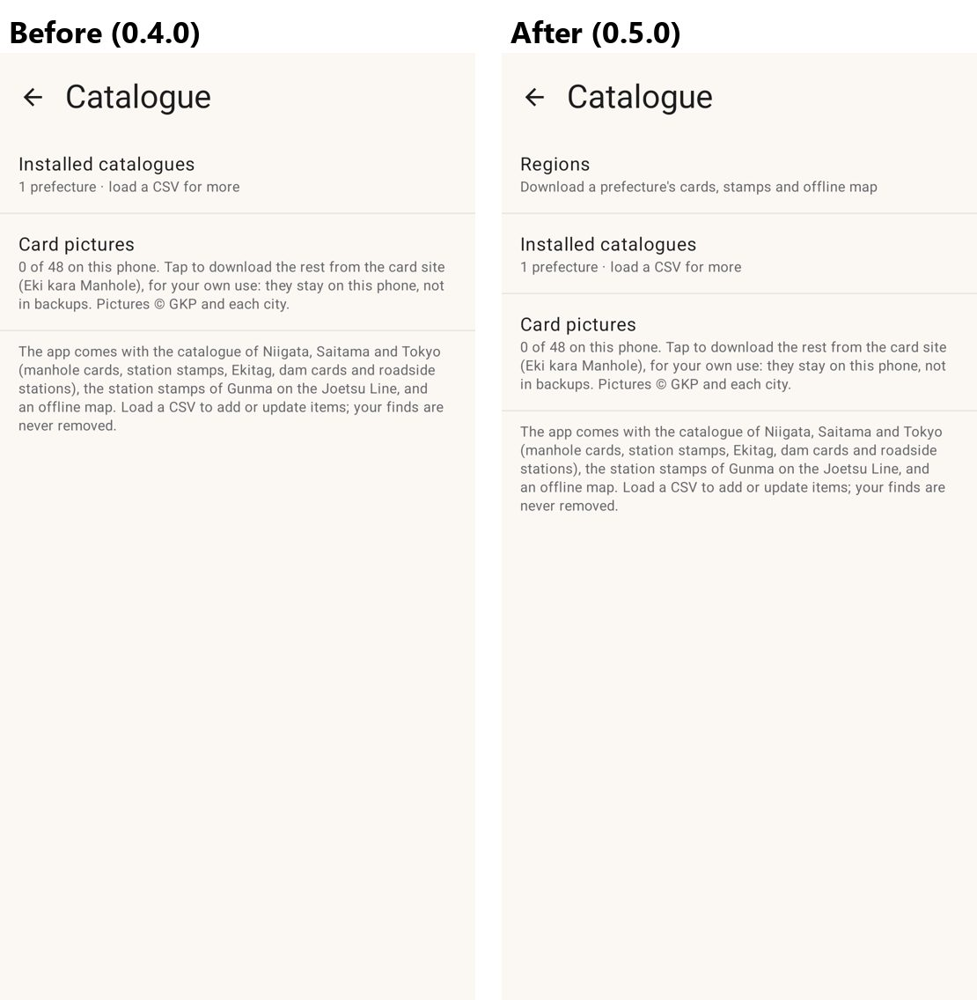
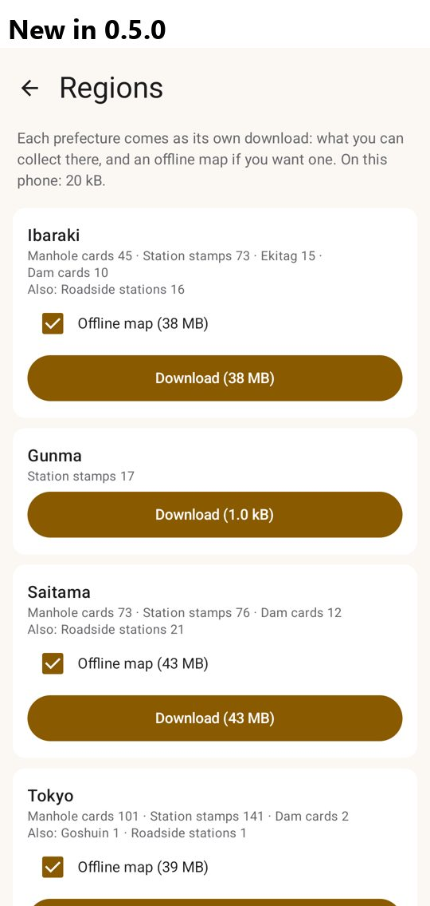
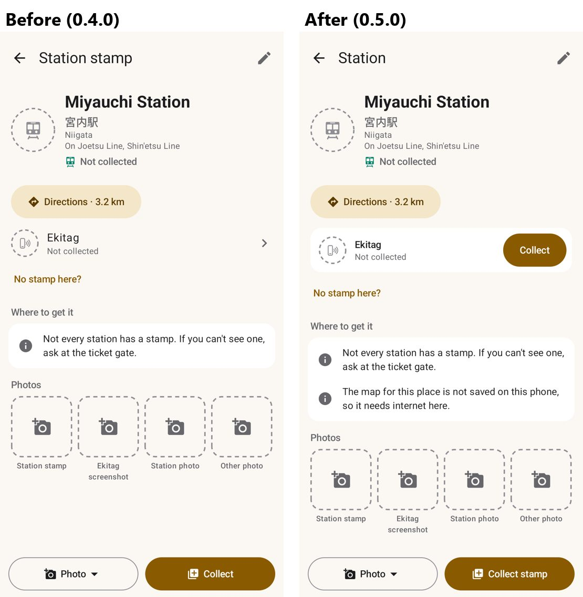
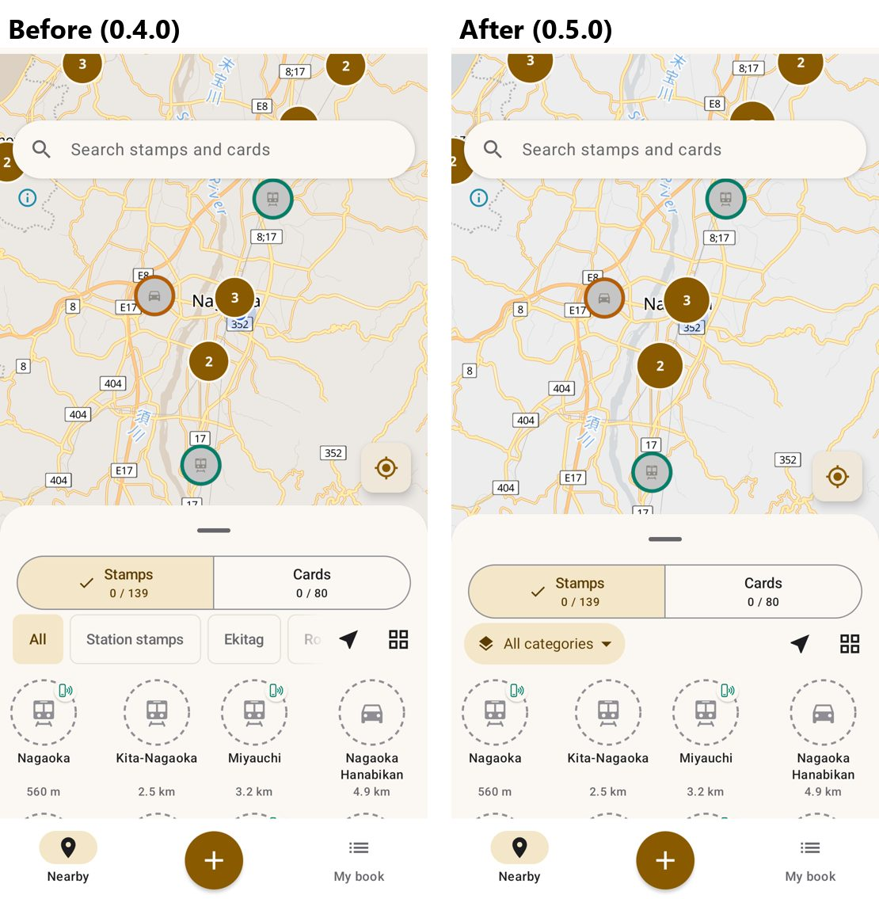

# What changed in 0.5.0

Pictures taken on an Android emulator with a phone-sized screen, before and after updating from 0.4.0 to 0.5.0 with the same data. Each pair shows the same screen in both versions; something that didn't exist before follows as its own picture, marked New in 0.5.0. The full list of changes is in the [changelog](../../CHANGELOG.md).

## What's new has a new layout

The same What's new card: an icon, the title, the version in a pill and the notes in a box that scrolls.

## Catalogue gains Regions

The same Catalogue page. 0.4.0 carried every prefecture and the offline map inside the app (134 MB); 0.5.0 adds a Regions row, and the app is 28 MB.

## New: Regions

Each prefecture is its own download: what you can collect there and, if you want it, its offline map. Updating from 0.4.0 keeps everything, and the old built-in map works until each prefecture's own map is downloaded.

## One page for a station

The same station. In 0.4.0 its Ekitag was a link to a second page; in 0.5.0 the Ekitag has its own Collect on the station's page.

## Nearby's category filter

The same Nearby sheet. The scrolling row of category chips becomes one pill with a menu, the same as on Alerts.

## Also in 0.5.0, without a picture here

- Opening hours: an item says whether it is open now, in Japan time, with holidays and the closed-Monday rule.
- Places: a new type for somewhere with more than one thing to collect.
- Change the type of something you added yourself.
- Send feedback from Help and about.
- Scan offers the closest cards when a code isn't in Meguri.
- Pages slide in and out; onboarding steps fade into place.
- Map markers show their category icon when zoomed out.
