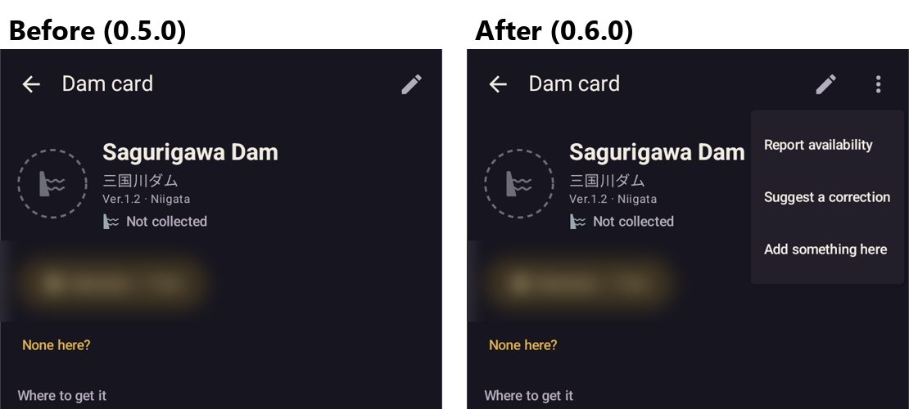
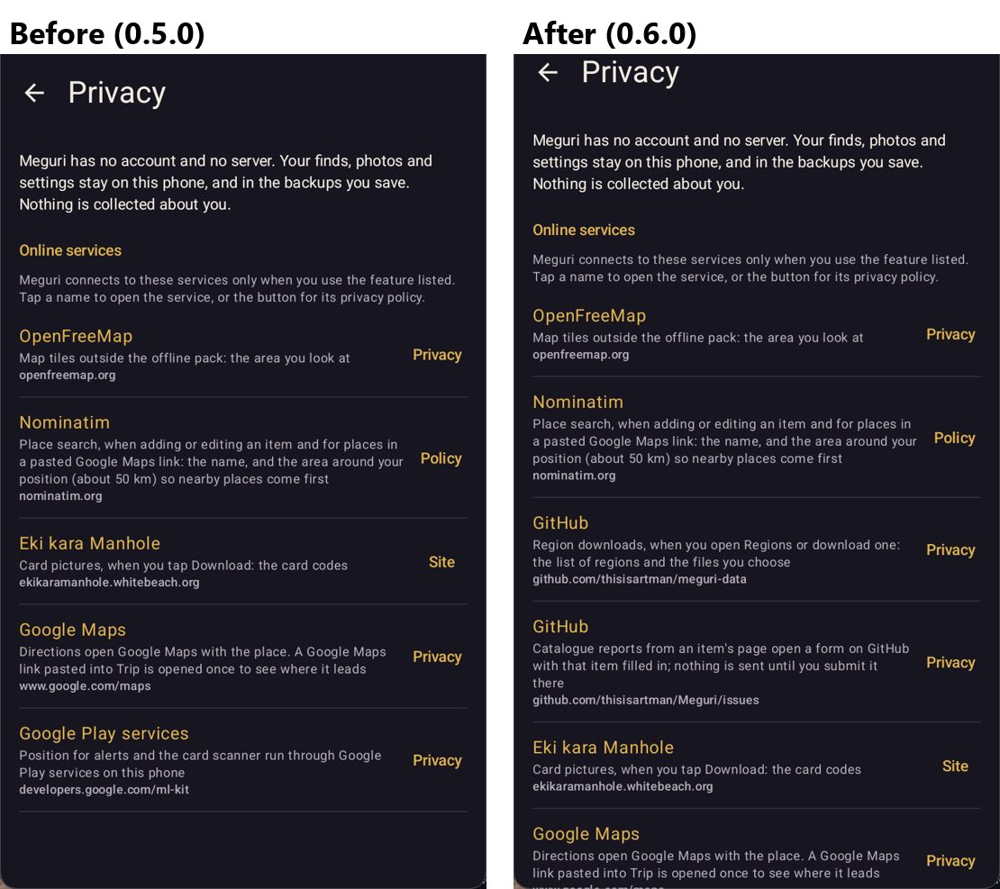

# What changed in 0.6.0

Pictures taken on a Galaxy Tab S9 with Meguri in a phone-sized window, before and after updating from 0.5.0 to 0.6.0, in the dark theme. The full list of changes is in the [changelog](../../CHANGELOG.md).

## Report from an item's page

Each item's page has a ⋮ menu: report whether it is still handed out, suggest a correction, or add something you found there. It opens a form on GitHub with the item already filled in.

## Privacy lists every online service

Privacy now lists everything Meguri connects to, including GitHub for region downloads and reports.

## Also in 0.6.0, without a picture here

- Weekly backup asks where to save: a folder, one file in Google Drive (replaced each week), or your own server (Nextcloud or WebDAV). You can restore from your server too.
- Send, Cancel and Save stay on screen above the keyboard.
- Places you add go under their prefecture in My book.
- Maps redraw after a map download.
