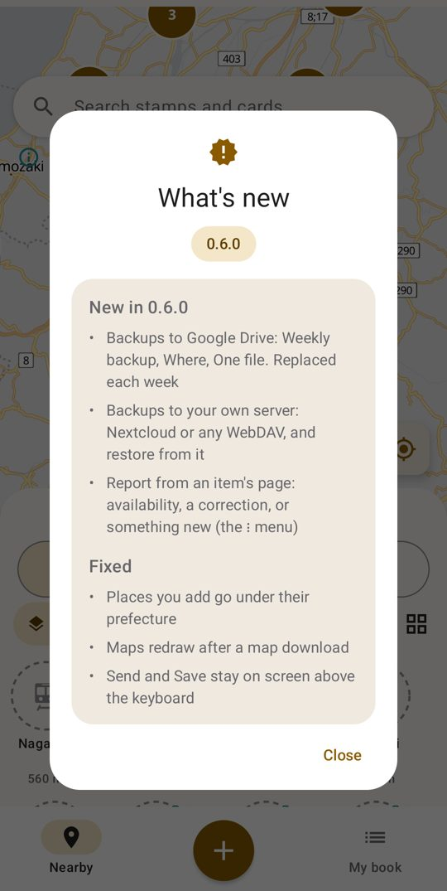
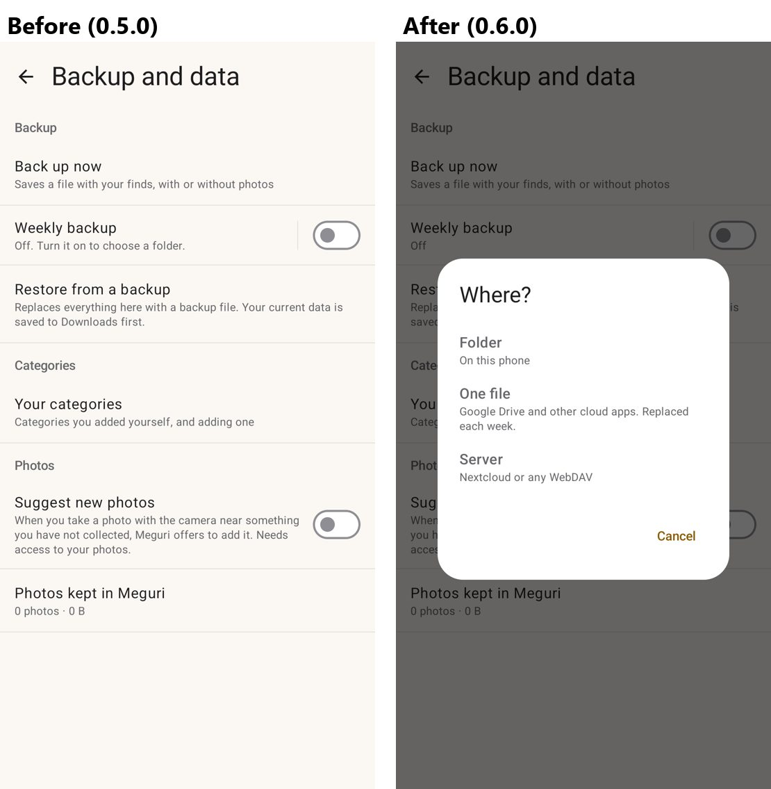
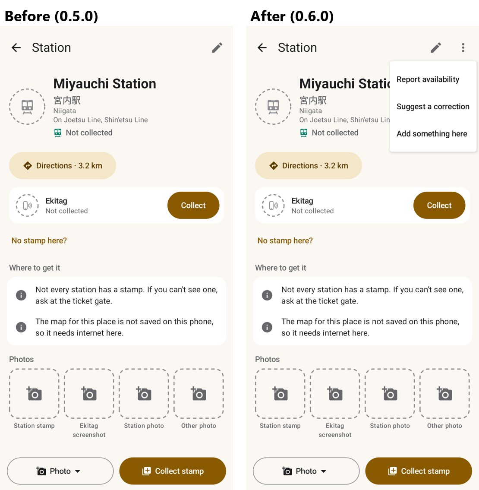
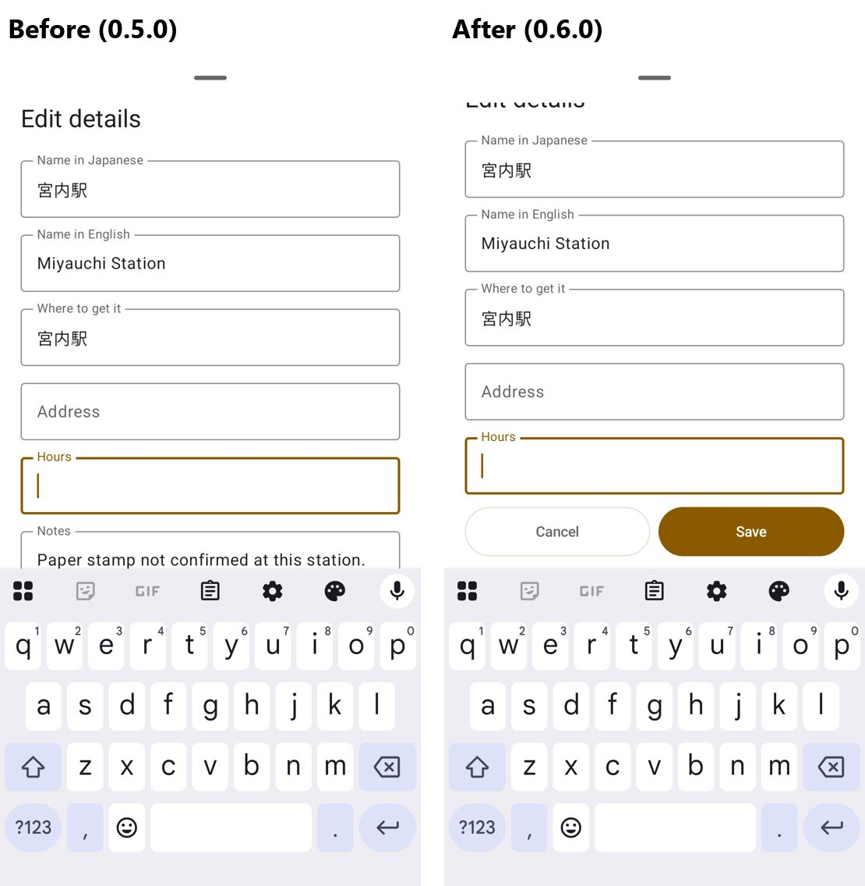

# What changed in 0.6.0

Pictures taken on an Android emulator with a phone-sized screen, before and after updating from 0.5.0 to 0.6.0 with the same data. The full list of changes is in the [changelog](../../CHANGELOG.md).

## What's new, after the update

The first time 0.6.0 opens, it says what changed.

## Weekly backup asks where

0.5.0 could only back up to a folder on the phone. Turning weekly backup on in 0.6.0 asks where: a folder, one file that Google Drive or another cloud app keeps (replaced each week), or your own server (Nextcloud or any WebDAV).

## Report from an item's page

The ⋮ menu on an item's page lets you report availability, suggest a correction or add something new at that place. Each opens a form on GitHub with the item filled in; nothing is sent until you submit it.

## Save stays above the keyboard

While you type, Cancel and Save stay on screen just above the keyboard, instead of being hidden below it.

## Privacy lists every online service

Privacy now also lists GitHub, used for region downloads and for catalogue reports.

## Also in 0.6.0, without a picture here

- Restore from your own server.
- Places you add go under their prefecture in My book.
- Maps redraw after a map download.
