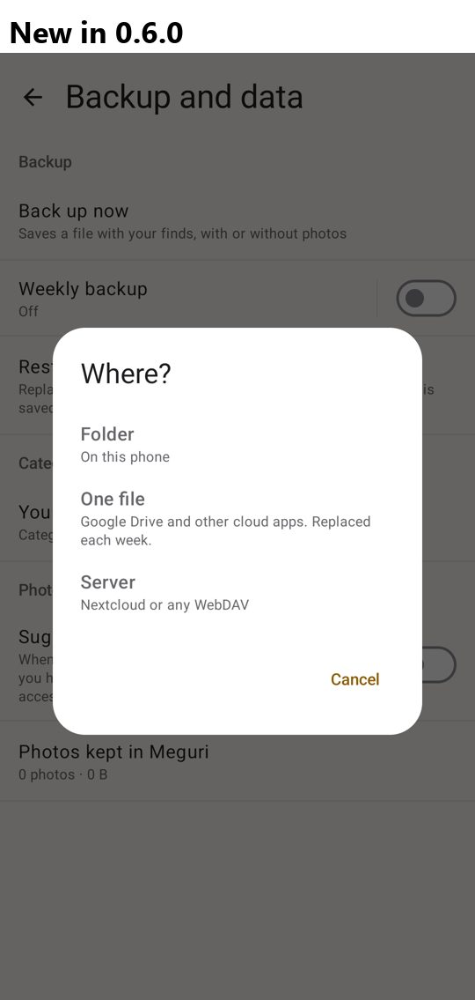
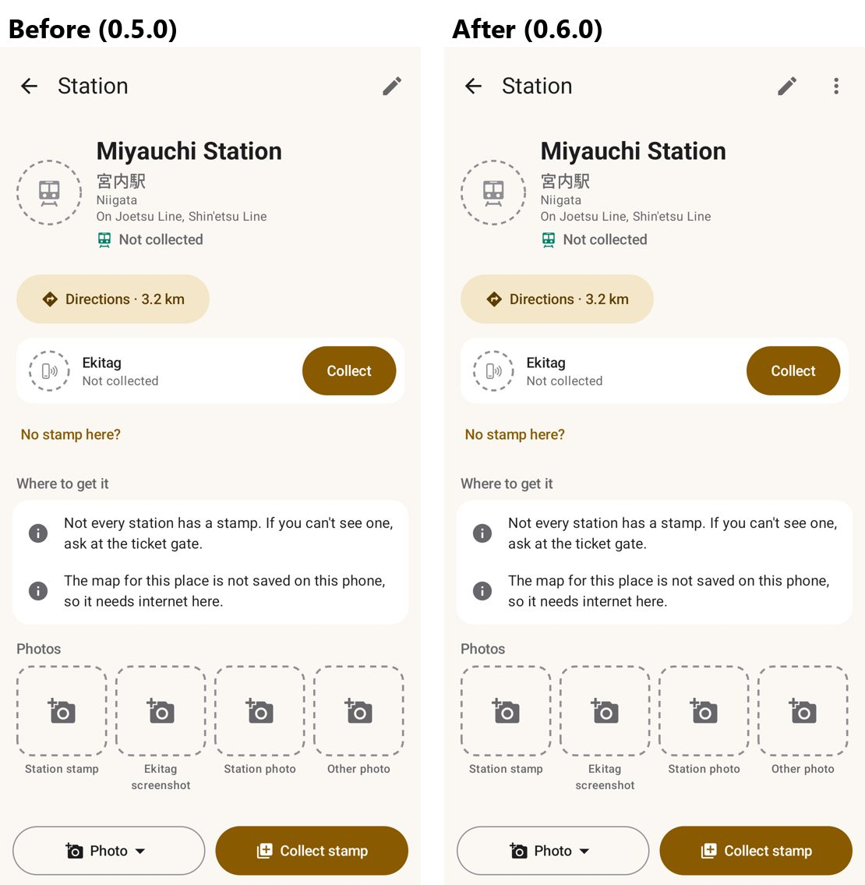

# What changed in 0.6.0

Pictures taken on an Android emulator with a phone-sized screen, before and after updating from 0.5.0 to 0.6.0 with the same data. Each pair shows the same screen in both versions; something that didn't exist before follows as its own picture, marked New in 0.6.0. The full list of changes is in the [changelog](../../CHANGELOG.md).

## What's new, after the update

The first time 0.6.0 opens, it says what changed.

## Weekly backup: the same switch

The Backup page is the same in both. 0.5.0's line says turning it on means choosing a folder; that was the only place a weekly backup could go.

## New: weekly backup asks where

Turning the switch on in 0.6.0 now asks where: a folder (as before), one file that Google Drive or another cloud app keeps (replaced each week), or your own server (Nextcloud or any WebDAV).

## An item's page gains a ⋮ menu

The same station page in both. 0.6.0 adds the ⋮ button next to Edit at the top right; nothing else on the page changed.

## New: report from the ⋮ menu

The menu reports availability, suggests a correction or adds something new at that place. Each opens a form on GitHub with the item filled in; nothing is sent until you submit it.

## Save stays above the keyboard

The same Edit details sheet, typing in Hours. In 0.5.0, Cancel and Save are below the keyboard, out of sight; in 0.6.0 they stay just above it.

## Privacy lists every online service

The same Privacy page, scrolled to the services. 0.6.0 adds GitHub twice: region downloads and catalogue reports.

## Also in 0.6.0, without a picture here

- Restore from your own server.
- Places you add go under their prefecture in My book.
- Maps redraw after a map download.
