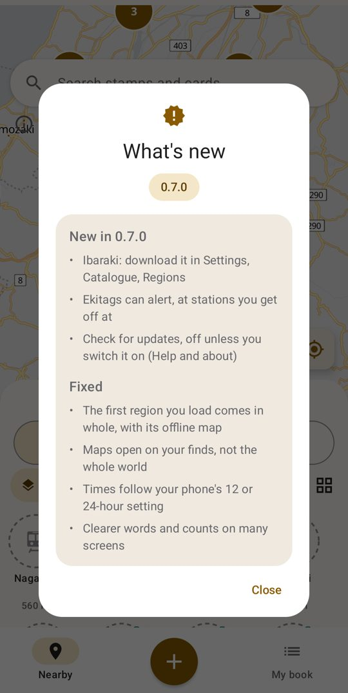
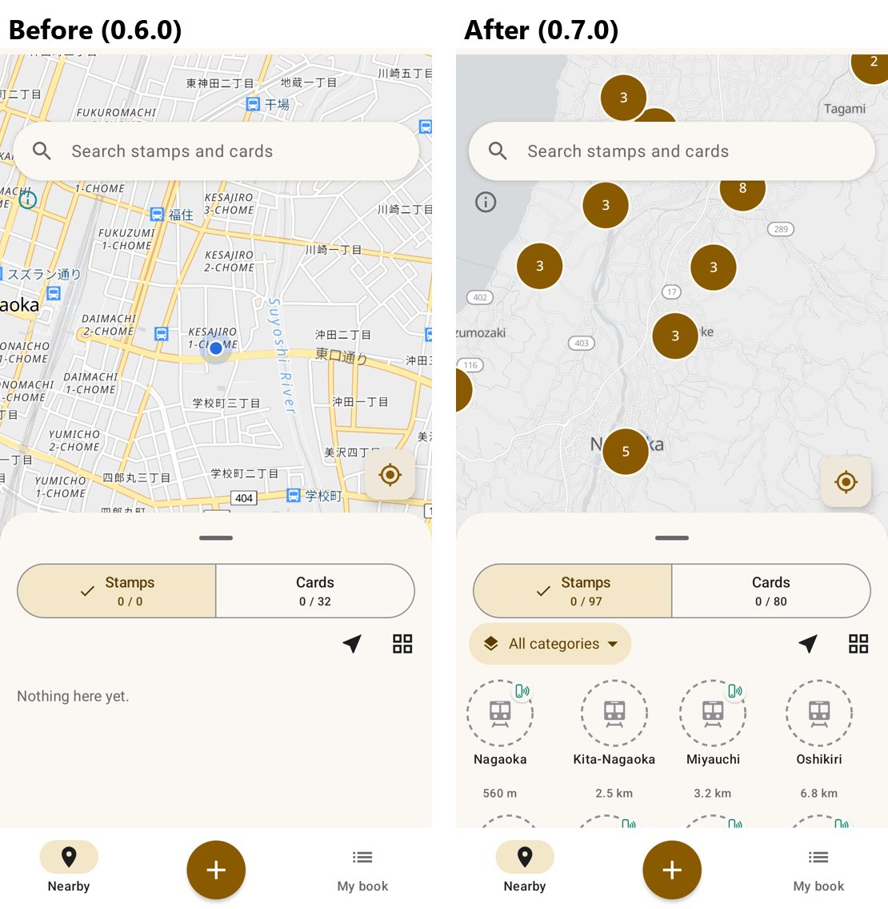
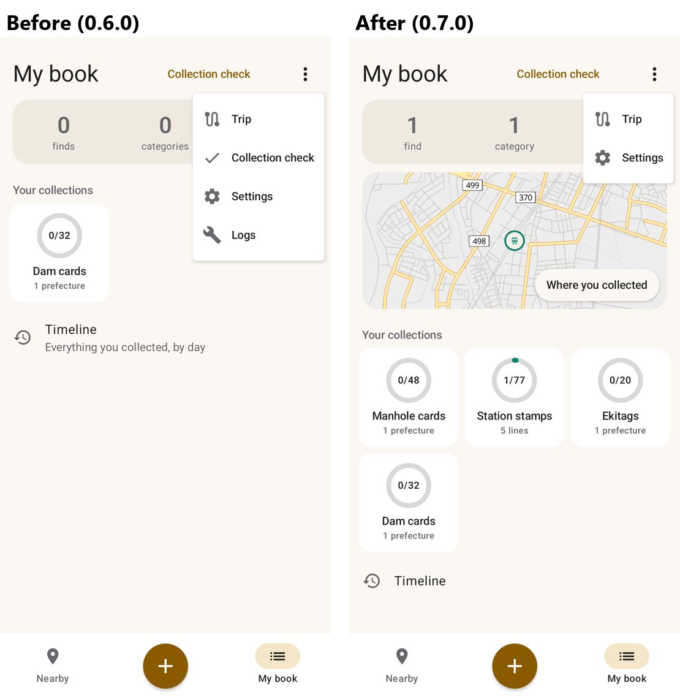
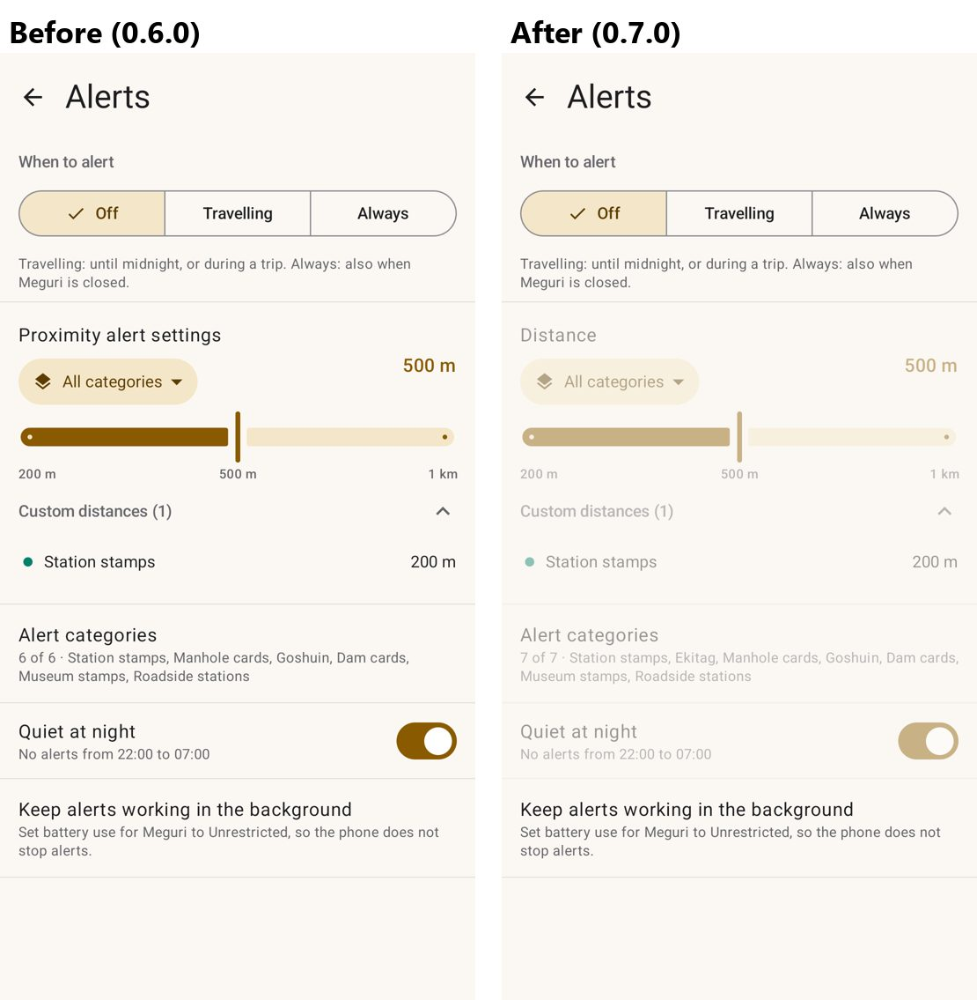
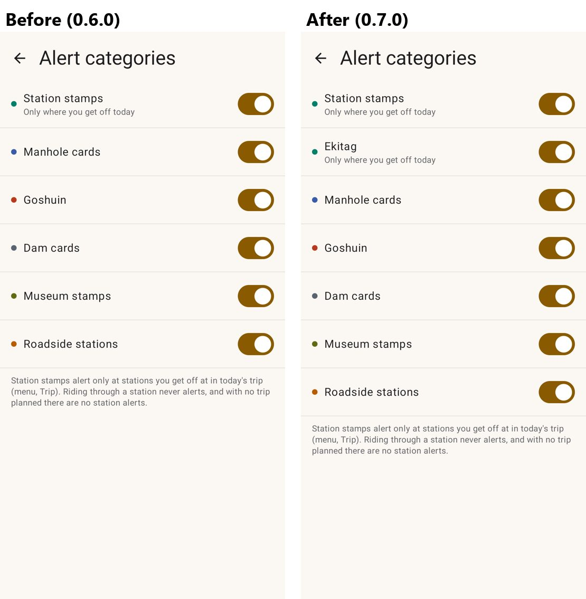
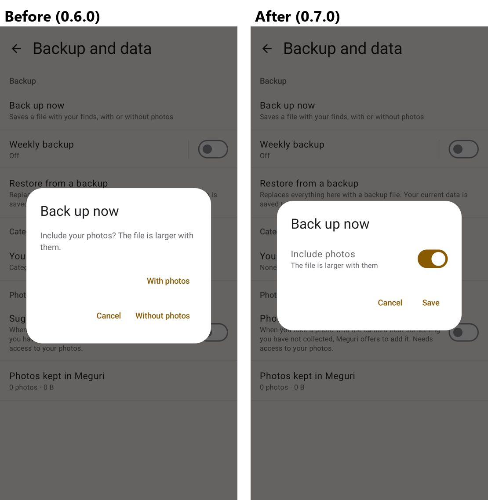
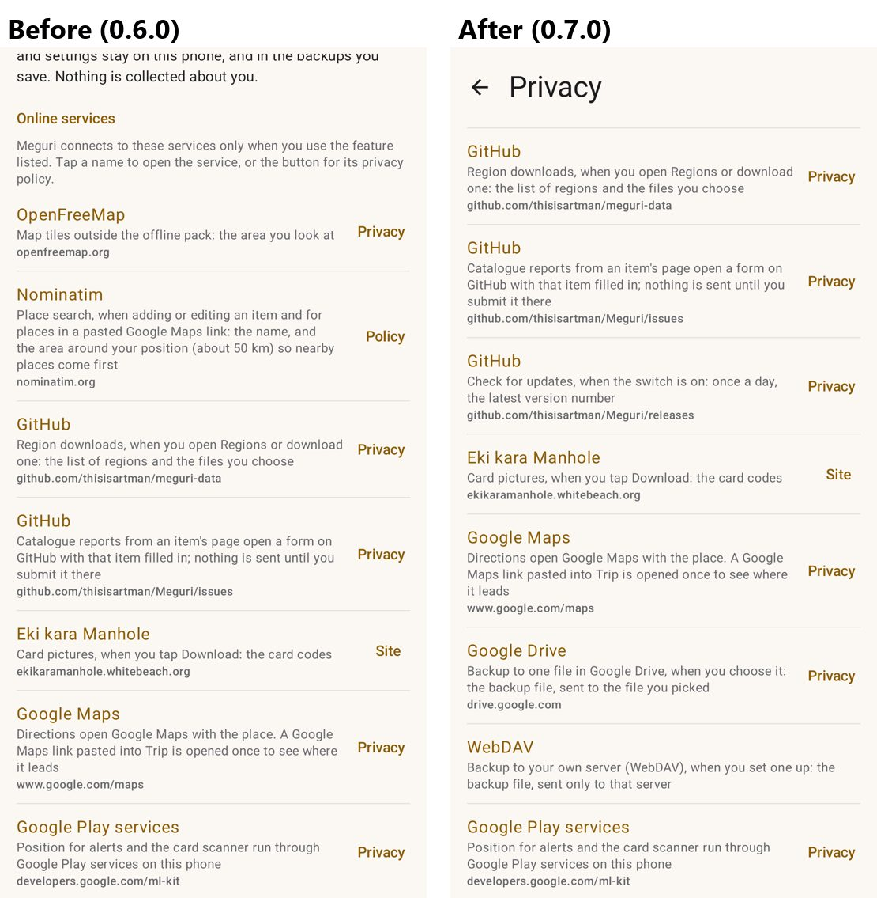
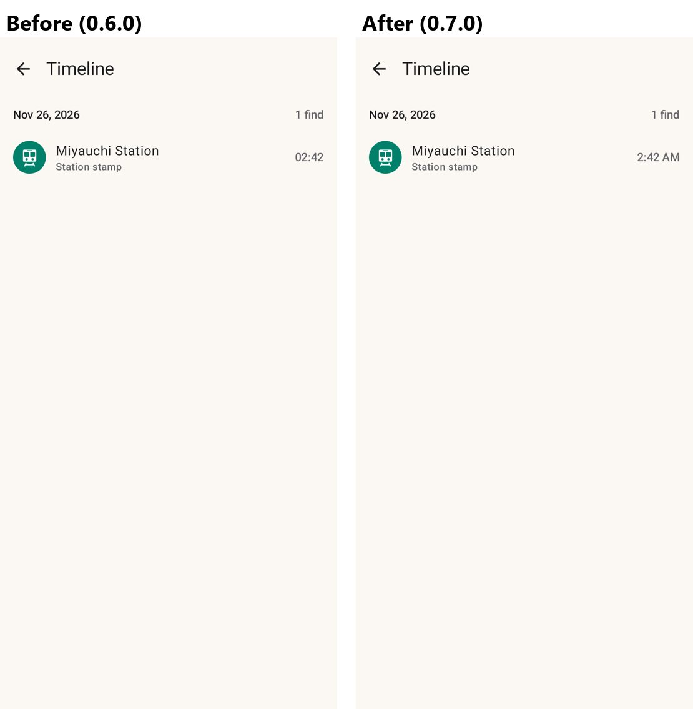
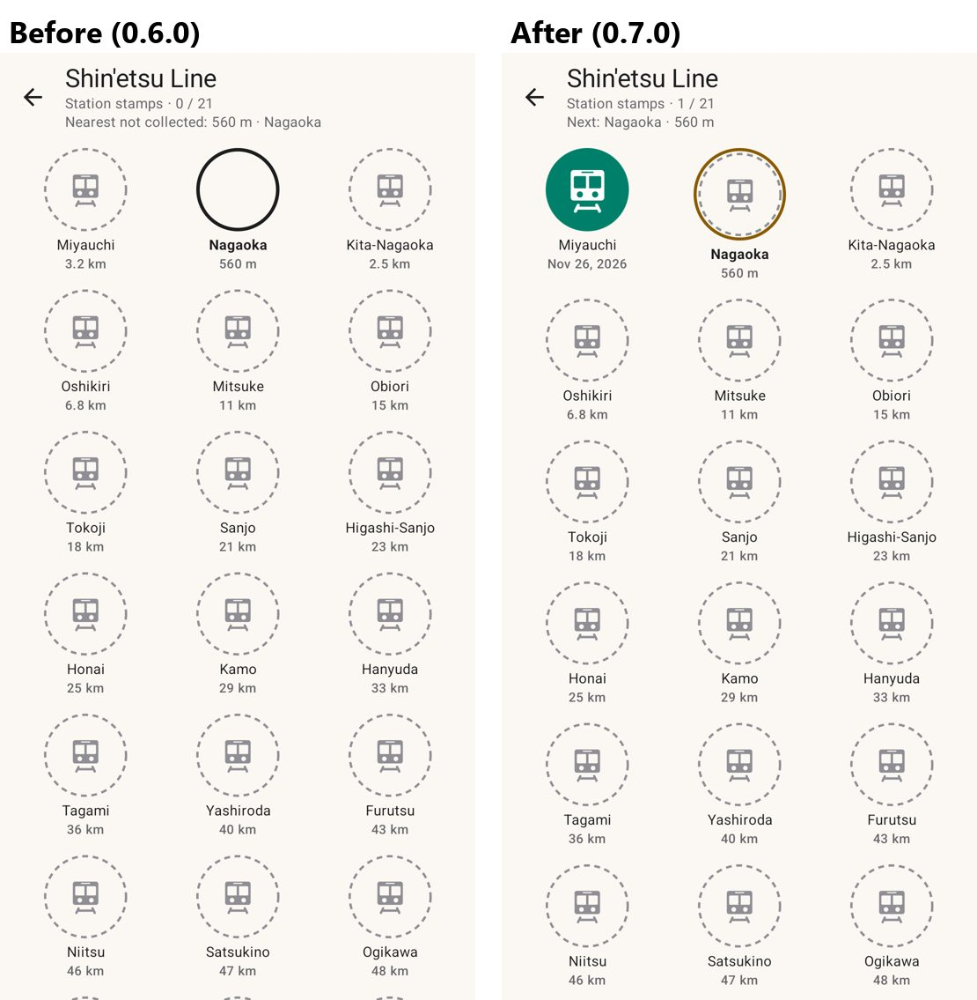

# What changed in 0.7.0

Pictures taken on an Android emulator with a phone-sized screen, before and after updating from 0.6.0 to 0.7.0 with the same data. The full list of changes is in the [changelog](../../CHANGELOG.md).

## What's new, after the update

The first time 0.7.0 opens, it says what changed.

## The first region arrives in full

Starting fresh with Niigata: 0.6.0 stopped part-way and showed 0 stamps; 0.7.0 loads all 97 stamps and 80 cards. Regions also says if part of a region is missing, with a button to fetch the rest.

## The menu is shorter

Collection check already has its own button on My book, and Logs lives in Help and about, so the menu keeps only Trip and Settings.

## Alerts show what's switched off

While alerts are Off, the settings below are dimmed. You can still set them up first.

## Ekitag can alert you

Ekitag joins the alert list. Like station stamps, it only alerts at stations you get off at on today's trip.

## Back up now is one simple choice

Include photos is a switch, and the buttons are just Cancel and Save.

## Back stays on screen

On Privacy and every other Settings page, the bar with Back stays at the top while you scroll. Privacy now also lists Google Drive, your own server and the update check.

## Times follow your phone

This phone is set to 12-hour time, so 02:42 becomes 2:42 AM. With 24-hour time it stays 02:42.

## The nearest station keeps its picture

On a line's page, the nearest station you still need keeps its icon, with a ring around it, and the top says which station is next. (On the right, Miyauchi has been collected since.)

## Also in 0.7.0, without a picture here

- Maps open on your finds or the area around you, not the whole world.
- Card pictures the card site doesn't have yet no longer count as failures.
- Check for updates, off unless you switch it on in Help and about.
- Clearer words and counts on many screens.
